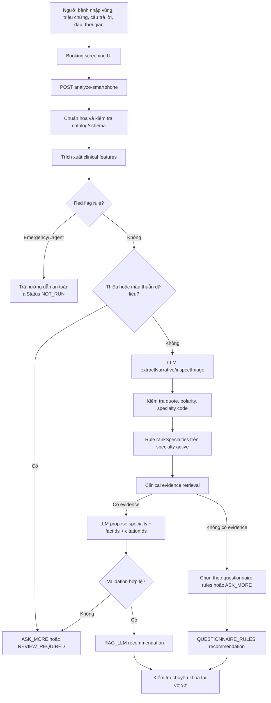
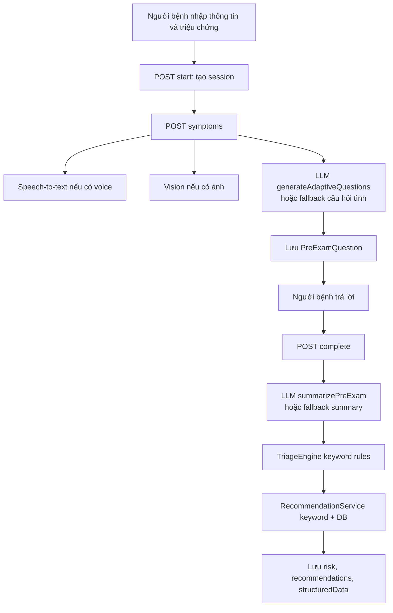
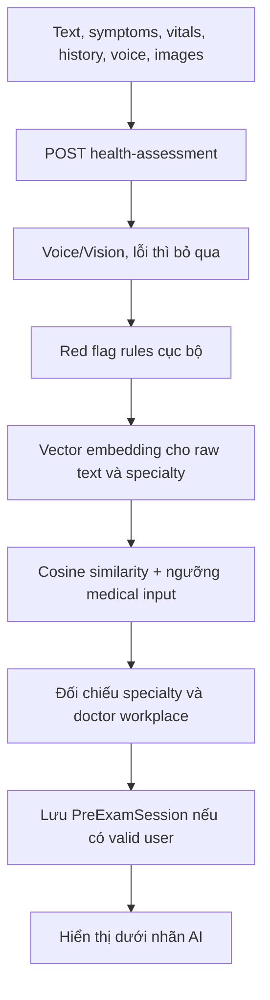
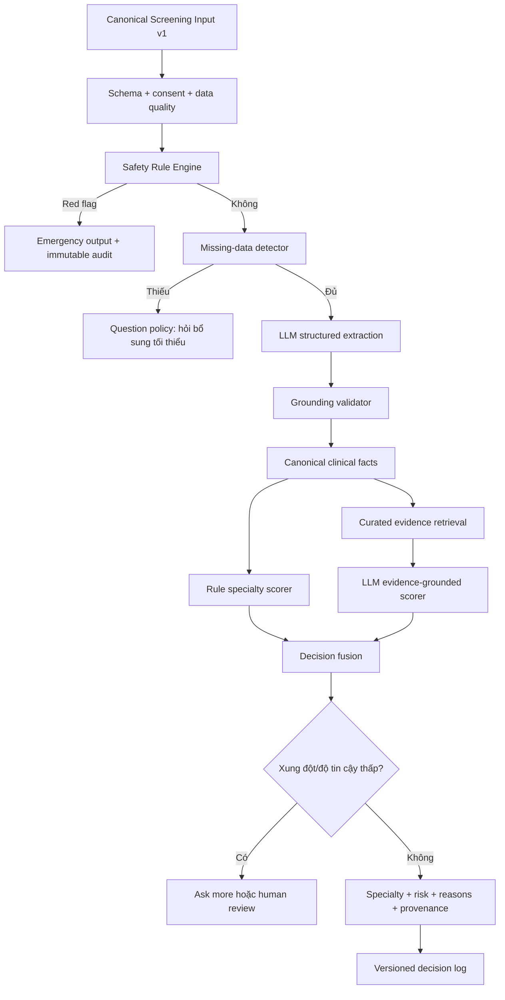

# AUDIT TOÀN DIỆN MODULE AI SÀNG LỌC NOVACARE

**Đề tài định hướng:** Nghiên cứu và đánh giá mô hình lai Rule-based kết hợp LLM trong sàng lọc tiền khám và gợi ý chuyên khoa cho hệ thống NovaCare  
**Ngày audit source:** 09/11/2026  
**Phạm vi:** frontend `nova-care-web`, backend `nova-care-backend`, Prisma schema, các engine sàng lọc và các kết quả kiểm thử đã lưu trong `NovaCare_AI_Testing`.  
**Nguyên tắc:** chỉ đọc và phân tích; không sửa source, không thay đổi database, không deploy và không gọi thêm LLM trong lần audit này.

---

## 1. Kết luận điều hành

NovaCare hiện tồn tại **ba luồng sàng lọc khác nhau**, cùng được mô tả là AI nhưng không dùng chung một cơ chế:

| Luồng | Frontend/API | Cơ chế thực tế | Có lưu DB |
|---|---|---|---|
| Smart Screening V3 | `bookingScreening.ts` → `POST /pre-exam-v2/analyze-smartphone` | Luật an toàn chạy trước; LLM trích xuất narrative/ảnh; xếp hạng rule; LLM đề xuất cuối chỉ chạy khi có evidence và được kiểm tra nghiêm ngặt | Không. Service tạo `randomUUID()` rồi trả response |
| Pre-exam session cũ | `PreExamScreening.tsx` → start/symptoms/answer/complete | LLM tạo câu hỏi và tóm tắt; khi thiếu key/lỗi thì dùng fallback tĩnh; triage và gợi ý chuyên khoa cuối bằng luật | Có `PreExamSession`, `PreExamQuestion` |
| Health Assessment Wizard | `AIHealthAssessmentWizard.tsx` → `POST /pre-exam-v2/health-assessment` | Luật red flag + vector similarity RAG; voice/ảnh có thể gọi model; không gọi chat LLM để quyết định chuyên khoa | Có, nhưng lỗi lưu bị bỏ qua; guest có thể gán vào user đầu tiên trong DB |

### Phân loại cơ chế kết hợp

- **V3 theo thiết kế source:** gần nhất với **E – Hybrid có cơ chế hợp nhất và giải quyết xung đột**. Rule-based có quyền phủ quyết an toàn; facts từ LLM phải qua validation; đề xuất LLM chỉ được nhận nếu thuộc shortlist, fact ID và citation hợp lệ, evidence hỗ trợ facts.
- **V3 trong lần kiểm thử đã lưu ngày 08/11/2026:** vận hành thực tế là **rule-dominant hybrid**. 31/31 lần extraction LLM lỗi `AUTH_FAILED`; `SCREENING_KNOWLEDGE_PATH` chưa cấu hình nên nhánh `propose()` không chạy. Không có bằng chứng LLM đã quyết định chuyên khoa cuối trong batch 60 ca.
- **Pre-exam session cũ:** **C – Rule-based gọi LLM bổ trợ**. LLM sinh câu hỏi/tóm tắt; `TriageEngineService` và `RecommendationService` quyết định kết quả cuối bằng keyword rules.
- **Health Assessment Wizard:** gợi ý chuyên khoa chủ yếu là **rule/vector-based**. Embedding API là AI model nhưng không phải LLM hội thoại tạo quyết định cuối.

Vì vậy, không nên ghi chung rằng “NovaCare đang dùng GPT để chẩn đoán và gợi ý chuyên khoa”. Phát biểu có căn cứ hơn là: **NovaCare có mã gọi model thật, nhưng mức độ tham gia của model khác nhau theo từng luồng; V3 gần nhất với kiến trúc nghiên cứu Hybrid, còn trạng thái chạy đã ghi nhận chưa chứng minh nhánh LLM đề xuất chuyên khoa hoạt động thành công.**

---

## 2. Sơ đồ luồng xử lý

### 2.1. Smart Screening V3

### 2.2. Pre-exam session cũ

### 2.3. Health Assessment Wizard

---

## 3. Danh sách file và vai trò

| Tệp | Vai trò và mức tham gia thực tế |
|---|---|
| [`AIHealthAssessmentWizard.tsx`](../nova-care-web/src/components/features/booking/AIHealthAssessmentWizard.tsx) | Thu text, triệu chứng, vị trí, đau, thời gian, tiền sử, thuốc, dị ứng, sinh hiệu, voice, ảnh; gọi health assessment; tự chọn gợi ý đầu tiên để điền booking. |
| [`PreExamScreening.tsx`](../nova-care-web/src/components/features/booking/PreExamScreening.tsx) | Điều phối session cũ. Gửi triệu chứng lên backend nhưng phần hỏi đáp tiếp theo lại dùng `ScreeningStep2` chạy rule ở client. |
| [`ScreeningStep2.tsx`](../nova-care-web/src/components/features/screening/ScreeningStep2.tsx) | Chạy `QuestionEngine`, `RedFlagEngine`, `RiskScoringEngine`, `TriageEngine`, `SpecialtyRecommendationEngine` hoàn toàn ở frontend. |
| [`bookingScreening.ts`](../nova-care-web/src/services/screening/bookingScreening.ts) | Xây FormData schema V3, gọi `analyze-smartphone`, kiểm tra một phần cấu trúc response, gọi route transcription. |
| [`pre-exam-v2.service.ts`](../nova-care-web/src/services/pre-exam-v2.service.ts) | Client API cho session cũ và health-assessment. |
| [`pre-exam-v2.controller.ts`](../nova-care-backend/src/modules/pre-exam-v2/pre-exam-v2.controller.ts) | Khai báo catalog, session, media, symptoms, answer, complete, transcribe, analyze-smartphone và health-assessment. |
| [`pre-exam-v2.service.ts`](../nova-care-backend/src/modules/pre-exam-v2/pre-exam-v2.service.ts) | Chứa cả session cũ, health assessment và entrypoint chuyển tiếp sang orchestrator V3. |
| [`ai-screening-orchestrator.service.ts`](../nova-care-backend/src/modules/pre-exam-v2/ai/ai-screening-orchestrator.service.ts) | Bộ điều phối V3: safety gate, LLM extraction, specialty ranking, evidence retrieval, validation, availability. |
| [`screening-input.ts`](../nova-care-backend/src/modules/pre-exam-v2/normalization/screening-input.ts) | Chuẩn hóa schema, catalog version, vùng, answers, facts và red flags. |
| [`screening-catalog.json`](../nova-care-backend/src/modules/pre-exam-v2/config/screening-catalog.json) | Ngân hàng câu hỏi, vùng áp dụng, risk impact và specialty hints. |
| [`clinical-feature-extractor.service.ts`](../nova-care-backend/src/modules/pre-exam-v2/services/clinical-feature-extractor.service.ts) | Rút trích cấu trúc đau, thần kinh, tim phổi, tiêu hóa, nội tiết, sinh hiệu và tiền sử từ input đã chuẩn hóa. |
| [`red-flag-rules.config.ts`](../nova-care-backend/src/modules/pre-exam-v2/config/red-flag-rules.config.ts) | Sáu luật red flag V3 được mã hóa trực tiếp. |
| [`red-flag-engine.service.ts`](../nova-care-backend/src/modules/pre-exam-v2/engines/red-flag-engine.service.ts) | Chạy toàn bộ luật, giữ các rule cùng kích hoạt và lấy mức nghiêm trọng cao nhất. |
| [`screening-routing.ts`](../nova-care-backend/src/modules/pre-exam-v2/engines/screening-routing.ts) | Alias specialty, từ khóa narrative, explicit facts, kiểm tra mâu thuẫn vùng và xếp hạng specialty. |
| [`screening-llm.service.ts`](../nova-care-backend/src/modules/ai/services/screening-llm.service.ts) | Vị trí gọi OpenAI-compatible API thật cho chat, vision, transcription và embeddings của V3. |
| [`clinical-evidence.service.ts`](../nova-care-backend/src/modules/ai/services/clinical-evidence.service.ts) | Đọc corpus từ `SCREENING_KNOWLEDGE_PATH`, lọc tài liệu đã duyệt/còn hạn, lexical + embedding retrieval và kiểm tra evidence hỗ trợ fact. |
| [`screening-provider-error.ts`](../nova-care-backend/src/modules/ai/services/screening-provider-error.ts) | Chuẩn hóa lỗi provider: auth, quota/rate, timeout, invalid response, unavailable. |
| [`openai.service.ts`](../nova-care-backend/src/modules/ai/openai.service.ts) | OpenAI-compatible client của luồng cũ: vision, câu hỏi thích ứng, summary, smartphone triage cũ và Whisper; mọi hàm có fallback offline. |
| [`medical-rag.service.ts`](../nova-care-backend/src/modules/ai/services/medical-rag.service.ts) | Vector hóa text và mô tả specialty, cosine similarity; lỗi API chuyển sang vector cục bộ xác định. Đây là retrieval/matching, không phải RAG sinh câu trả lời từ tài liệu. |
| [`triage-engine.service.ts`](../nova-care-backend/src/modules/pre-exam-v2/services/triage-engine.service.ts) | Triage keyword của session cũ: `MONITOR`, `CONSULT`, `EMERGENCY`. |
| [`recommendation.service.ts`](../nova-care-backend/src/modules/pre-exam-v2/services/recommendation.service.ts) | Mapping keyword/body area sang specialty và tìm doctor workplace. |
| [`risk-scoring-engine.service.ts`](../nova-care-backend/src/modules/pre-exam-v2/engines/risk-scoring-engine.service.ts) | Công thức score 0–100 phía backend; hiện được provider/export/test nhưng **không được orchestrator V3 gọi**. |
| [`schema.prisma`](../nova-care-backend/prisma/schema.prisma) | Định nghĩa `PreExamSession`, `PreExamQuestion`, `ScreeningMedia` và quan hệ user. |

---

## 4. Bằng chứng gọi LLM thật

### 4.1. V3 `ScreeningLLMService`

Tệp [`screening-llm.service.ts`](../nova-care-backend/src/modules/ai/services/screening-llm.service.ts) khởi tạo SDK `OpenAI` bằng `OPENAI_API_KEY`, tùy chọn `OPENAI_BASE_URL`, timeout 20 giây và `maxRetries: 0`. Lời gọi thật là `client.chat.completions.create(...)`; do base URL có thể thay đổi nên chỉ có thể khẳng định đây là **OpenAI SDK với API OpenAI-compatible**, không thể khẳng định nhà cung cấp runtime chỉ từ SDK.

| Hàm | Model/cấu hình | Input | Output và cách dùng |
|---|---|---|---|
| `extractNarrative(text)` | Bắt buộc `OPENAI_MODEL_CHAT` | System prompt chống suy diễn và prompt injection; user text là lời kể triệu chứng | `{facts:[{quote,specialtyCode,polarity}]}`. Quote phải tồn tại nguyên văn; chỉ fact PRESENT, đúng code mới được thêm vào `input.facts`, sau đó ảnh hưởng `rankSpecialties`. |
| `inspectImage(file, regions)` | Bắt buộc `OPENAI_MODEL_VISION` | Vùng đã chọn + ảnh data URL | `{quality,relevant,observations,visibleCategory}`; chỉ observation ảnh chất lượng tốt/liên quan mới thành facts. |
| `propose(payload)` | `OPENAI_MODEL_CHAT` | Facts, shortlist candidates và evidence chunks | `{specialtyId,factIds,citationIds}`. Orchestrator kiểm tra toàn bộ ID, quan hệ evidence-specialty và evidence-fact trước khi nhận. |
| `transcribe(file)` | `OPENAI_MODEL_WHISPER`, mặc định `whisper-1` | File audio, ngôn ngữ Việt | Text; kiểm tra rỗng, quá dài và cụm hallucination phổ biến. |
| `embed(texts)` | `OPENAI_MODEL_EMBEDDING`, mặc định `text-embedding-3-small` | Mảng text đã giới hạn | Vector cho evidence retrieval. |

Nếu không có key hoặc model chat/vision, service ném lỗi; orchestrator ghi mã lỗi an toàn và tiếp tục bằng rule/fallback. Strict JSON Schema chỉ bật khi `SCREENING_STRICT_OUTPUTS=true`; nếu không, provider chỉ bị yêu cầu `json_object` rồi application tự validate.

### 4.2. Luồng cũ `OpenAIService`

Tệp [`openai.service.ts`](../nova-care-backend/src/modules/ai/openai.service.ts) cũng gọi `client.chat.completions.create(...)`. Model chat/vision đọc từ biến môi trường và fallback trong class là `gpt-5.4`; trong [`configuration.ts`](../nova-care-backend/src/config/configuration.ts) fallback lại là `gpt-4o`. Model thực tế vì vậy phụ thuộc cách `ConfigService` và environment được nạp; comment “GPT-4o” trong source không phải bằng chứng đủ về model runtime.

- `generateAdaptiveQuestions`: gửi triệu chứng, tuổi, giới, tiền sử và hội thoại trước; yêu cầu JSON array tối đa 5 câu. Lỗi/key thiếu → bộ câu hỏi tĩnh.
- `summarizePreExam`: gửi toàn bộ session; yêu cầu summary có chief complaint, details, history, priority, suggested specialty. Lỗi/key thiếu/JSON lỗi → summary tĩnh và specialty `Nội tổng quát`.
- `analyzeImage`: gửi ảnh base64; lỗi → mô tả fallback theo loại ảnh.
- `analyzeSmartphoneInputs`: có lời gọi chat thật nhưng **không được route V3 hiện tại sử dụng**; route V3 gọi orchestrator mới.

### 4.3. Kết quả LLM có được sử dụng không?

- **V3 narrative:** có. Fact hợp lệ từ LLM được đưa vào `input.facts` và tham gia xếp hạng specialty.
- **V3 final proposal:** có điều kiện. Chỉ dùng khi retrieval có evidence và validation đạt; nếu không thì không dùng.
- **Session cũ:** summary LLM được trải vào dữ liệu đưa sang triage, nhưng triage chỉ đọc một phần text/vitals/age; `aiSummary.suggestedSpecialty` chủ yếu xuất hiện trong audit log. `RecommendationService` vẫn tự map specialty bằng keyword. Vì vậy LLM summary không có quyền quyết định chắc chắn specialty cuối.
- **Health assessment:** không gọi chat LLM để chọn specialty. Vector embedding hoặc local fallback quyết định nearest specialty.

### 4.4. Trạng thái provider đã quan sát

Báo cáo thực nghiệm có sẵn [`report_actual_v3.md`](./report_actual_v3.md) và dữ liệu [`test_results_actual.json`](./test_results_actual.json) ghi nhận ngày 08/11/2026:

- 60 ca; 31 ca đi đến bước gọi narrative LLM.
- 31/31 lời gọi lỗi `AUTH_FAILED`; 0 lời gọi thành công trong batch.
- 29 ca không gọi LLM do safety/review gate.
- `SCREENING_KNOWLEDGE_PATH` không được cấu hình nên `propose()` không chạy.
- Một probe HTTP riêng từng trả facts nhưng `aiStatus` vẫn `NOT_RUN`; probe này không thuộc batch và không đủ để kết luận provider ổn định.

Không có secret nào được ghi trong báo cáo này.

---

## 5. Rule-based hiện có

### 5.1. Sáu luật red flag V3

| Rule ID | Điều kiện | Mức |
|---|---|---|
| `CHEST_CARDIAC_PRESSURE_RADIATION_RED_FLAG` | Vùng ngực + đau kiểu đè nặng/bóp nghẹt + lan tay/hàm | EMERGENCY |
| `CHEST_SEVERE_DYSPNEA_RED_FLAG` | Vùng ngực + khó thở | EMERGENCY |
| `CHEST_SYNCOPE_RED_FLAG` | Vùng ngực + ngất/mất ý thức | EMERGENCY |
| `STROKE_NEUROLOGICAL_RED_FLAG` | Yếu liệt **hoặc** nói bất thường **hoặc** méo mặt | EMERGENCY |
| `CRITICAL_VITAL_ARRHYTHMIA_RED_FLAG` | PPG không LOW và nhịp tim `<40` hoặc `>140` | EMERGENCY |
| `SEVERE_PAIN_RED_FLAG` | Đau `>=8/10` | URGENT |

Ngoài sáu luật trên, orchestrator nhận red flag từ catalog answers và thêm phát hiện từ khóa “đau đầu dữ dội đột ngột”. Nếu nhiều luật cùng kích hoạt, tất cả reason được giữ; mức ưu tiên là EMERGENCY trước URGENT. Red flag được xử lý trước mọi lời gọi LLM.

### 5.2. Risk Score

Có **ba taxonomy/công thức khác nhau**:

1. **V3 orchestrator thực tế:** không gọi `RiskScoringEngineService`. Mức nền là `CONSULT`; red flag chuyển `URGENT/EMERGENCY`. Không trả score số.
2. **Backend `RiskScoringEngineService` chưa nối vào V3:** base 20; đau `min(30, pain×3)`; cấp tính +15; kéo dài +10; warning answers tối đa +25; có ảnh +5; HR >100 hoặc <55 +10; `>=75 EMERGENCY`, `>=40 CONSULT`, còn lại ROUTINE. Emergency rule override tối thiểu 75.
3. **Frontend `RiskScoringEngine`:** cộng pain, duration, red flag, đa vùng và option score theo `riskConfig`; clamp 100; `TriageEngine` đổi score thành mức. Đây là quyết định ở browser, không phải kết quả V3 backend.

Sự không thống nhất này làm khó việc so sánh accuracy và giải thích kết quả giữa các màn hình.

### 5.3. Gợi ý chuyên khoa

#### V3

- Chỉ xét specialty `isActive` trong database và có alias code trong `screening-routing.ts`.
- Facts dương tính cùng specialty code tạo điểm; anatomy prior +10; số nguồn fact ×20, tối đa 60; pattern score ×0,3.
- Candidate cần score `>=20`; lấy tối đa 3. Khoảng cách top 1 với top 2 cần `>=10` để được coi đủ rõ.
- LLM không được phép trả specialty ngoài shortlist.
- Nếu specialty code từ input không tồn tại trong mapping database, hệ thống trả `CONTACT_FACILITY`, không tự thay thế.
- `Răng Hàm Mặt` không có alias/code narrative tương ứng nên khó được V3 định tuyến.
- Trẻ dưới 18 tuổi bị dừng ở `REVIEW_REQUIRED`; do đó V3 không tự gợi ý Nhi khoa cho nhóm cần nó.

#### Session cũ

`RecommendationService` dùng thứ tự keyword cố định: Tim mạch → Thần kinh → Hô hấp → Tiêu hóa → Cơ xương khớp → Da liễu → Mắt → Tai Mũi Họng → fallback Nội tổng quát. Thứ tự này có thể gây thiên lệch khi một mô tả chứa từ khóa của nhiều khoa, ví dụ “đau ngực do ho” ưu tiên Tim mạch trước Hô hấp.

#### Health assessment

`MedicalRAGService` tạo embedding cho raw text và từng specialty rồi lấy cosine similarity. Nếu API lỗi, service dùng vector local hash-based; nếu similarity dưới 0,30 hoặc thiếu từ khóa y tế thì không gợi ý. Nếu không match specialty DB, service fallback sang tên chứa “nội” hoặc record specialty đầu tiên.

---

## 6. Cơ chế hợp nhất và xử lý xung đột

| Tình huống | V3 xử lý |
|---|---|
| Rule phát hiện nguy hiểm | Dừng ngay, không gọi LLM, trả hướng dẫn emergency/urgent |
| LLM trích specialty nhưng quote không có trong input | Loại fact |
| LLM fact phủ định/tiền sử/người khác | Prompt yêu cầu UNKNOWN; application chỉ nhận PRESENT và còn kiểm tra hỗ trợ narrative |
| LLM đề xuất ngoài shortlist | Loại proposal |
| Citation/fact ID do LLM bịa | Loại proposal |
| Evidence không thuộc specialty hoặc không hỗ trợ fact | Loại proposal |
| LLM lỗi | Ghi `providerErrors`, tiếp tục bằng facts/rules; không làm hỏng request |
| Nhiều specialty sát điểm | `ASK_MORE` với `AMBIGUOUS_SPECIALTIES` |
| Thiếu câu bắt buộc/vùng mâu thuẫn/không có symptom | `ASK_MORE` trước khi đề xuất |
| Specialty không có tại cơ sở | Giữ specialty nhưng `canApply=false`, yêu cầu chọn cơ sở khác |

Đây là bằng chứng cho phân loại E ở mức thiết kế. Tuy nhiên, `aiStatus` chưa phản ánh đầy đủ extraction thành công: sau một extraction thành công nhưng không chạy proposal, trạng thái có thể vẫn là `NOT_RUN`. Telemetry hiện không đủ để đo chính xác tỷ lệ gọi/thành công theo từng stage nếu chỉ nhìn một field.

---

## 7. Ưu điểm và hạn chế

| Nhóm | Ưu điểm có bằng chứng | Hạn chế/rủi ro có bằng chứng |
|---|---|---|
| Safety | Red flag V3 chạy trước LLM; lỗi provider không chặn safety path | Bộ luật chỉ có 6 rule mã hóa cứng; một số red flag từ catalog phụ thuộc câu hỏi đã hiển thị/được trả lời |
| LLM grounding | Quote, code, fact ID, citation ID và evidence đều được validate | Strict schema có thể tắt; extraction success không có telemetry riêng; provider batch gần nhất lỗi toàn bộ |
| Specialty | Chỉ trả specialty active và kiểm tra availability tại cơ sở | Thiếu mapping Răng Hàm Mặt; Nhi khoa không thể được auto-route; aliases và database có thể lệch |
| Missing data | V3 có required answers, region conflict và ambiguity gate | Session cũ và health assessment thường không hỏi lại khi dữ liệu thiếu; có thể fallback Nội tổng quát |
| Explainability | V3 trả reasons, evidence facts, citations khi hợp lệ, decisionReason và source | Health assessment ghi `llm_reasoning` dù thực tế là reasoning từ vector matcher; UI đều dùng nhãn AI, dễ gây hiểu sai nguồn quyết định |
| Persistence | Session cũ lưu input, questions, risk và recommendations | V3 không lưu audit trail; health assessment nuốt lỗi lưu; anonymous request có thể dùng user đầu tiên trong DB, là vấn đề toàn vẹn dữ liệu |
| Consistency | V3 có schema/catalog version | Ba luồng có taxonomy risk, engine, specialty mapping và output khác nhau; frontend session trộn câu hỏi backend LLM với quyết định rule client rồi gọi complete backend lần nữa |
| Clinical validity | Có guardrail, disclaimer và evidence review metadata | Rule/threshold là heuristic nội bộ, chưa có bằng chứng thẩm định lâm sàng; fallback recommendation có lời khuyên dùng thuốc chung trong session cũ |
| Testing | Có unit/integration tests và batch 60 ca | Bộ nhãn batch là synthetic, chưa được bác sĩ duyệt; exact specialty accuracy 9/36 = 25% trong tập comparable, không thể đại diện hiệu quả lâm sàng |

### Các lỗi/hạn chế nổi bật cần ưu tiên

1. **Các luồng trùng chức năng nhưng không thống nhất:** người dùng có thể nhận kết quả khác nhau với cùng input tùy màn hình.
2. **UI có thể hiển thị “AI” khi chỉ dùng fallback/rule:** session cũ và health assessment không trả metadata nguồn quyết định đủ rõ cho UI.
3. **Knowledge corpus chưa cấu hình trong lần chạy gần nhất:** nhánh RAG-LLM cuối không hoạt động.
4. **Provider xác thực thất bại trong batch:** không thể dùng batch hiện tại để kết luận chất lượng LLM.
5. **Mapping specialty chưa phủ danh mục DB:** đặc biệt Răng Hàm Mặt; Nhi khoa bị chặn theo tuổi.
6. **Risk taxonomy không thống nhất:** `LOW/MODERATE/HIGH/EMERGENCY`, `MONITOR/CONSULT/EMERGENCY`, `CONSULT/URGENT/EMERGENCY` cùng tồn tại.
7. **Health assessment guest persistence không an toàn:** lấy `prisma.user.findFirst()` để thỏa foreign key có thể gắn dữ liệu vào sai user.
8. **Một số engine backend được inject nhưng không dùng trong service path:** `QuestionEngineService`, `RedFlagEngineService`, `ClinicalPatternEngineService`, constraint validator, ICD resolver và specialty engine xuất hiện trong constructor cũ nhưng không tham gia `evaluateHealthAssessment`; `RiskScoringEngineService` không tham gia orchestrator V3.

---

## 8. Kiến trúc Hybrid đề xuất cho nghiên cứu

Phần này là **đề xuất mới, chưa được triển khai đầy đủ**.

### Nguyên tắc hợp nhất đề xuất

1. Safety rules có quyền phủ quyết tuyệt đối và không phụ thuộc provider.
2. LLM chỉ tạo structured facts và score có dẫn chứng; không phát minh specialty ngoài catalog.
3. Rule score và LLM score được chuẩn hóa cùng thang, nhưng không dùng một trọng số cố định chưa hiệu chỉnh.
4. Nếu rule và LLM khác specialty top-1, hoặc confidence gap thấp, hệ thống hỏi thêm hoặc chuyển review thay vì ép chọn.
5. Mỗi output phải có `decisionSource`, `ruleIds`, `model`, `promptVersion`, `catalogVersion`, `evidenceIds`, `fallbackReason` và latency theo stage.
6. Một canonical backend endpoint là nguồn quyết định duy nhất; frontend chỉ thu thập và hiển thị.

---

## 9. Thành phần cần phát triển

| Thành phần | Trạng thái hiện tại | Việc cần làm cho nghiên cứu |
|---|---|---|
| Canonical input/output schema | Có V3 nhưng hai luồng cũ chưa dùng | Chuẩn hóa toàn bộ màn hình về V3 hoặc adapter có version |
| Safety rule registry | Có 6 rule + catalog | Mở rộng bằng rule được bác sĩ duyệt, version hóa, test từng rule và tổ hợp |
| Specialty ontology | Alias thủ công, chưa đủ | Mã chuẩn duy nhất nối catalog, DB, rule, LLM và dataset |
| Evidence corpus | Service đã có; runtime gần nhất chưa cấu hình | Xây corpus có nguồn, ngày duyệt, specialty, routing criteria, expiry và quy trình review |
| Prompt registry | Prompt nằm trong code | Version hóa prompt, schema và changelog; lưu prompt version vào audit |
| Fusion/conflict policy | Có validation nhưng chưa có score fusion hiệu chỉnh | Định nghĩa policy, threshold từ validation set; human review cho bất đồng |
| Provenance/telemetry | Có `aiStatus`, `providerErrors`, source | Tách status từng stage; ghi latency/token/model/fallback mà không ghi PHI/secret |
| Decision persistence | Session cũ có, V3 chưa có | Bảng immutable screening decision hoặc event log, pseudonym hóa cho nghiên cứu |
| Clinical dataset | Có 60 ca synthetic | Bác sĩ gán nhãn độc lập, adjudication, cân bằng specialty/risk và ca mơ hồ |
| Evaluation harness | Có runner V3 | Thêm ba mode Rule-only, LLM-only, Hybrid với cùng input và cùng output contract |

---

## 10. Kế hoạch thực nghiệm ba phương pháp

### 10.1. Câu hỏi nghiên cứu

- RQ1: Hybrid có tăng top-1/top-3 specialty accuracy so với Rule-only và LLM-only không?
- RQ2: Hybrid có giữ hoặc tăng độ nhạy red flag mà không tăng quá nhiều dương tính giả không?
- RQ3: Hybrid có giảm tỷ lệ kết quả không hợp lệ/hallucination và cải thiện khả năng giải thích không?
- RQ4: Chi phí, latency và độ ổn định provider có chấp nhận được không?

### 10.2. Thiết kế so sánh

| Nhánh | Cấu hình |
|---|---|
| Rule-only | Tắt mọi lời gọi model; cùng canonical facts từ form/catalog; safety + specialty rules |
| LLM-only | LLM nhận cùng dữ liệu và catalog; vẫn giữ safety gate tối thiểu bắt buộc để không gây rủi ro khi thử nghiệm |
| Hybrid | Safety rules → LLM extraction → rule scorer + evidence-grounded LLM scorer → conflict policy |

Không nên dùng luồng sản phẩm hiện tại nguyên trạng làm ba nhánh vì input/output và taxonomy khác nhau. Cần cùng một dataset, cùng catalog version, cùng specialty ontology và cùng tiêu chí chấm.

### 10.3. Dataset

- Tách train/development/test theo tình huống, không tách các biến thể của cùng ca sang nhiều tập.
- Bao phủ toàn bộ 12 specialty thực tế, ca đa chuyên khoa, input thiếu, phủ định, tiền sử, người khác, nhiễu/prompt injection, red flag và không phải triệu chứng y tế.
- Mỗi ca có: top-1 và danh sách specialty chấp nhận được, risk level, red flags, câu hỏi cần bổ sung, rationale và mức độ mơ hồ.
- Tối thiểu hai bác sĩ gán nhãn độc lập; bất đồng được bác sĩ thứ ba adjudicate.

### 10.4. Chỉ số

| Nhóm | Chỉ số chính |
|---|---|
| Specialty | Top-1 accuracy, Top-3 recall, macro F1, confusion matrix, coverage |
| Safety | Red flag sensitivity, specificity, false-negative rate, false-positive rate |
| Triage | Weighted kappa hoặc macro F1 theo taxonomy thống nhất |
| Abstention | Tỷ lệ ASK_MORE/REVIEW, selective accuracy theo coverage |
| Grounding | Tỷ lệ quote hợp lệ, citation precision, unsupported-claim rate, schema validity |
| Vận hành | p50/p95 latency, provider success, fallback rate, token/cost mỗi ca |
| Khả năng giải thích | Bác sĩ chấm correctness/relevance của reason theo thang chuẩn hóa |

### 10.5. Phân tích thống kê

- Dùng cùng ca cho cả ba phương pháp; bootstrap 95% CI cho accuracy/F1.
- McNemar cho khác biệt đúng/sai theo cặp ở specialty và red flag.
- Báo cáo theo từng specialty, risk level, độ mơ hồ và completeness; không chỉ báo cáo trung bình chung.
- Thực hiện ablation: bỏ evidence, bỏ LLM extraction, bỏ conflict gate, bỏ question policy.
- Đóng băng model, prompt, rule version, catalog và corpus trước khi chạy test set cuối.

### 10.6. Tiêu chí an toàn trước khi thử người dùng

Không xác lập một ngưỡng lâm sàng tùy ý từ tập synthetic. Ngưỡng chấp nhận phải được hội đồng/bác sĩ phụ trách định trước, ưu tiên giới hạn false negative red flag, sau đó mới tối ưu specialty accuracy và coverage.

---

## 11. Đối chiếu kết quả kiểm thử đã có

| Chỉ số batch V3 ngày 08/11/2026 | Giá trị | Cách diễn giải hợp lệ |
|---|---:|---|
| Tổng ca | 60 | 12 specialty × 5, dữ liệu synthetic |
| Ca specialty comparable | 36 | Loại expected red flag và toàn bộ Nhi khoa |
| Specialty đúng | 9/36 = 25,0% | Chỉ là exact match với nhãn synthetic, chưa phải hiệu quả lâm sàng |
| Expected red flag được nâng EMERGENCY/URGENT | 21/21 | Không đồng nghĩa đúng mức độ; có 5 false positive theo nhãn dataset |
| Risk exact match | 48/57 = 84,2% | Loại 3 nhãn MONITOR vì V3 không có mức này |
| LLM gọi thành công trong batch | 0/31 | Không thể đánh giá chất lượng LLM hoặc Hybrid đầy đủ |
| Orchestrator latency | median 360 ms, max 792 ms | Chủ yếu phản ánh rule/failure path, không đại diện successful LLM + retrieval |

---

## 12. Kết luận cho đề tài nghiên cứu

Source hiện tại cung cấp nền tảng phù hợp để nghiên cứu Hybrid vì đã có safety rules, structured extraction, specialty ranking, evidence retrieval và validation. Tuy nhiên, chưa thể tuyên bố mô hình Hybrid hoàn chỉnh đã được chứng minh hiệu quả: ba luồng sản phẩm còn phân tán; nhánh evidence-grounded proposal chưa hoạt động trong cấu hình được kiểm thử; provider lỗi xác thực; dataset chưa được chuyên gia thẩm định; mapping specialty và risk taxonomy chưa thống nhất.

Đóng góp nghiên cứu khả thi nhất là: **chuẩn hóa một pipeline duy nhất, xây dựng cơ chế fusion có abstention và provenance, tạo bộ dữ liệu được bác sĩ gán nhãn, rồi đánh giá đối chứng Rule-only, LLM-only và Hybrid trên cùng điều kiện**. Đây là khoảng trống có căn cứ trực tiếp từ source và kết quả chạy hiện có.
