# KẾ HOẠCH TRIỂN KHAI TIẾP THEO – NGHIÊN CỨU HYBRID AI NOVACARE

**Ngày lập:** 09/11/2026  
**Căn cứ:** Research Protocol V1.1, Evidence Registry V1.1, Evidence Consistency Audit và kiến trúc Smart Screening V3  
**Trạng thái hiện tại:** Evidence consistency `PASS`; evidence gate hai người `NOT PASSED`; chưa được phép chạy scored Dataset Pilot

## 1. Mục tiêu của giai đoạn tiếp theo

Đưa nghiên cứu từ bộ tài liệu nhất quán sang một Dataset Annotation Dry Run có thể kiểm tra được, sau đó mới khóa protocol, tạo pilot có nhãn và phát triển dataset 150 ca. Source code, runtime RAG và bốn experimental arms chỉ được triển khai sau khi các quyết định nghiên cứu tương ứng được phê duyệt.

## 2. Nguyên tắc thực hiện

1. Không dùng nhãn provisional để báo accuracy.
2. Không gọi literature-based label là clinical ground truth.
3. Safety override và specialty recommendation được đánh giá riêng.
4. Không tạo runtime evidence `APPROVED` từ Registry Markdown.
5. Không mở rộng specialty trước khi khóa catalog và evidence scope.
6. Không dùng locked test để chỉnh rule, prompt hoặc mapping.
7. Mỗi giai đoạn chỉ bắt đầu khi quality gate của giai đoạn trước đạt.

## 3. Lộ trình tổng thể

| Phase | Tên giai đoạn | Mục tiêu | Thời lượng dự kiến | Gate kết thúc |
|---|---|---|---:|---|
| P0 | Chốt quyết định nghiên cứu | Xử lý các quyết định đang OPEN/NEEDS_REVIEW | 1–3 ngày làm việc | Decision Gate |
| P1 | Independent Evidence Verification | Người thứ hai xác minh nguồn và excerpt | 3–5 ngày | Evidence Gate |
| P2 | Annotation Dry Run 10–20 ca | Kiểm tra schema, hướng dẫn và disagreement | 3–5 ngày | Dry Run Gate |
| P3 | Adjudication và Protocol Freeze | Sửa guideline labeling, khóa taxonomy/catalog | 2–4 ngày | Labeling Gate |
| P4 | Scored Dataset Pilot | Tạo và gắn nhãn pilot có kiểm soát | 5–7 ngày | Pilot Gate |
| P5 | Dataset 150 ca | Tạo 50 template families, annotation và group split | 2–4 tuần | Dataset Freeze Gate |
| P6 | Research Harness và 4 arms | Cài đặt method isolation, schemas và telemetry | 2–4 tuần | Method Gate |
| P7 | Provider/RAG Preflight | Xác minh provider, corpus, retrieval và citation | 1–3 ngày | Runtime Gate |
| P8 | Frozen Experiment | Chạy paired evaluation bốn arms | Theo chi phí/provider | Run Completion Gate |
| P9 | Statistical Analysis | Tính metrics, CI, error analysis và báo cáo | 1–2 tuần | Research Report Gate |

Thời lượng chỉ là ước lượng lập kế hoạch, không phải cam kết tiến độ.

## 4. P0 – Chốt quyết định nghiên cứu

### 4.1. Quyết định phải chốt trước Dry Run

| Decision | Khuyến nghị hiện tại | Người xác nhận | Mức chặn |
|---|---|---|---|
| DL-03 – Phạm vi specialty | Giữ 5 specialty dự kiến cho dry run | Người nghiên cứu + cố vấn chuyên môn | Chặn sampling frame |
| DL-04 – Tuổi | Chỉ ca giả lập từ 18 tuổi | Người nghiên cứu | Chặn eligibility |
| DL-07 – Safety override | `DEFERRED_AFTER_TRIAGE`, không chấm specialty | Người nghiên cứu + cố vấn an toàn | Chặn case schema |
| DL-08 – Referral → triage | Tạo bảng mapping riêng; chuyên gia duyệt | Cố vấn an toàn | Chặn triage labels |
| DL-14 – Annotators | Hai người cho pilot chính thức; một người chỉ dry run provisional | Người nghiên cứu/người hướng dẫn | Chặn label gate |
| DL-19 – Catalog snapshot | Khóa ID, code, name, alias, active và hash | Người nghiên cứu + AI engineer | Chặn specialty labels |
| DL-20 – Claim boundary | Chỉ dùng literature-based reference label | Người nghiên cứu/người hướng dẫn | Chặn báo cáo |

### 4.2. Quyết định có thể chốt sau Dry Run nhưng trước Dataset Pilot

- DL-05: chọn `40/20/40` hoặc `60/20/20`.
- DL-06: định nghĩa mức khác biệt tối thiểu giữa các case cùng family.
- DL-09–DL-11: adjudication EX-04/05/06/08/10.
- DL-15: cách diễn giải agreement; chưa đặt threshold tùy ý.
- DL-16: primary estimand ITE.
- DL-17: three primary contrasts và multiple-testing policy.
- DL-18: model/prompt reproducibility policy.

### Deliverable

- `RESEARCH_DECISION_APPROVAL_RECORD.md` do người có thẩm quyền xác nhận.
- Decision Log cập nhật bằng lịch sử thay đổi, không ghi đè quyết định cũ.

### Decision Gate

- Scope, age, safety override, catalog và claim boundary có quyết định rõ.
- Mọi quyết định lâm sàng có tên người chịu trách nhiệm xác nhận.
- Không có quyết định được tự động chuyển sang `APPROVED`.

## 5. P1 – Independent Evidence Verification

### Công việc

1. Người thứ hai mở độc lập từng nguồn được dùng trong dry run.
2. Kiểm title, version, URL/DOI, locator và excerpt.
3. Chấm riêng symptom, triage, specialty assessment và referral directness.
4. Xử lý DOC-BYT-STROKE-2024:
   - tìm bản chính thức có thể mở;
   - khóa chapter/page/excerpt;
   - nếu vẫn không xác minh được, giữ `NEEDS_REVIEW` và không dùng làm căn cứ chính.
5. Ghi conflict; không để người lập Registry tự ký thay reviewer.

### Deliverable

- `EVIDENCE_VERIFICATION_CHECKLIST_COMPLETED.md` hoặc bản có chữ ký/controlled approval.
- `EVIDENCE_REVIEW_CONFLICT_LOG.md`.
- Registry V1.2 nếu có thay đổi được xác minh.

### Evidence Gate

- Mỗi nguồn dùng trong dry run có metadata, locator, excerpt và reviewer thứ hai.
- Nguồn `SUPERSEDED` không được dùng.
- Nguồn không xác minh được bị `NEEDS_REVIEW` hoặc `EXCLUDED`.
- Directness không gộp assessment với routing.

## 6. P2 – Dataset Annotation Dry Run 10–20 ca

### Mục đích

Kiểm tra quy trình annotation, không đo chất lượng AI và không tạo kết luận lâm sàng.

### Phân bổ khuyến nghị: 16 ca

| Nhóm | Số ca | Mục tiêu |
|---|---:|---|
| Safety critical/deferred | 4 | Kiểm tra red flags và `DEFERRED_AFTER_TRIAGE` |
| Clear specialty assessment | 5 | Mỗi specialty một ca, chưa mặc định referral |
| Cross-specialty/ambiguous | 3 | Kiểm tra acceptable set và ASK_MORE |
| Insufficient information | 2 | Kiểm tra `INSUFFICIENT` và `REVIEW_REQUIRED` |
| Out-of-catalog/context trap | 2 | Kiểm tra abstention, negation, history/other-person |
| **Tổng** | **16** | Không dùng để báo accuracy |

### Artifact cần tạo

- `ANNOTATION_GUIDELINE_V0.1.md`.
- `DRY_RUN_CASES_V0.1.jsonl` – chỉ case skeleton và dữ liệu giả lập.
- `DRY_RUN_LABELS_ANNOTATOR_A.jsonl`.
- `DRY_RUN_LABELS_ANNOTATOR_B.jsonl` nếu có người thứ hai.
- `DRY_RUN_DISAGREEMENT_REPORT.md`.
- `DRY_RUN_ISSUE_LOG.md`.

### Trạng thái nhãn

- Một annotator: `PROVISIONAL_SINGLE_ANNOTATOR`.
- Hai annotator nhưng chưa adjudicate: `NEEDS_REVIEW`.
- Không dùng `LITERATURE_SUPPORTED` trong dry run trừ khi evidence gate và adjudication đã hoàn tất đúng protocol.

### Dry Run Gate

- 100% case parse được theo canonical schema.
- 100% evidence IDs và locators truy ngược Registry.
- Không có nhãn emergency specialty bị tính như outpatient routing.
- Mọi disagreement có category và rationale.
- Hướng dẫn annotation đủ rõ để người thứ hai áp dụng độc lập.

## 7. P3 – Adjudication và Protocol Freeze

### Công việc

1. Phân loại disagreement: triage, applicability, specialty set, sufficiency, evidence directness hoặc wording.
2. Adjudicate các case minh họa EX-04, EX-05, EX-06, EX-08 và EX-10.
3. Tạo bảng thuật ngữ `immediate`, `same-day`, `urgent`, `emergency` → protocol taxonomy; cần chuyên gia an toàn xác nhận.
4. Khóa specialty catalog snapshot và alias mapping.
5. Chọn split ratio; khuyến nghị `40/20/40` nếu locked evaluation là mục tiêu chính.
6. Khóa Annotation Guideline V1.0 và Dataset Schema V1.0.

### Deliverable

- `ANNOTATION_GUIDELINE_V1.0.md`.
- `TRIAGE_TERMINOLOGY_MAPPING_V1.0.md`.
- `SPECIALTY_CATALOG_SNAPSHOT.json` và hash.
- `DRY_RUN_ADJUDICATION_REPORT.md`.
- Protocol/Decision Log phiên bản tiếp theo nếu có quyết định được người có thẩm quyền duyệt.

### Labeling Gate

- Không còn ambiguity về schema và status lifecycle.
- Các nhãn scored pilot có evidence và adjudication đủ điều kiện.
- Người xác nhận lâm sàng và người xác nhận phương pháp được ghi rõ.

## 8. P4 – Scored Dataset Pilot

### Quy mô khuyến nghị

20–30 ca, độc lập với dry run hoặc được viết lại đủ khác biệt để tránh reuse bias.

### Mục tiêu

- Ước lượng tỷ lệ disagreement và thời gian annotation.
- Kiểm tra phân bố 5 specialty và các scenario tags.
- Thử group split theo `templateFamilyId`.
- Xác định khả năng đạt đủ ca `APPLICABLE` cho macro metrics.

### Pilot Gate

- Hai annotator hoàn thành độc lập.
- Agreement và disagreement được báo cáo, không chỉ một con số tổng.
- Tất cả scored labels đã adjudicate.
- Không điều chỉnh rule/prompt bằng locked pilot labels.
- Quyết định có tiếp tục 150 ca hay cần sửa protocol được ghi lại.

## 9. P5 – Xây dựng dataset 150 ca

### Thiết kế đã đề xuất

- 50 `templateFamilyId`, mỗi family 3 case khác biệt lâm sàng.
- Primary cohorts: 60 clear, 30 cross-specialty, 30 safety-critical, 30 insufficient/ambiguous/out-of-scope.
- Không chia cùng một family qua nhiều tập.
- Split cuối chỉ thực hiện sau khi label/adjudication hoàn tất và trước method tuning cuối.

### Dataset Freeze Gate

- Schema validation đạt 100%.
- Không có duplicate/near-duplicate vượt ngưỡng đã định.
- Không có `NEEDS_REVIEW` trong primary scored set.
- Split manifest và dataset hash được khóa.
- Locked labels không được mở cho người chỉnh method.

## 10. P6 – Research Harness và bốn experimental arms

### Chỉ bắt đầu sau khi người dùng duyệt sửa source

Các công việc dự kiến:

1. Chuẩn hóa canonical input/output adapters.
2. Tách `RULE_ONLY`, `LLM_ONLY`, `LLM_RAG`, `HYBRID`.
3. Giữ safety gate chung và log safety override riêng.
4. Không cho provider failure fallback âm thầm sang arm khác.
5. Ghi per-case stage provenance, latency, model, prompt/rule/catalog/evidence versions.
6. Tạo immutable result artifacts và resume-safe runner.

### Method Gate

- Contract chứng minh mỗi arm không gọi thành phần bị cấm.
- Cùng input bytes/hash và snapshots.
- Raw output và canonical output được tách.
- Provider failure, invalid output và abstain được giữ nguyên.
- Không có secret hoặc dữ liệu nhận dạng trong log.

## 11. P7 – Provider và RAG Preflight

### Kiểm tra tối thiểu

- Provider health probe với dữ liệu phi y tế.
- Structured-output probe.
- Corpus schema/hash/review/expiry validation.
- Retrieval probe có expected evidence ID.
- Citation/fact/routing validation.
- Model và prompt version được ghi vào manifest.

### Runtime Gate

- Preflight pass trước dataset run.
- Evidence chunks có reviewer thật và `routingCriteria` được duyệt.
- Nếu provider/RAG fail, arm tương ứng là `BLOCKED`; không đổi thành Rule-only.

## 12. P8–P9 – Experiment và phân tích

### Thứ tự

1. Freeze methods và run manifest.
2. Chạy paired cases qua bốn arms với thứ tự counterbalanced.
3. Lưu từng kết quả ngay sau case.
4. Báo cohort flow: assigned → safety override → method eligible → provider status → valid output → prediction/abstain.
5. Tính ITE primary analysis và conditional-on-success secondary analysis.
6. Báo CI, effect sizes, provider failures và limitations.

### Các contrast chính

- `LLM_RAG − LLM_ONLY`: tác động của RAG.
- `HYBRID − LLM_RAG`: tác động của gói rule integration.
- `HYBRID − RULE_ONLY`: giá trị Hybrid so với baseline.

Không tuyên bố clinical effectiveness hoặc statistical significance nếu dữ liệu/power không hỗ trợ.

## 13. Critical path

```mermaid
flowchart LR
    A[Chốt scope age safety catalog] --> B[Independent evidence review]
    B --> C[Annotation Dry Run]
    C --> D[Adjudication và protocol freeze]
    D --> E[Scored Dataset Pilot]
    E --> F[Dataset 150 và group split]
    F --> G[Research Harness 4 arms]
    G --> H[Provider RAG preflight]
    H --> I[Frozen paired experiment]
    I --> J[Statistical analysis]
```

## 14. RACI rút gọn

| Công việc | Người nghiên cứu | Evidence reviewer | Cố vấn y tế/an toàn | AI engineer | Thống kê/người hướng dẫn |
|---|---|---|---|---|---|
| Chốt scope/age | A/R | C | C | C | C |
| Evidence verification | A | R | C | I | I |
| Triage terminology | C | C | A/R | I | C |
| Catalog snapshot | A | I | C | R | I |
| Annotation | A/R | R | C/A khi adjudicate | I | C |
| Dataset split | A | I | I | C | R/C |
| Harness/arms | A | I | C | R | C |
| Statistical analysis | A | I | C | C | R |

`A`: accountable; `R`: responsible; `C`: consulted; `I`: informed.

## 15. Việc nên triển khai ngay trong sprint tiếp theo

1. Tổ chức decision review cho DL-03, DL-04, DL-07, DL-08, DL-14, DL-19 và DL-20.
2. Chỉ định independent evidence reviewer và giao checklist V1.1.
3. Hoàn tất hoặc loại DOC-BYT-STROKE-2024 khỏi evidence chính của dry run.
4. Soạn `ANNOTATION_GUIDELINE_V0.1.md` và canonical JSONL templates.
5. Tạo 16 case skeleton cho dry run sau khi scope/age/safety được xác nhận.
6. Không chạy LLM, không chấm accuracy và không sửa source trong sprint này.

## 16. Tiêu chí quyết định GO/NO-GO gần nhất

### GO cho Annotation Dry Run

- Scope và tuổi đã được người nghiên cứu xác nhận.
- Safety override policy được ghi rõ, dù clinical mapping vẫn có thể `NEEDS_REVIEW`.
- Catalog snapshot draft tồn tại.
- Case chỉ dùng nguồn có locator/excerpt truy ngược.
- Nhãn được ghi provisional.

### NO-GO cho Scored Dataset Pilot

Giữ `NO-GO` nếu thiếu một trong các điều kiện: independent reviewer, adjudication, safety taxonomy approval, catalog freeze hoặc evidence gate.
