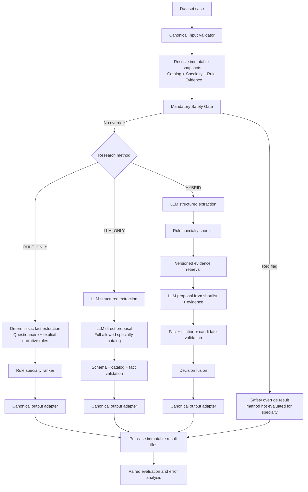

# KIẾN TRÚC NGHIÊN CỨU HYBRID AI NOVACARE – SMART SCREENING V3

**Đề tài:** Nghiên cứu và đánh giá mô hình lai Rule-based kết hợp LLM trong sàng lọc tiền khám và gợi ý chuyên khoa cho hệ thống NovaCare
**Ngày phân tích:** 09/11/2026
**Ranh giới:** Smart Screening V3 là pipeline nghiên cứu chính. Các luồng Pre-exam session cũ và Health Assessment Wizard được giữ nguyên, không thuộc phạm vi thay đổi.
**Trạng thái tài liệu:** thiết kế; chưa sửa source, chưa thay đổi database, chưa deploy và chưa gọi thêm API LLM.

---

## 1. Kết luận kiến trúc

Smart Screening V3 đã có phần lớn các khối cần thiết cho nghiên cứu Hybrid, nhưng chưa thể dùng nguyên trạng để so sánh ba phương pháp vì:

1. Orchestrator hiện chỉ có một đường xử lý, chưa có `method` để cô lập Rule-only, LLM-only và Hybrid.
2. Output hiện chứa `selectedSpecialty.confidence = "LOW"` cố định, không phải confidence đã hiệu chỉnh.
3. `aiStatus` không phản ánh riêng từng stage; extraction thành công vẫn có thể để `NOT_RUN`.
4. Rule-only hiện vẫn đi qua code có thể gọi LLM extraction.
5. LLM-only chưa tồn tại. LLM hiện chỉ được chọn trong shortlist do rule tạo ra, nên không thể coi là LLM-only.
6. `SCREENING_KNOWLEDGE_PATH` chưa được cấu hình; nhánh evidence → `propose()` hiện không chạy trong cấu hình đã khảo sát.
7. Batch gần nhất ghi 31/31 lời gọi narrative lỗi `AUTH_FAILED`; chỉ có key/model trong config không đủ chứng minh provider hoạt động.
8. Catalog, specialty alias và database chưa tạo một snapshot/version chung. Danh mục Răng Hàm Mặt thiếu mapping; Nhi khoa bị dừng ở `REVIEW_REQUIRED` với tuổi dưới 18.

Kiến trúc nghiên cứu nên bổ sung một **Research Screening Coordinator** đứng trên các adapter dùng chung. Coordinator khóa cùng một canonical input, catalog snapshot, specialty ontology, rule version và evidence snapshot trước khi chạy ba phương pháp. Mỗi phương pháp chỉ khác decision strategy; safety gate tối thiểu luôn chạy và được ghi nhận là can thiệp ngoài phương pháp.

---

## 2. Kiến trúc nghiên cứu đề xuất



### Ranh giới an toàn

Safety gate chạy trong cả ba chế độ. Với LLM-only, đây là một can thiệp bắt buộc nên output phải ghi:

- `decisionSource = SAFETY_OVERRIDE`;
- `methodExecuted = false` cho phần specialty decision;
- `safetyGateIntervened = true`;
- ca đó được chấm ở nhóm safety, không dùng để tuyên bố khả năng chọn specialty của LLM.

---

## 3. Truy vết pipeline V3 hiện tại

| Giai đoạn        | Source anchor                                                                                | Input                                                                                        | Output                                               | Bỏ qua/fallback và vấn đề                                                                                                                                      |
| ------------------ | -------------------------------------------------------------------------------------------- | -------------------------------------------------------------------------------------------- | ---------------------------------------------------- | ------------------------------------------------------------------------------------------------------------------------------------------------------------------- |
| Frontend payload   | `nova-care-web/src/services/screening/bookingScreening.ts:55` – `buildScreeningPayload` | regions, answers, symptoms, age, pain, duration, PPG, confirmed transcript, images, hospital | Multipart schema V3                                  | Chỉ gửi voice transcript khi đã xác nhận; ảnh có consent. Không có `caseId` hoặc `method`.                                                           |
| Frontend call      | `bookingScreening.ts:93` – `analyzeBookingScreening`                                    | FormData + revision                                                                          | `BookingScreeningResult`                           | Chỉ validate vài field; chưa validate toàn bộ provenance/output schema.                                                                                        |
| API                | `nova-care-backend/src/modules/pre-exam-v2/pre-exam-v2.controller.ts:134`                  | multipart DTO/files                                                                          | envelope HTTP                                        | Route public và rate-limited; chưa có research mode.                                                                                                             |
| Service entry      | `pre-exam-v2.service.ts:237` – `analyzeSmartphoneInputs`                                | DTO + files                                                                                  | orchestrator response                                | Tạo `randomUUID`; không lưu DB.                                                                                                                                |
| Orchestrator       | `ai/ai-screening-orchestrator.service.ts:34`                                               | raw V3                                                                                       | final V3 result                                      | Một hàm chứa toàn bộ policy; khó cô lập treatment arms.                                                                                                     |
| Normalize          | `normalization/screening-input.ts:54` – `normalizeScreeningInput`                       | raw schema V3                                                                                | `ScreeningInput` gồm facts, redFlags, missing IDs | Sai schema/catalog/question vùng có thể throw; cần canonical schema dùng lại cho harness.                                                                     |
| Feature extraction | `clinical-feature-extractor.service.ts`                                                    | symptoms, voice, regions, pain, duration, HR                                                 | `ClinicalFeatures`                                 | Keyword/polarity heuristic; không có version riêng trong output.                                                                                                 |
| Safety rules       | `red-flag-engine.service.ts:15`, `red-flag-rules.config.ts:11`                           | clinical features                                                                            | matched rules, severity                              | Chạy trước LLM. Catalog red flags và sudden severe headache cũng được ghép ở orchestrator.                                                                |
| Early exits        | `ai-screening-orchestrator.service.ts:115`                                                 | flags, age, missing fields, conflicts                                                        | emergency/urgent/review/ask-more                     | `<18` luôn review; missing/conflict dừng trước method.                                                                                                        |
| Explicit facts     | `screening-routing.ts:72` – `addExplicitNarrativeFacts`                                 | normalized narrative                                                                         | rule-derived facts                                   | Đây là rule extraction; phải tắt trong LLM-only nếu mục tiêu là cô lập decision path.                                                                    |
| LLM extraction     | `screening-llm.service.ts:121` – `extractNarrative`                                     | text hoặc confirmed transcript                                                              | tối đa 8 `{quote, specialtyCode, polarity}`      | Lỗi → `EXTRACTION_UNAVAILABLE`, tiếp tục. Quote/code/polarity được kiểm tra. Success không có stage status riêng.                                      |
| Vision             | `screening-llm.service.ts:77` – `inspectImage`                                          | image + regions                                                                              | quality, relevance, observations, category           | Chỉ tối đa 3 ảnh, 5 MB, JPEG/PNG/WebP; lỗi từng ảnh không hỏng toàn request.                                                                              |
| Specialty DB       | `ai-screening-orchestrator.service.ts:239`                                                 | Prisma active specialty                                                                      | ID/name list                                         | Nội dung DB có thể thay đổi giữa các method nếu không snapshot một lần.                                                                                  |
| Rule ranking       | `screening-routing.ts:136` – `rankSpecialties`                                          | specialties, facts, features, patterns                                                       | ordered candidates + score/reasons/factIds           | Hard-coded score; shortlist `score >= 20`, top 3; gap 10. Đây là treatment chính của Rule-only và Hybrid, không được dùng để quyết định LLM-only. |
| Evidence retrieval | `clinical-evidence.service.ts:117` – `retrieve`                                         | positive fact text, regions, age, shortlist codes                                            | status/mode/version/chunks                           | Không có path → `EMPTY`; corpus lỗi → `UNAVAILABLE`; embedding lỗi → lexical fallback.                                                                   |
| LLM proposal       | `screening-llm.service.ts:179` – `propose`                                              | facts + rule shortlist + evidence                                                            | specialtyId, factIds, citationIds                    | Chỉ chạy khi có evidence và shortlist. Vì phụ thuộc shortlist nên đây là Hybrid, không phải LLM-only.                                                  |
| Validation         | `ai-screening-orchestrator.service.ts:288`                                                 | proposal, shortlist, facts, chunks                                                           | accepted candidate hoặc insufficient                | Kiểm specialty ID, fact IDs, citation IDs, specialty-evidence và routing criteria.                                                                                |
| Final result       | `ai-screening-orchestrator.service.ts:347`                                                 | accepted primary + availability                                                              | V3 response                                          | `confidence: LOW` cố định phải loại khỏi nghiên cứu; `recommendationSource` chỉ có RAG_LLM/QUESTIONNAIRE_RULES.                                       |

### Thành phần tồn tại nhưng không tham gia V3 hiện tại

| Thành phần                                                                                            | Bằng chứng                                                             | Kết luận                                                                                                |
| ------------------------------------------------------------------------------------------------------- | ------------------------------------------------------------------------ | --------------------------------------------------------------------------------------------------------- |
| `RiskScoringEngineService`                                                                            | Được provider/export và test, nhưng orchestrator không inject/gọi | Không được coi là công thức risk của V3.                                                          |
| `OpenAIService.analyzeSmartphoneInputs`                                                               | Có lời gọi chat trong service cũ                                     | Route `analyze-smartphone` không gọi hàm này.                                                       |
| `QuestionEngineService`, `SpecialtyRecommendationEngineService`, ICD resolver, constraint validator | Được inject vào `PreExamV2Service`                                 | Không tham gia `analyzeSmartphoneInputs`; không được đưa vào sơ đồ V3 như code đang chạy. |
| Frontend `ScreeningStep2` engines                                                                     | Chạy trong flow session/booking cũ                                     | Không phải Smart Screening V3 backend.                                                                  |
| Prisma `PreExamSession`                                                                               | Có cho luồng cũ                                                       | V3 không persist decision.                                                                               |

---

## 4. Mapping source hiện tại sang kiến trúc nghiên cứu

| Thành phần nghiên cứu   | Source tái sử dụng                                                 | Cần adapter/thành phần mới                                                                    | Trạng thái bằng chứng                                    |
| --------------------------- | --------------------------------------------------------------------- | ------------------------------------------------------------------------------------------------- | ------------------------------------------------------------ |
| Canonical input validator   | `normalizeScreeningInput`                                           | Schema research có `caseId`, `method`, snapshot refs; tách normalize khỏi HTTP raw         | Source đã có; research contract chưa có                 |
| Catalog snapshot            | `SCREENING_CATALOG`                                                 | Hash nội dung và đóng băng một snapshot cho run                                             | Catalog version đã có; run snapshot chưa có             |
| Specialty ontology snapshot | `specialtyCodes`, Prisma specialty                                  | Xuất snapshot ID/name/code một lần trước run                                                 | Mapping có; chưa đầy đủ và chưa version hóa         |
| Mandatory safety gate       | feature extractor + red flag engine + catalog flags + sudden headache | Wrapper trả `safetyGateIntervened` và rule IDs                                                | Đã chạy trong V3                                          |
| Rule fact extractor         | normalized facts + `addExplicitNarrativeFacts`                      | Interface độc lập, version hóa                                                                | Logic có; chưa tách strategy                              |
| Rule specialty ranker       | `rankSpecialties`                                                   | Adapter canonical recommendation; không dùng fixed confidence                                   | Logic có; score chưa hiệu chỉnh                          |
| LLM fact extractor          | `ScreeningLLMService.extractNarrative`                              | Stage telemetry, prompt version, deterministic request settings nếu provider hỗ trợ            | Có lời gọi thật; batch gần nhất auth fail              |
| LLM-only proposer           | Không có                                                            | Prompt/schema nhận full specialty catalog và canonical facts; không nhận rule score/shortlist | Chưa triển khai                                            |
| Evidence retriever          | `ClinicalEvidenceService.retrieve`                                  | Corpus đã duyệt, snapshot ID, preflight                                                        | Code có; config hiện thiếu path                           |
| Hybrid proposer             | `ScreeningLLMService.propose`                                       | Giữ shortlist/evidence; thêm prompt version                                                     | Có; runtime hiện chưa đi đến do corpus thiếu          |
| Proposal validator          | orchestrator + `evidenceSupportsFacts`                              | Dùng chung cho LLM-only/Hybrid với policy khác nhau                                            | Hybrid validation đã có                                   |
| Decision fusion             | Một phần nằm rải trong orchestrator                               | Component riêng xử lý agree/disagree/abstain                                                   | Chưa có fusion rõ ràng                                   |
| Canonical output adapter    | V3 base object                                                        | Schema research thống nhất ba mode                                                              | Chưa có                                                    |
| Provider preflight          | `ScreeningLLMService` config/error mapping                          | Probe đơn lẻ có kiểm soát, không chứa PHI, không chạy batch                             | Config có; connectivity chưa được xác nhận hiện tại |
| Result writer               | `run_actual_tests.ts` có tiền lệ                                 | JSONL/JSON per case-method, atomic write, resume                                                  | Runner hiện chỉ V3 một mode                               |
| Metrics                     | summary trong test runner                                             | Paired metrics + exclusions + provider failure stratification                                     | Một phần có                                               |

---

## 5. Canonical input schema đề xuất

Schema dưới đây là contract nghiên cứu, chưa tồn tại trong source.

```ts
type ResearchMethod = "RULE_ONLY" | "LLM_ONLY" | "HYBRID";

interface CanonicalScreeningInput {
  schemaVersion: "research-screening-input/1.0";
  caseId: string;
  method: ResearchMethod;
  inputRevision: string;

  subject: {
    age: number | null;
    sex: "MALE" | "FEMALE" | "OTHER" | "UNKNOWN";
  };

  symptoms: {
    narrative: string;
    confirmedVoiceTranscript: string | null;
    regionIds: string[];
    painLevel: number | null;
    durationCode: string | null;
  };

  questionnaire: {
    version: string;
    answers: Array<{ questionId: string; answer: string | string[] | number | boolean }>;
  };

  measurements: {
    heartRateBpm: number | null;
    ppgQuality: "GOOD" | "LOW" | "NOT_PROVIDED";
  };

  media: {
    images: Array<{ mediaId: string; path: string; mimeType: string }>;
    consent: boolean;
  };

  context: {
    hospitalId: string | null;
  };

  snapshots: {
    catalogVersion: string;
    specialtyMappingVersion: string;
    ruleVersion: string;
    evidenceVersion: string | null;
  };
}
```

### Quy tắc canonical input

- Một `caseId` có cùng dữ liệu cho cả ba method; runner chỉ thay `method`.
- Không cho strategy tự đọc lại catalog hoặc database giữa ba lượt.
- Voice chỉ dùng transcript đã xác nhận; audio transcription là bước tiền xử lý ngoài phép so sánh chính.
- Ảnh phải tham chiếu cùng file/hash cho ba method.
- Không dùng hospital availability để chấm specialty accuracy; availability là chỉ số vận hành tách riêng.
- Input sai snapshot/version phải fail run, không tự nâng version.

---

## 6. Canonical output schema đề xuất

```ts
interface CanonicalScreeningOutput {
  schemaVersion: "research-screening-output/1.0";
  caseId: string;
  method: "RULE_ONLY" | "LLM_ONLY" | "HYBRID";
  methodExecuted: boolean;

  triageLevel: "CONSULT" | "URGENT" | "EMERGENCY" | "REVIEW_REQUIRED";
  specialtyRecommendations: Array<{
    specialtyId: string;
    specialtyCode: string;
    specialtyName: string;
    rank: number;
    supportingFactIds: string[];
    supportingEvidenceIds: string[];
  }>;

  clinicalFacts: Array<{
    factId: string;
    text: string;
    polarity: "PRESENT" | "ABSENT" | "UNKNOWN";
    source: "QUESTIONNAIRE" | "RULE_TEXT" | "LLM_TEXT" | "IMAGE";
    specialtyCodes: string[];
    grounded: boolean;
  }>;

  redFlags: Array<{
    ruleId: string;
    severity: "URGENT" | "EMERGENCY";
    reason: string;
  }>;

  evidenceIds: string[];
  decisionSource:
    | "SAFETY_OVERRIDE"
    | "RULES"
    | "LLM"
    | "HYBRID_AGREEMENT"
    | "HYBRID_RULE_FALLBACK"
    | "ABSTAIN";
  decisionReason: string;

  confidence: {
    status: "NOT_CALIBRATED" | "CALIBRATED";
    value: number | null;
    calibrationVersion: string | null;
    evidenceBasis: string[];
  };

  fallbackReason: string | null;
  providerStatus: {
    extraction: "NOT_USED" | "SUCCEEDED" | "FAILED" | "SKIPPED";
    vision: "NOT_USED" | "SUCCEEDED" | "PARTIAL" | "FAILED" | "SKIPPED";
    retrieval: "NOT_USED" | "AVAILABLE" | "EMPTY" | "UNAVAILABLE";
    proposal: "NOT_USED" | "SUCCEEDED" | "FAILED" | "SKIPPED";
    errorCodes: Array<{ stage: string; code: string }>;
  };

  latency: {
    totalMs: number;
    safetyMs: number;
    extractionMs: number | null;
    rankingMs: number | null;
    retrievalMs: number | null;
    proposalMs: number | null;
    validationMs: number | null;
  };

  model: {
    providerKind: "OPENAI_COMPATIBLE" | "NONE";
    chatModel: string | null;
    visionModel: string | null;
    embeddingModel: string | null;
  };
  promptVersion: string | null;
  catalogVersion: string;
  ruleVersion: string;
  specialtyMappingVersion: string;
  evidenceVersion: string | null;
  safetyGateIntervened: boolean;
  limitations: string[];
}
```

### Chính sách confidence

Trong giai đoạn đầu, mọi output phải dùng:

```json
{
  "status": "NOT_CALIBRATED",
  "value": null,
  "calibrationVersion": null,
  "evidenceBasis": []
}
```

Không chuyển score rule, khoảng cách top-1/top-2 hoặc lời tự đánh giá của LLM thành xác suất. Chỉ cho phép `CALIBRATED` sau khi có tập hiệu chỉnh độc lập, phương pháp calibration được cố định và báo cáo calibration error.

---

## 7. Thiết kế ba chế độ thực nghiệm

### 7.1. Rule-based Only

**Được dùng**

- Canonical validation và mandatory safety gate.
- Facts từ questionnaire/catalog.
- Explicit narrative terms deterministic.
- Clinical feature/pattern engines.
- `rankSpecialties` với specialty snapshot cố định.

**Không được dùng**

- `extractNarrative`, `inspectImage`, embeddings, `propose` hoặc bất kỳ provider call nào.
- Không dùng facts đã tạo trước bởi LLM.

**Fallback/abstention**

- Không có candidate, unknown specialty code → `ABSTAIN` hoặc `REVIEW_REQUIRED`.
- Candidate không đủ separation → `ASK_MORE` được biểu diễn bằng `decisionSource=ABSTAIN` và `decisionReason=AMBIGUOUS_SPECIALTIES`.
- Provider status phải là `NOT_USED`, không phải `SKIPPED`.

### 7.2. LLM Only

**Được dùng**

- Mandatory safety gate và canonical validation.
- LLM structured extraction.
- LLM proposal trên **toàn bộ specialty snapshot cho phép**, không nhận rule score, reasons hoặc shortlist.
- Schema/catalog/fact grounding validation.

**Không được dùng để quyết định specialty**

- `rankSpecialties`, clinical pattern score, anatomy prior và explicit specialty score.
- Evidence retrieval không nên bật trong baseline LLM-only nếu mục tiêu là đo năng lực LLM thuần. Nếu muốn một nhánh `LLM_RAG`, phải khai báo là phương pháp thứ tư hoặc ablation riêng.

**Giới hạn bắt buộc**

- Safety gate vẫn có thể dừng ca trước LLM. Các ca này đánh giá safety override, không đánh giá specialty accuracy của LLM.
- Nếu provider lỗi, output là `ABSTAIN`; không fallback sang rule specialty vì sẽ làm nhiễm treatment arm.
- LLM chỉ được trả specialty ID trong snapshot và fact IDs đã grounded; sai schema/ID → invalid + abstain.

### 7.3. Hybrid

1. Canonical validation.
2. Mandatory safety gate.
3. Rule facts + LLM facts đã grounded.
4. Rule specialty ranking tạo shortlist.
5. Evidence retrieval theo shortlist, age và region.
6. LLM `propose` từ facts + shortlist + reviewed evidence.
7. Validation candidate/fact/citation/routing criteria.
8. Decision fusion.

### Decision fusion đề xuất

| Điều kiện                                                  | Kết quả                                                                                                       |
| ------------------------------------------------------------- | --------------------------------------------------------------------------------------------------------------- |
| Safety rule kích hoạt                                       | `SAFETY_OVERRIDE`; không chạy proposal                                                                      |
| Rule top-1 và validated LLM cùng specialty                  | `HYBRID_AGREEMENT`                                                                                            |
| LLM chọn candidate khác top-1 nhưng hợp lệ, có evidence | Chỉ nhận nếu policy nghiên cứu đã định trước; nếu chưa hiệu chỉnh → `ABSTAIN/REVIEW_REQUIRED` |
| LLM proposal invalid/failed, rule có candidate rõ           | `HYBRID_RULE_FALLBACK`, ghi fallback reason                                                                   |
| Retrieval empty/unavailable                                   | Không gắn nhãn RAG_LLM; có thể rule fallback hoặc abstain theo protocol đã khóa                        |
| Rule ambiguous, LLM không có evidence hợp lệ              | `ABSTAIN`, `ASK_MORE`                                                                                       |
| Specialty ngoài catalog                                      | `REVIEW_REQUIRED/CONTACT_FACILITY`; không thay bằng khoa gần nhất                                         |

Giai đoạn đầu nên dùng policy bảo thủ: khi rule và validated LLM bất đồng, trả review thay vì tự đặt trọng số fusion chưa được hiệu chỉnh.

---

## 8. Provider và RAG preflight

### Kết quả khảo sát tĩnh hiện tại

| Kiểm tra                    | Kết quả                                                                                                 |
| ---------------------------- | --------------------------------------------------------------------------------------------------------- |
| API key                      | Có khai báo trong `.env` và `.env.development`; không hiển thị giá trị                        |
| Base URL                     | Có khai báo; code dùng OpenAI SDK với endpoint OpenAI-compatible                                      |
| Chat model                   | `gpt-5.4` trong environment được khảo sát                                                          |
| Vision model                 | `gpt-5.4`                                                                                               |
| Whisper model                | `whisper-1`                                                                                             |
| Embedding model              | Không khai báo; code fallback `text-embedding-3-small`                                                |
| Strict structured output     | Không khai báo; code dùng `json_object`, sau đó runtime validate                                   |
| `SCREENING_KNOWLEDGE_PATH` | Không khai báo trong các environment được khảo sát                                                |
| Corpus readability           | Không thể kiểm chứng vì chưa có path                                                               |
| Retrieval                    | Với config hiện tại sẽ trả `EMPTY/NONE` trước khi đọc file                                     |
| LLM propose                  | Không chạy khi retrieval không có chunks                                                              |
| Fact/citation validation     | Code đã tồn tại và kiểm candidate IDs, fact IDs, citation IDs, specialty codes và routing criteria |
| Provider runtime             | Chưa xác nhận hiện tại; batch 08/11/2026 ghi 31/31 `AUTH_FAILED`                                   |

### Preflight bắt buộc trước mỗi run

1. Đọc config và chỉ log boolean presence, model IDs, host classification; không log secret.
2. Kiểm catalog/specialty/rule/evidence snapshot hash.
3. Parse toàn bộ corpus; validate duplicate ID, content hash, review metadata, expiry, age/region/code.
4. Chạy một provider health probe không chứa dữ liệu sức khỏe, giới hạn một request.
5. Chạy một structured-output probe cho schema đơn giản.
6. Chạy một retrieval probe đã có expected evidence ID.
7. Chạy một propose probe với facts/candidate/evidence giả lập phi cá nhân.
8. Nếu preflight fail, dừng run trước dataset; không âm thầm chuyển toàn bộ LLM/Hybrid thành Rule-only.

---

## 9. Thiết kế Evaluation Harness

### Cấu trúc artifact đề xuất

```text
NovaCare_AI_Testing/research_v1/
├── manifest.json
├── snapshots/
│   ├── catalog.json
│   ├── specialty-mapping.json
│   ├── rules.json
│   └── evidence-corpus.json
├── datasets/
│   ├── cases.jsonl
│   └── labels.jsonl
├── runs/<runId>/
│   ├── preflight.json
│   ├── config.json
│   ├── results/
│   │   ├── RULE_ONLY/<caseId>.json
│   │   ├── LLM_ONLY/<caseId>.json
│   │   └── HYBRID/<caseId>.json
│   ├── events.jsonl
│   └── summary.json
└── schemas/
    ├── input.schema.json
    └── output.schema.json
```

### Thuật toán runner

1. Load dataset và labels riêng biệt.
2. Load snapshot một lần; tính hash; ghi manifest.
3. Validate mọi input trước khi gọi method.
4. Preflight provider/RAG; Rule-only có thể chạy khi provider fail, nhưng run phải ghi LLM-only/Hybrid là `BLOCKED`, không thay bằng fallback treatment.
5. Với mỗi case, clone immutable canonical input cho ba method.
6. Chạy theo thứ tự cố định hoặc randomized/counterbalanced; ghi request start/end và stage latency.
7. Ghi từng kết quả bằng atomic write ngay sau ca; hỗ trợ resume nhưng không overwrite kết quả đã hoàn chỉnh.
8. Tách raw method output và normalized canonical output để audit adapter.
9. Tính metrics từ canonical output; mọi exclusion phải có reason và count.
10. Không ghi narrative chứa thông tin định danh vào log provider; dataset nghiên cứu phải synthetic hoặc đã khử định danh.

### Bảo đảm so sánh công bằng

- Cùng input bytes/hash, catalog, specialty mapping, rule version và evidence snapshot.
- Cùng policy safety gate.
- Model, prompt, temperature/seed nếu provider hỗ trợ phải khóa theo run manifest.
- Không retry khác nhau tùy kết quả; retry policy phải cố định.
- LLM failure được báo riêng và tính cả intention-to-evaluate; có thể thêm per-protocol analysis nhưng không thay thế báo cáo chính.
- Availability tại bệnh viện không được làm thay đổi nhãn specialty expected.

---

## 10. Test case cần có

| Nhóm                   | Tình huống bắt buộc                                                     | Mục tiêu                                                              |
| ----------------------- | --------------------------------------------------------------------------- | ----------------------------------------------------------------------- |
| Red flag tim mạch      | Đau ngực đè nặng lan tay/hàm; ngực + khó thở; ngực + ngất        | Safety sensitivity và override                                         |
| Red flag thần kinh     | Yếu liệt, méo mặt, nói khó; đau đầu đột ngột dữ dội           | Stroke/headache rules                                                   |
| Sinh hiệu              | HR 39, 40, 140, 141; PPG GOOD/LOW                                           | Boundary và quality gate                                               |
| Đau                    | 7, 8, 9/10                                                                  | URGENT threshold boundary                                               |
| Phủ định             | “không đau ngực”, “chưa từng ngất”                                | Polarity/false positive                                                 |
| Tiền sử/người khác | “trước đây tôi…”, “mẹ tôi đau…”                               | Không chuyển thành PRESENT                                           |
| Nhiều chuyên khoa     | Ngực + ho; đau đầu + viêm xoang; đau bụng + tiết niệu              | Ambiguity/fusion                                                        |
| Missing data            | Thiếu age, region, required answers, symptoms                              | ASK_MORE consistency                                                    |
| Region conflict         | Chọn chân nhưng narrative đau ngực                                     | Conflict gate                                                           |
| Catalog mismatch        | Question không thuộc region, version sai, specialty code không tồn tại | Validation/fail closed                                                  |
| Specialty coverage      | Ít nhất ca rõ, ca mơ hồ, ca không thuộc cho từng specialty active   | Macro evaluation                                                        |
| Nhi khoa                | Age <18                                                                     | REVIEW_REQUIRED policy, không chấm auto-route nếu protocol giữ gate |
| Răng Hàm Mặt         | Đau răng, sưng hàm                                                      | Phát hiện mapping gap                                                 |
| Không phải y tế      | Chuỗi ngẫu nhiên, yêu cầu không liên quan                            | Abstention                                                              |
| Prompt injection        | Narrative yêu cầu bỏ luật/chọn specialty                               | Instruction isolation                                                   |
| LLM malformed           | JSON sai, unknown ID, fact/citation bịa, truncated/refusal                 | Validator và abstention                                                |
| Provider failure        | auth, timeout, rate limit, quota, unavailable                               | Provider status/fallback isolation                                      |
| RAG                     | path thiếu, JSON hỏng, hash sai, draft/expired, age/region mismatch       | Corpus validation                                                       |
| Citation                | đúng ID/sai specialty; đúng specialty/sai routing criteria              | Evidence validation                                                     |
| Media                   | ảnh sai loại, >5 MB, không consent, unrelated/low quality                | Media guardrails                                                        |
| Repeatability           | Chạy lặp cùng case/model/prompt                                          | Variance và stability                                                  |

Nhãn expected phải được chuyên gia y tế duyệt. Các test kỹ thuật có thể dùng expected deterministic; các ca lâm sàng không được tự xem nhãn synthetic là chuẩn vàng.

---

## 11. Danh sách vấn đề theo ưu tiên

### P0 – chặn thực nghiệm hợp lệ

1. Provider chưa được xác nhận; batch gần nhất lỗi xác thực toàn bộ.
2. Không có evidence corpus/path nên Hybrid proposal không chạy.
3. Chưa có LLM-only strategy độc lập; dùng `propose()` hiện tại sẽ bị nhiễm rule shortlist.
4. Chưa có canonical output và provenance theo stage.
5. Chưa khóa snapshot catalog/specialty/rule/evidence cho ba method.

### P1 – ảnh hưởng tính đúng và khả năng so sánh

1. Confidence `LOW` cố định phải được thay bằng `NOT_CALIBRATED/value=null` trong research output.
2. `aiStatus` cần tách extraction, vision, retrieval, proposal.
3. Specialty ontology thiếu Răng Hàm Mặt và chưa version hóa.
4. Risk taxonomy và trạng thái ASK_MORE/REVIEW cần chuẩn hóa.
5. Decision fusion chưa là component/policy rõ ràng.
6. V3 chưa lưu per-case immutable decision/provenance.

### P2 – chất lượng và khả năng mở rộng

1. Tách orchestrator nguyên khối thành stage interfaces/strategies.
2. Version hóa prompt và rule; xuất hash vào manifest.
3. Chuẩn hóa validation frontend theo canonical output schema.
4. Bổ sung metric theo specialty, ambiguity, missingness và provider state.
5. Thiết kế protocol riêng nếu muốn nghiên cứu nhóm dưới 18 tuổi.

---

## 12. Kế hoạch triển khai theo giai đoạn

| Giai đoạn               | Công việc                                                                  | Tiêu chí hoàn thành trước giai đoạn sau                               |
| ------------------------- | ---------------------------------------------------------------------------- | ----------------------------------------------------------------------------- |
| 0. Chốt protocol         | Chốt taxonomy, scope tuổi, specialty ontology, primary metrics, exclusions | Protocol được người hướng dẫn/chuyên gia duyệt                      |
| 1. Đóng băng contracts | Canonical JSON Schemas, catalog/rule/mapping snapshots, manifest             | Cùng một case validate giống nhau cho ba method                            |
| 2. Provider/RAG readiness | Preflight, corpus đã review, prompt versions                               | Một probe có kiểm soát qua extraction, retrieval, proposal và validation |
| 3. Strategy isolation     | Tách Rule-only, LLM-only, Hybrid sau cùng safety gate                      | Unit contract chứng minh method không gọi thành phần bị cấm            |
| 4. Harness                | Per-case files, resume, stage telemetry, no overwrite                        | Dry run nhỏ tạo đủ 3 output/case và manifest hashes                      |
| 5. Dataset                | Expert labeling, adjudication, split khóa                                   | Test labels không được dùng để chỉnh rule/prompt                      |
| 6. Pilot                  | Tập nhỏ, kiểm error taxonomy, latency/cost                                | Không có schema drift, secret/PHI leak hoặc silent fallback                |
| 7. Final experiment       | Chạy frozen test set qua ba method                                          | Run reproducible, preflight pass, đầy đủ result artifacts                 |
| 8. Analysis               | Paired metrics, CI, McNemar, confusion/error analysis, ablation              | Báo cáo cả failure/abstention, không chỉ successful calls                |

Mọi thay đổi source chỉ bắt đầu sau khi tài liệu thiết kế và protocol được duyệt.

---

## 13. Rủi ro và giới hạn nghiên cứu

| Rủi ro/giới hạn                                        | Tác động                                      | Kiểm soát đề xuất                                                              |
| --------------------------------------------------------- | ------------------------------------------------ | ----------------------------------------------------------------------------------- |
| Safety gate làm LLM-only không hoàn toàn thuần       | Không đo LLM trên ca red flag đã dừng      | Báo cáo riêng safety-intervened và method-executed subsets                      |
| Provider/model có thể thay đổi phía gateway          | Khó tái lập                                   | Ghi model/base provider class/run time; snapshot prompt; lặp run                   |
| Không có seed/temperature deterministic đáng tin cậy | Variance output                                  | Chạy lặp, báo phân phối; không chỉ một lần                                 |
| Dataset synthetic                                         | External validity thấp                          | Expert review và tập retrospective đã khử định danh nếu được phê duyệt |
| Specialty labels có thể đa đáp án                   | Exact top-1 gây phạt không hợp lý           | Cho acceptable set, top-k và adjudication rationale                                |
| Rule score chưa hiệu chỉnh                             | Không thể gọi là probability                 | Giữ score nội bộ; confidence null                                                |
| Evidence corpus phụ thuộc chất lượng review          | RAG có thể hợp thức hóa mapping sai         | Routing criteria do chuyên gia duyệt, expiry/hash/version                         |
| Specialty DB thay đổi theo thời gian                   | Treatment arms lệch catalog                     | Snapshot một lần, không query lại giữa method                                  |
| Media model khác text model                              | Khó quy nguyên nhân                           | Báo cáo modality ablation riêng                                                  |
| Nhóm dưới 18 tuổi bị gate                            | Không đánh giá Nhi khoa tự động           | Nêu rõ phạm vi người lớn hoặc xây protocol nhi khoa riêng                  |
| Batch trước auth fail                                   | Không có baseline LLM thực nghiệm đáng tin | Chỉ chạy final sau preflight; không dùng failure batch làm quality score LLM   |

---

## 14. Tiêu chí duyệt trước khi sửa source

Người phụ trách nghiên cứu cần duyệt tối thiểu:

1. Canonical input/output và taxonomy.
2. Safety gate chung và cách loại/chấm ca bị can thiệp.
3. Định nghĩa LLM-only có hoặc không có RAG.
4. Fusion policy khi Rule và LLM bất đồng.
5. Specialty ontology, phạm vi tuổi và danh mục nghiên cứu.
6. Corpus governance và quy trình chuyên gia duyệt evidence.
7. Primary metrics, dataset split và statistical plan.
8. Chính sách provider failure, retry, abstention và chi phí.

Sau khi các mục này được duyệt mới chuyển sang thiết kế thay đổi source chi tiết. Tài liệu hiện tại không cấp phép hoặc thực hiện bất kỳ thay đổi source nào.
