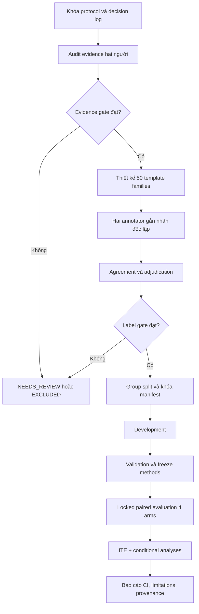

# RESEARCH PROTOCOL V1.1 – HYBRID AI NOVACARE

**Đề tài:** Nghiên cứu và đánh giá mô hình lai Rule-based kết hợp LLM trong sàng lọc tiền khám và gợi ý chuyên khoa cho NovaCare  
**Phiên bản:** 1.1 – 09/11/2026  
**Trạng thái:** Protocol draft sau phản biện; chưa được xem là phê duyệt lâm sàng  
**Pipeline:** Smart Screening V3

## 0. Tuyên bố về nhãn và giới hạn kết luận

Nhãn trong nghiên cứu là **literature-based reference labels** được xây dựng từ tài liệu đã xác minh theo protocol. Chúng không phải nhãn bác sĩ xác nhận, không phải chẩn đoán và không phải clinical ground truth. `CLINICIAN_CONFIRMED` chỉ được ghi khi một chuyên gia đủ thẩm quyền thực sự duyệt ca. Kết quả không được diễn giải thành độ chính xác lâm sàng ngoài thực tế.

Triage và specialty là hai nhiệm vụ riêng. Nguồn hỗ trợ hành động cấp cứu không tự động hỗ trợ một specialty ngoại trú. Ca bị safety gate chặn được đánh giá an toàn, còn specialty decision được ghi `DEFERRED_AFTER_TRIAGE` và không đưa vào specialty denominator.

## 1. Research objectives và questions

### 1.1. Mục tiêu

1. So sánh bốn phương pháp trên cùng ca, catalog và safety policy: `RULE_ONLY`, `LLM_ONLY`, `LLM_RAG`, `HYBRID`.
2. Đo chất lượng triage/safety, gợi ý specialty, hành vi abstain, độ tin cậy vận hành, latency và chi phí.
3. Ước lượng tác động của RAG và của gói tích hợp rules mà không đồng nhất correlation với hiệu quả lâm sàng.
4. Xây dựng quy trình evidence, labeling và evaluation có thể tái lập.

### 1.2. Research questions

| RQ | Câu hỏi | Contrast/analysis chính |
|---|---|---|
| RQ1 | RAG thay đổi specialty performance và grounding của LLM ra sao? | LLM_RAG − LLM_ONLY |
| RQ2 | Gói rule integration trong Hybrid thay đổi kết quả so với LLM có RAG ra sao? | HYBRID − LLM_RAG |
| RQ3 | Hybrid có giá trị hơn baseline rules về specialty và abstention không? | HYBRID − RULE_ONLY |
| RQ4 | Safety gate phát hiện red flags và tránh specialty decision không phù hợp ra sao? | Safety metrics, báo riêng khỏi specialty |
| RQ5 | Provider failure, invalid output, latency và cost ảnh hưởng utility thực tế thế nào? | Intention-to-evaluate và operational metrics |

Giả thuyết là định hướng, không khẳng định trước kết quả. Với 150 ca pilot, CI và effect size được ưu tiên hơn tuyên bố có ý nghĩa thống kê.

## 2. Research scope

### 2.1. Đối tượng

- Ca giả lập của người từ 18 tuổi; không dùng dữ liệu bệnh nhân thật.
- Nội dung tiếng Việt, mô phỏng đầu vào canonical của V3.
- Ngoài phạm vi: chẩn đoán bệnh, kê đơn, đánh giá kết cục điều trị, trẻ em, sản khoa cấp cứu, nha khoa và specialty chưa được chọn.
- Ca ngoài catalog được giữ để đo abstention/out-of-catalog, không dùng để tính accuracy của 5 specialty.

### 2.2. Specialty proposal

| Code nghiên cứu | Tên hiển thị/catalog cần khóa | Khả năng mapping V3 | Evidence hiện tại | Đề xuất |
|---|---|---|---|---|
| cardiology | Tim mạch | Có | Mạnh cho triage đau ngực; routing ngoại trú còn phụ thuộc ca | INCLUDE, chờ catalog snapshot |
| neurology | Thần kinh | Có | Mạnh cho red flags/referral; emergency specialty thường deferred | INCLUDE |
| pulmonology | Hô hấp | Có | COPD hỗ trợ đánh giá hô hấp; routing code còn PARTIAL | INCLUDE có điều kiện |
| gastroenterology | Tiêu hóa | Có | GERD hỗ trợ đánh giá; phải loại trừ red flags/tim khi phù hợp | INCLUDE có điều kiện |
| orthopedics | Cơ xương khớp | Có alias/rule | Nguồn hỗ trợ MSK, chưa luôn tương đương Orthopedics | INCLUDE có điều kiện; khóa tên/code |

Quyết định cuối cùng về 5 specialty vẫn `OPEN`. Catalog snapshot phải chứa ID, code, tên, alias, trạng thái active và hash; cùng snapshot dùng cho cả labeling lẫn bốn arms.

## 3. Evidence registry

### 3.1. Chiến lược tìm kiếm

Thứ tự ưu tiên: Bộ Y tế Việt Nam; guideline của hiệp hội/chính phủ uy tín; referral/triage guideline; PubMed/PMC; giáo trình có provenance. Mỗi truy vấn, ngày tìm, cơ sở dữ liệu, tiêu chí chọn/loại và duplicate phải được lưu.

Không tạo DOI, URL, trang hoặc excerpt. Một tài liệu chỉ được dùng sau khi hai reviewer có thể truy lại đúng nội dung. Registry V1.1 tách:

- hỗ trợ nhận diện triệu chứng;
- hỗ trợ mức khẩn cấp;
- hỗ trợ đánh giá tại một lĩnh vực;
- hỗ trợ referral/routing đến đúng specialty.

### 3.2. Trạng thái và directness

`VERIFIED`, `VERIFIED_WITH_LIMITATION`, `NEEDS_REVIEW`, `EXCLUDED`, `SUPERSEDED`. Directness được ghi riêng thành `symptomDirectness`, `triageDirectness`, `specialtyAssessmentDirectness`, `referralDirectness` với `DIRECT`, `PARTIAL`, `CONTEXTUAL`, `NONE`.

Audit chi tiết nằm trong `EVIDENCE_REGISTRY_AUDIT.md`. `DOC-GOLD-COPD-2025` bị supersede bởi `DOC-GOLD-COPD-2026`. `DOC-BYT-STROKE-2024` chưa vào locked test cho đến khi có locator và verifier thứ hai.

## 4. Reference labeling protocol

### 4.1. Triage label

| Label | Định nghĩa protocol |
|---|---|
| `CONSULT` | Không có red flag theo evidence đã khóa; phù hợp tư vấn/khám có kế hoạch |
| `URGENT` | Cần đánh giá sớm theo khoảng thời gian được protocol quy định trước; mapping phải có evidence/adjudication |
| `EMERGENCY` | Evidence yêu cầu hành động cấp cứu/immediate action và mapping thuật ngữ đã được duyệt |
| `REVIEW_REQUIRED` | Không đủ căn cứ để gắn một trong ba mức trên hoặc ngoài policy; không phải chẩn đoán |

Không hạ triage vì specialty chưa xác định. Bảng ánh xạ “immediate referral”, “urgent referral”, “call emergency services” sang taxonomy phải được cố vấn an toàn duyệt trước locked test.

### 4.2. Specialty label

`specialtyLabelType` nhận `ONE`, `MULTI_ACCEPTABLE`, `INSUFFICIENT_INFORMATION`, `OUT_OF_CATALOG` hoặc `NONE`. `acceptableSpecialties` là tập không thứ tự và chỉ chứa code trong catalog snapshot.

Một specialty chỉ được đưa vào acceptable set khi evidence hỗ trợ hướng đánh giá/referral đó cho đầy đủ ngữ cảnh ca, hoặc được adjudicator chuyên môn duyệt. Không suy từ tên bệnh, triệu chứng đơn lẻ hoặc nơi tiếp nhận cấp cứu.

### 4.3. Specialty applicability

| Giá trị | Quy tắc |
|---|---|
| `APPLICABLE` | Safety không override, thông tin đủ và reference specialty có căn cứ |
| `DEFERRED_AFTER_TRIAGE` | Safety action phải xảy ra trước; specialty không được chấm trong lần chạy này |
| `NOT_APPLICABLE` | Ca ngoài nhiệm vụ specialty, ví dụ ngoài catalog hoặc không phải yêu cầu y tế phù hợp |
| `NEEDS_REVIEW` | Chưa đủ evidence/adjudication để quyết định applicability |

### 4.4. Information sufficiency

| Label | Định nghĩa |
|---|---|
| `SUFFICIENT` | Đủ dữ kiện cho nhiệm vụ đang áp dụng; không bắt buộc đủ để chẩn đoán |
| `INSUFFICIENT` | Thiếu trường quyết định và phải hỏi thêm/review |
| `AMBIGUOUS` | Có dữ kiện nhưng nhiều cách hiểu hợp lý chưa phân giải được |

### 4.5. Các ngữ cảnh bắt buộc

- Phủ định chỉ áp dụng cho đúng người, thời điểm và triệu chứng.
- Tiền sử không được coi là triệu chứng hiện tại.
- Triệu chứng của người khác trong lời kể không gắn cho subject.
- Multi-specialty chỉ dùng khi từng label có evidence riêng.
- Red flag chạy trước; specialty có thể deferred.
- Ngoài catalog dùng `OUT_OF_CATALOG`/`NOT_APPLICABLE`, không ép vào khoa gần nhất.

### 4.6. Label provenance/status

`PROVISIONAL_SINGLE_ANNOTATOR`, `NEEDS_REVIEW`, `LITERATURE_SUPPORTED`, `CLINICIAN_CONFIRMED`, `EXCLUDED`. `LITERATURE_SUPPORTED` yêu cầu hai annotator độc lập đồng thuận/adjudication, evidence verified, locator/excerpt và directness phù hợp. Nó không được đổi tên thành ground truth.

## 5. Quy trình labeling

1. Hai annotator đọc cùng registry đã qua evidence gate.
2. Gắn độc lập triage, specialty, applicability, sufficiency, rationale và evidence IDs; không xem output AI.
3. So sánh sau khi cả hai khóa vòng đầu.
4. Báo exact agreement và Cohen's kappa cho triage/sufficiency; specialty báo exact-set agreement, mean Jaccard và label-wise agreement. Báo prevalence để tránh diễn giải kappa máy móc.
5. Bất đồng chuyển adjudicator; lưu cả nhãn ban đầu, quyết định và lý do.
6. Không đủ căn cứ sau adjudication thì giữ `NEEDS_REVIEW`, không vào locked test primary analysis.

Nếu chỉ có một người: thực hiện hai lượt cách nhau tối thiểu hai tuần, đảo thứ tự và ẩn lượt trước. Trạng thái là `PROVISIONAL_SINGLE_ANNOTATOR`; không gọi là inter-rater agreement và không dùng làm locked test reference nếu chưa có reviewer độc lập.

## 6. Audit 10 tình huống minh họa

| Case | Triage | specialtyApplicability | Specialty reference dùng để chấm | Evidence directness | Trạng thái V1.1 |
|---|---|---|---|---|---|
| EX-01 | EMERGENCY | DEFERRED_AFTER_TRIAGE | Không | triage DIRECT; specialty CONTEXTUAL | Giữ safety, bỏ specialty metric |
| EX-02 | EMERGENCY | DEFERRED_AFTER_TRIAGE | Không | DIRECT / CONTEXTUAL | Evidence BYT còn NEEDS_REVIEW |
| EX-03 | EMERGENCY | DEFERRED_AFTER_TRIAGE | Không | DIRECT / PARTIAL | Giữ safety |
| EX-04 | CONSULT | APPLICABLE | pulmonology tạm thời | PARTIAL / PARTIAL | NEEDS_REVIEW |
| EX-05 | CONSULT | APPLICABLE | gastroenterology tạm thời | PARTIAL / PARTIAL | NEEDS_REVIEW |
| EX-06 | CONSULT | APPLICABLE | orthopedics tạm thời | PARTIAL / PARTIAL | NEEDS_REVIEW |
| EX-07 | EMERGENCY | DEFERRED_AFTER_TRIAGE | Không | DIRECT / CONTEXTUAL | Giữ safety |
| EX-08 | URGENT đề xuất | NEEDS_REVIEW | Chưa chốt | PARTIAL / PARTIAL | Không vào locked test |
| EX-09 | REVIEW_REQUIRED | NEEDS_REVIEW | [] | protocol-defined / NONE | Đo ask-more/review |
| EX-10 | EMERGENCY đề xuất | DEFERRED_AFTER_TRIAGE | Không | immediate referral DIRECT; specialty CONTEXTUAL | Mapping triage cần chuyên gia duyệt |

Chi tiết lý do từng ca nằm trong `PROTOCOL_REVIEW_REPORT.md`.

## 7. Synthetic dataset design

### 7.1. Quy mô và cohort

Giữ 150 ca. `primaryCohort` là nhóm chính không chồng lấn:

| primaryCohort | Số ca | Số family | Mục tiêu |
|---|---:|---:|---|
| `CLEAR_SINGLE_SPECIALTY` | 60 | 20 | 12 ca tiềm năng cho mỗi specialty trước split |
| `CROSS_SPECIALTY` | 30 | 10 | Giao thoa có acceptable set hoặc cần phân giải |
| `SAFETY_CRITICAL` | 30 | 10 | Red flags/safety override; specialty thường deferred |
| `INSUFFICIENT_AMBIGUOUS_OOS` | 30 | 10 | Ask-more, ambiguous, out-of-catalog, negation/context traps |
| **Tổng** | **150** | **50** | Mỗi family có 3 ca khác biệt lâm sàng |

`scenarioTags` có thể chồng lấn: `red_flag`, `multi_specialty`, `insufficient`, `ambiguous`, `out_of_catalog`, `negated_symptom`, `history_only`, `other_person_symptom`, `prompt_injection`, `safety_override`.

Ba ca trong một family phải khác về yếu tố lâm sàng có khả năng làm thay đổi quyết định, ví dụ onset, red flag, exertional relation, accompanying symptom hoặc sufficiency. Không tạo family bằng ba paraphrase hoặc chỉ đổi tuổi/giới.

### 7.2. Canonical case schema

```json
{
  "caseId": "NC-...",
  "templateFamilyId": "CLR-01",
  "primaryCohort": "CLEAR_SINGLE_SPECIALTY",
  "scenarioTags": [],
  "language": "vi",
  "syntheticDemographics": { "age": 45, "sex": "F" },
  "patientNarrative": "...",
  "onsetDuration": "...",
  "severity": "...",
  "associatedSymptoms": [],
  "negatedSymptoms": [],
  "redFlags": [],
  "triageReferenceLabel": "CONSULT",
  "specialtyApplicability": "APPLICABLE",
  "specialtyLabelType": "ONE",
  "acceptableSpecialties": ["..."],
  "informationSufficiency": "SUFFICIENT",
  "evidenceDocumentIds": ["DOC-..."],
  "evidenceLocators": ["..."],
  "labelRationale": "...",
  "labelBasis": "LITERATURE",
  "labelingStatus": "NEEDS_REVIEW",
  "limitations": [],
  "annotation": { "annotatorIds": [], "adjudicatorId": null }
}
```

## 8. Dataset split strategy

### 8.1. Đề xuất chính

V1.1 đề xuất `40/20/40`: development 60, validation 30, locked test 60. Với 50 family ×3 ca, chia 20/10/20 family và không rò rỉ family.

| Tập | Ca | Families | Clear | Cross | Safety | Insufficient/ambiguous/OOS |
|---|---:|---:|---:|---:|---:|---:|
| Development | 60 | 20 | 24 | 12 | 12 | 12 |
| Validation | 30 | 10 | 12 | 6 | 6 | 6 |
| Locked test | 60 | 20 | 24 | 12 | 12 | 12 |

Family assignment dự kiến:

- Development: `CLR-01..08`, `XSP-01..04`, `SAF-01..04`, `UNC-01..04`.
- Validation: `CLR-09..12`, `XSP-05..06`, `SAF-05..06`, `UNC-05..06`.
- Locked test: `CLR-13..20`, `XSP-07..10`, `SAF-07..10`, `UNC-07..10`.

### 8.2. Specialty presence plan

Đếm dưới đây là label incidence ở các ca `APPLICABLE`; multi-label có thể làm tổng incidence lớn hơn số ca.

| Tập | Cardiology | Neurology | Pulmonology | Gastroenterology | Orthopedics |
|---|---:|---:|---:|---:|---:|
| Development – clear | 5 | 5 | 5 | 5 | 4 |
| Development – cross | 6 | 4 | 5 | 5 | 4 |
| Validation – clear | 2 | 2 | 3 | 2 | 3 |
| Validation – cross | 3 | 2 | 3 | 2 | 2 |
| Locked test – clear | 5 | 5 | 5 | 4 | 5 |
| Locked test – cross | 5 | 5 | 4 | 5 | 5 |

### 8.3. Tag checklist dự kiến

| Tag | Development | Validation | Locked test | Tổng |
|---|---:|---:|---:|---:|
| red_flag/safety_override | 12 | 6 | 12 | 30 |
| multi_specialty | 12 | 6 | 12 | 30 |
| insufficient | 8 | 4 | 8 | 20 |
| ambiguous | 8 | 4 | 8 | 20 |
| out_of_catalog | 3 | 1 | 2 | 6 |
| negation/history/other-person traps | 6 | 3 | 6 | 15 |

Tags chồng lấn nên không cộng thành 150. Phân bổ cuối được kiểm bằng script trước khóa dataset.

### 8.4. Đánh giá phương án 60/20/20

`90/30/30` khả thi chính xác bằng 30/10/10 families, nhưng locked test dự kiến chỉ khoảng 18 ca specialty-applicable. Vì vậy phương án này không được khuyến nghị nếu mục tiêu chính là so sánh Macro F1 cho 5 specialty. Chống leakage ưu tiên hơn tỷ lệ chính xác; mọi chênh lệch do group split phải được ghi trước khi chạy arms.

## 9. Experimental arms

| Arm | Safety gate | Rule specialty ranking | RAG | LLM | Decision |
|---|---|---|---|---|---|
| RULE_ONLY | Chung, bắt buộc | Có | Không | Không | Rules/abstain theo schema chung |
| LLM_ONLY | Chung, bắt buộc | Không | Không | Có | LLM từ full catalog |
| LLM_RAG | Chung, bắt buộc | Không | Có | Có | LLM từ full catalog + evidence |
| HYBRID | Chung, bắt buộc | Có | Có | Có | Extraction, ranking, evidence, proposal, validation/fusion |

Điều kiện công bằng:

- cùng canonical input, case order policy, catalog snapshot và safety gate;
- cùng model family, model version, decoding và retry policy khi có thể;
- `LLM_ONLY` không nhận shortlist/rule score;
- `LLM_RAG` nhận evidence nhưng không nhận specialty ranking;
- Hybrid dùng shortlist và fusion theo kiến trúc đã khóa;
- provider failure không fallback âm thầm sang arm khác;
- log model, promptVersion, ruleVersion, catalogVersion, corpus hash, latency, tokens/cost và providerStatus.

`HYBRID − LLM_RAG` đo hiệu ứng của **gói rule integration**, không cô lập thuần túy ranking rules vì shortlist, retrieval scope và fusion có thể cùng thay đổi. Đây là confound phải ghi trong kết luận.

## 10. Evaluation metrics và denominators

### 10.1. Phân tích chính: intention-to-evaluate (ITE)

Đơn vị là mọi ca đã phân cho arm và đủ điều kiện cho metric. Provider failure/invalid output được coi là không có dự đoán trong utility metric, đồng thời báo riêng. Phân tích conditional-on-success chỉ là phụ.

| Metric | Numerator / denominator |
|---|---|
| Top-1 Accuracy | Ca `APPLICABLE`, acceptable set không rỗng, top-1 thuộc set / tất cả ca như vậy; abstain/failure là sai trong ITE |
| Top-3 Accuracy | Ca có ít nhất một dự đoán trong top 3 thuộc acceptable set / cùng denominator Top-1 |
| Macro P/R/F1 | One-vs-rest trên 5 specialty, cùng ITE eligible set; empty prediction được giữ |
| Multi-label P/R/F1, Jaccard | Chỉ ca `MULTI_ACCEPTABLE` và `APPLICABLE`; empty set có điểm theo quy tắc khóa trước |
| Red-flag Sensitivity | Safety positives phát hiện / tất cả reference red-flag positives |
| Red-flag FNR | Bỏ sót red flag / tất cả reference red-flag positives |
| Triage accuracy/confusion | Triage đúng / mọi ca có reference triage được adjudicate; báo theo lớp |
| Abstention Rate | Quyết định `ASK_MORE/REVIEW_REQUIRED/ABSTAIN` / method-executed eligible cases |
| Coverage | Ca có valid specialty prediction / tất cả specialty-applicable cases assigned; failure làm giảm coverage |
| Invalid Output Rate | Response không qua schema/validation / mọi invocation attempt |
| Provider Failure Rate | Provider errors/timeouts/auth failures / mọi provider call attempt; báo theo stage |
| LLM Success Rate | LLM calls có response hợp lệ / mọi LLM call attempt; không đồng nghĩa quyết định đúng |
| Latency | median/p90/p95 cho attempts và successful runs riêng; total và stage |
| Estimated Cost/Case | Tổng cost ước lượng, kể cả failed attempt nếu provider tính phí / cases assigned; báo assumptions |

Ca `DEFERRED_AFTER_TRIAGE`, `NOT_APPLICABLE`, `NEEDS_REVIEW`, `OUT_OF_CATALOG` không vào specialty accuracy; chúng có cohort report riêng. Safety override không được ghi như LLM/rules đã thực hiện specialty decision.

### 10.2. Required cohort flow

Cho mỗi arm báo: assigned → safety override → method eligible → provider attempted → provider success/failure → valid/invalid output → specialty prediction/abstain. Báo toàn dataset, APPLICABLE subset, red flags, provider failure, abstain, từng specialty và từng template family.

## 11. Statistical analysis

1. Báo point estimate và 95% CI; cluster bootstrap theo `templateFamilyId` cho accuracy/F1/Jaccard khi đủ clusters.
2. Paired binary outcomes dùng McNemar exact cho contrasts đã đăng ký; continuous paired differences dùng permutation hoặc Wilcoxon khi phù hợp.
3. Ba contrasts chính: LLM_RAG–LLM_ONLY, HYBRID–LLM_RAG, HYBRID–RULE_ONLY. Nếu thực hiện significance testing xác nhận, dùng Holm correction.
4. Báo effect size và CI ngay cả khi p-value không đạt ngưỡng.
5. Không impute specialty prediction. Provider failure giữ trong ITE và báo conditional analysis phụ.
6. 150 ca/50 clusters là pilot. Chưa có power calculation hoặc discordant-pair rate đáng tin; không tuyên bố đủ power. Sau pilot development/validation, thực hiện power calculation mà không xem locked labels và quyết định tăng test set.

## 12. Reproducibility

- Đóng băng dataset manifest, split manifest và SHA-256 trước locked evaluation.
- Version/hashes cho source commit, rules, catalog, evidence corpus, prompts và schema.
- Lưu provider/model ID thực tế, ngày chạy, region/base URL identifier không chứa secret, decoding/seed nếu hỗ trợ.
- Lưu raw response an toàn, parsed response, validation errors, fallbackReason và stage latency.
- Không lưu API key, token hoặc PII.
- Giữ environment manifest và runner version; chạy arms theo thứ tự cân bằng/ngẫu nhiên đã định.
- Chọn trước subset lặp lại để đo LLM variability; không thay prompt/rules sau khi xem locked results.

## 13. Limitations

1. Synthetic cases không đại diện đầy đủ bệnh nhân thực tế hoặc ngôn ngữ tự nhiên ngoài thực địa.
2. Literature-based labels không tương đương clinician-confirmed labels hay diagnosis.
3. Nguồn có thể khác hệ thống y tế, referral pathway và thời điểm cập nhật.
4. Nhiều triệu chứng không ánh xạ duy nhất sang specialty.
5. Safety gate chung làm safety performance gần như cố định giữa arms và không đo riêng năng lực LLM.
6. Hybrid-vs-LLM_RAG là composite intervention, còn confounding.
7. LLM/provider/model có thể thay đổi và không hoàn toàn deterministic.
8. 150 ca không đủ cho khẳng định clinical effectiveness và có thể thiếu power cho chênh lệch nhỏ.
9. Năm specialty không đại diện toàn bộ NovaCare.

## 14. Research workflow



## 15. Quality gates

1. **Evidence gate:** metadata, locator, excerpt, version và hai verifier; directness tách theo nhiệm vụ.
2. **Label gate:** hai annotator/adjudication; không còn `NEEDS_REVIEW` trong primary locked set.
3. **Catalog gate:** cùng snapshot/hash cho labeling và bốn arms.
4. **Leakage gate:** không family nào xuất hiện ở nhiều split; near-duplicate scan đạt.
5. **Safety gate:** mapping triage và red-flag minimum criteria được người có thẩm quyền duyệt.
6. **Provider/RAG gate:** xác thực thành công bằng smoke case, corpus path/read/retrieval/citation validation hoạt động; không gọi hàng loạt trước gate.
7. **Method gate:** prompts/rules/model/retry/fallback frozen trước locked run.
8. **Reporting gate:** cohort flow, denominators, failures và exclusions đầy đủ; không dùng từ clinical ground truth/clinical accuracy.

## 16. Quyết định cần duyệt

Các quyết định, chủ thể xác nhận và trạng thái nằm trong `PROTOCOL_DECISION_LOG.md`. Các mục quan trọng trước Dataset Pilot: phạm vi 5 specialty; split 40/20/40 hay 60/20/20; mapping thuật ngữ khẩn cấp; EX-04/05/06/08/10; yêu cầu hai annotator; primary ITE estimand; catalog snapshot; và ranh giới clinical claims.
