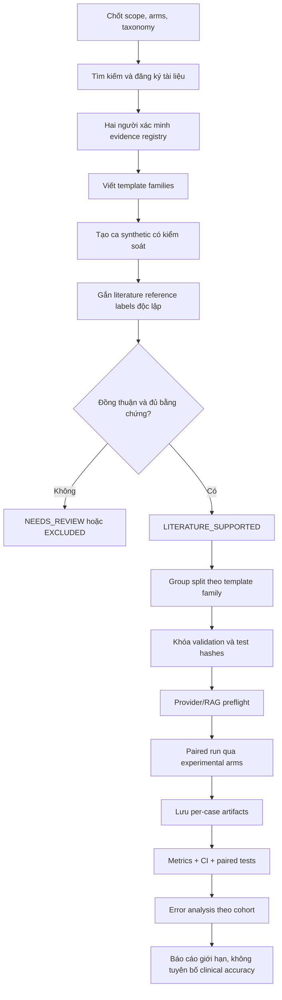

# RESEARCH PROTOCOL V1 – HYBRID AI NOVACARE

**Tên đề tài:** Nghiên cứu và đánh giá mô hình lai Rule-based kết hợp LLM trong sàng lọc tiền khám và gợi ý chuyên khoa cho hệ thống NovaCare
**Pipeline nghiên cứu:** Smart Screening V3
**Phiên bản protocol:** 1.0-draft
**Ngày lập:** 09/11/2026
**Tài liệu kiến trúc nền:** [`KIEN_TRUC_NGHIEN_CUU_HYBRID_AI_V3.md`](./KIEN_TRUC_NGHIEN_CUU_HYBRID_AI_V3.md)
**Trạng thái:** chờ người nghiên cứu duyệt; chưa sửa source, chưa tạo dataset hàng loạt, chưa gọi LLM hàng loạt.

---

## 0. Tuyên bố về bản chất nhãn

Protocol phân biệt bắt buộc ba khái niệm:

| Khái niệm                                | Ý nghĩa                                                                                                    | Được dùng trong V1                                                           |
| ------------------------------------------ | ------------------------------------------------------------------------------------------------------------ | -------------------------------------------------------------------------------- |
| **Literature-based reference label** | Nhãn tham chiếu được hai người gắn nhãn dựa trên tài liệu đã đăng ký và quy tắc protocol | Có; là nhãn chính của dataset V1                                            |
| **Clinician-confirmed label**        | Nhãn đã được bác sĩ có chuyên môn xem xét và xác nhận cho tình huống                        | Chưa có mặc định; chỉ ghi nếu thực sự được xác nhận                |
| **Clinical diagnosis**               | Kết luận chẩn đoán sau khám, xét nghiệm/cận lâm sàng và trách nhiệm chuyên môn               | Không có trong dataset giả lập; không được suy ra từ nhãn chuyên khoa |

Nhãn tài liệu không phải “ground truth lâm sàng”. Kết quả nghiên cứu chỉ phản ánh mức độ phù hợp với **reference protocol** trong tập dữ liệu giả lập.

---

## 1. Research objective

### 1.1. Mục tiêu chính

So sánh khả năng của các phương pháp Rule-based, LLM, LLM có RAG và Hybrid trong:

1. phát hiện dấu hiệu cần nâng mức sàng lọc;
2. gợi ý chuyên khoa phù hợp với nhãn tham chiếu từ tài liệu;
3. từ chối hoặc yêu cầu thêm thông tin khi dữ liệu thiếu/mơ hồ;
4. tạo output đúng schema, có căn cứ và có thể truy vết;
5. duy trì tính ổn định, latency và chi phí chấp nhận được.

### 1.2. Đơn vị phân tích

Một tình huống giả lập người lớn, được biểu diễn bằng một canonical input và chạy theo thiết kế paired evaluation qua tất cả experimental arms đủ điều kiện.

### 1.3. Ngoài phạm vi

- Chẩn đoán bệnh.
- Khuyến nghị thuốc hoặc điều trị cá nhân.
- Chứng minh hiệu quả lâm sàng ngoài thực tế.
- Đánh giá trẻ em, sản khoa cấp cứu, nha khoa hoặc specialty chưa được chọn trong V1.
- Thay thế phân luồng cấp cứu hoặc quyết định của nhân viên y tế.

---

## 2. Research questions và hypotheses

| Mã | Research question                                                                                          | Hypothesis định hướng                                                                 |
| --- | ---------------------------------------------------------------------------------------------------------- | ----------------------------------------------------------------------------------------- |
| RQ1 | Hybrid có cải thiện specialty Top-1/Top-3 và macro F1 so với Rule-only không?                        | H1: Hybrid cao hơn Rule-only trên tập method-eligible; kiểm định hai phía          |
| RQ2 | RAG có cải thiện tính phù hợp specialty và grounding so với LLM không RAG không?                 | H2: LLM_RAG cao hơn LLM_ONLY về specialty và citation validity                         |
| RQ3 | Rule shortlist/fusion có cải thiện LLM_RAG không?                                                      | H3: Hybrid giảm invalid/unsupported recommendation và tăng selective accuracy          |
| RQ4 | Mandatory safety gate có giữ độ nhạy red flag theo reference protocol không?                         | H4: Không đặt ngưỡng trước khi chốt với chuyên gia; báo sensitivity/FNR và CI |
| RQ5 | Các phương pháp khác nhau thế nào về abstention, coverage, latency, provider failure và chi phí? | H5: Hybrid có chi phí/latency cao hơn Rule-only nhưng giảm unsupported output        |
| RQ6 | Kết quả LLM có ổn định qua các lần lặp không?                                                    | H6: Đo agreement/variance; không giả định deterministic                              |

Các hypothesis không phải tuyên bố kết quả. Effect size tối thiểu có ý nghĩa và tiêu chí safety phải là **OPEN DECISION** trước khi khóa test set.

---

## 3. Research scope

### 3.1. Tuổi và đối tượng

- **Đề xuất V1:** người lớn `>=18 tuổi`.
- V3 hiện trả `REVIEW_REQUIRED` khi tuổi dưới 18 tại `ai-screening-orchestrator.service.ts:124`.
- Không đặt giới hạn tuổi tối đa cứng, nhưng phải phân tầng `18–39`, `40–64`, `>=65` khi thiết kế ca để kiểm tra ảnh hưởng tuổi.
- Chỉ dùng dữ liệu giả lập, không có thông tin cá nhân thật.

### 3.2. Danh mục specialty thực tế

Audit database/seed trước đó ghi nhận 12 specialty hoạt động: Tim mạch, Thần kinh, Nội tiết, Nhi khoa, Sản phụ khoa, Cơ xương khớp, Tai Mũi Họng, Mắt, Răng Hàm Mặt, Da liễu, Tiêu hóa và Hô hấp.

Mapping V3 nằm tại [`screening-routing.ts`](../nova-care-backend/src/modules/pre-exam-v2/engines/screening-routing.ts). LLM extraction cho phép các code: neurology, ent, ophthalmology, orthopedics, cardiology, pulmonology, gastroenterology, dermatology, endocrinology, urology, gynecology và general. Không có dental code. Pediatrics có alias nhưng bị age gate với đối tượng phù hợp.

### 3.3. Bảng lựa chọn specialty

| Specialty         | Mapping source           |                         Khả năng V1 | Quyết định đề xuất | Lý do                                                                                  |
| ----------------- | ------------------------ | ------------------------------------: | ------------------------ | --------------------------------------------------------------------------------------- |
| Tim mạch         | Có `cardiology`       |                                  Tốt | **INCLUDE**        | Rule red flag và tài liệu BYT/AHA rõ                                                |
| Thần kinh        | Có `neurology`        |                                  Tốt | **INCLUDE**        | Stroke/headache safety và tài liệu BYT/NICE rõ                                      |
| Hô hấp          | Có `pulmonology`      |                                  Tốt | **INCLUDE**        | Mapping, COPD guidance và triệu chứng hô hấp rõ                                   |
| Tiêu hóa        | Có `gastroenterology` |                                  Tốt | **INCLUDE**        | Mapping và ACG GERD; có ca giao thoa đau ngực                                       |
| Cơ xương khớp | Có `orthopedics`      |                                  Tốt | **INCLUDE**        | Mapping, tài liệu BYT/NICE low back pain                                              |
| Nội tiết        | Có `endocrinology`    |                           Trung bình | DEFER V2                 | Cần xây routing criteria từ triệu chứng chung, tránh đồng nhất bệnh với khoa |
| Tai Mũi Họng    | Có `ent`              |                           Trung bình | DEFER V2                 | Cần phân biệt URI, hô hấp, thần kinh và mắt                                     |
| Mắt              | Có `ophthalmology`    |                           Trung bình | DEFER V2                 | Cần protocol riêng cho red-eye/vision emergency và image modality                    |
| Da liễu          | Có `dermatology`      |                           Trung bình | DEFER V2                 | Phụ thuộc mô tả/ảnh; cần evidence và đánh giá modality riêng                 |
| Sản phụ khoa    | Có `gynecology`       |                           Trung bình | DEFER V2                 | Cần policy giới/khả năng mang thai và safety riêng                                |
| Nhi khoa          | Có alias `pediatrics` | Không khả thi trong V1 người lớn | **EXCLUDE**        | V3 chủ động review người dưới 18                                                 |
| Răng Hàm Mặt   | Không có dental code   |                           Không đủ | **EXCLUDE**        | Source chưa chứng minh V3 hỗ trợ routing nhất quán                                |

### 3.4. Quy mô phạm vi

**Khuyến nghị chính thức:** bắt đầu với 5 specialty được INCLUDE. Mở rộng toàn bộ 12 specialty sẽ làm giảm chất lượng evidence/labeling và đưa vào hai specialty hiện không thể đánh giá hợp lệ. Mở rộng chỉ sau khi hoàn thành ontology, evidence registry và pilot cho từng specialty mới.

---

## 4. Literature search strategy

### 4.1. Thứ tự ưu tiên nguồn

1. Bộ Y tế Việt Nam/Cục Quản lý Khám, chữa bệnh.
2. Guideline của hiệp hội chuyên ngành hoặc cơ quan y tế quốc gia.
3. Guideline/chuyên khảo peer-reviewed trong PubMed/PubMed Central.
4. Giáo trình/tài liệu của bệnh viện, trường y hoặc tổ chức có nguồn gốc rõ.

Không dùng nội dung do AI tạo, blog thương mại, diễn đàn hoặc trang không truy được nguồn gốc để gắn nhãn.

### 4.2. Nguồn tìm kiếm

- Cổng Bộ Y tế và Cục Quản lý Khám, chữa bệnh.
- PubMed/PubMed Central.
- Website chính thức AHA/ACC, GOLD, ACG, NICE, CDC.
- Crossref/DOI resolver để xác minh DOI.

### 4.3. Cụm truy vấn mẫu

```text
(site:moh.gov.vn OR site:kcb.vn) "hướng dẫn chẩn đoán" <nhóm triệu chứng/bệnh cảnh>
PubMed: (<symptom cluster>) AND (guideline OR referral OR triage)
Official society: <symptom> guideline emergency referral specialty
```

### 4.4. Tiêu chí chọn tài liệu

- Tổ chức/tác giả và năm rõ ràng.
- URL/DOI truy cập được tại ngày đăng ký.
- Có đoạn/mục liên quan trực tiếp tới triệu chứng, mức khẩn cấp, đánh giá hoặc chuyển tuyến.
- Phiên bản hiện hành hoặc lý do dùng phiên bản cũ được ghi rõ.
- Không hết hiệu lực nếu có tài liệu thay thế được xác định.

### 4.5. Quy trình hai người

1. Người A tìm và đăng ký tài liệu.
2. Người B xác minh metadata, URL/DOI, section và evidence summary.
3. Bất đồng directness hoặc specialty label → `NEEDS_REVIEW`.
4. Không tìm được căn cứ trực tiếp → không tạo label; đánh dấu `NEEDS_REVIEW` hoặc `EXCLUDED`.

---

## 5. Evidence registry design

### 5.1. Schema

```json
{
  "documentId": "DOC-...",
  "title": "...",
  "organizationOrAuthors": "...",
  "publicationYear": 2025,
  "url": "https://...",
  "doi": null,
  "version": "...",
  "relevantLocation": "section/page/recommendation",
  "accessedAt": "2026-11-09",
  "evidenceSummary": "Paraphrase ngắn, không phải chẩn đoán ca",
  "symptomGroups": ["..."],
  "specialtyCodes": ["..."],
  "triageImplications": ["..."],
  "directness": "DIRECT|PARTIAL|CONTEXTUAL",
  "verificationStatus": "VERIFIED|NEEDS_REVIEW|EXCLUDED",
  "verifiedBy": ["annotator-a", "annotator-b"],
  "notes": "..."
}
```

### 5.2. Bảng nguồn đã tìm được cho protocol V1

`Evidence summary` dưới đây là diễn giải, không phải trích dẫn nguyên văn.

| Document ID            | Tài liệu – tổ chức/tác giả – năm                                                        | URL/DOI                                                                                                                                                                  | Phiên bản/mục                                       | Evidence summary                                                                                                                    | Nhóm/khoa            | Directness                               |
| ---------------------- | ------------------------------------------------------------------------------------------------ | ------------------------------------------------------------------------------------------------------------------------------------------------------------------------ | ------------------------------------------------------ | ----------------------------------------------------------------------------------------------------------------------------------- | --------------------- | ---------------------------------------- |
| DOC-BYT-ACS-2019       | Hướng dẫn chẩn đoán và xử trí hội chứng mạch vành cấp – Bộ Y tế – 2019         | [QĐ 2187/QĐ-BYT](https://kcb.vn/van-ban/thu-vien-huong-dan-chan-doan-dieu-tri.html)                                                                                     | QĐ 2187; phần đại cương và tiếp cận HCMVC     | Hội chứng mạch vành cấp là bệnh cảnh cấp cứu; đau ngực cấp cần đánh giá nhanh                                      | Đau ngực/Tim mạch  | DIRECT                                   |
| DOC-AHA-CHEST-2021     | Guideline for Evaluation and Diagnosis of Chest Pain – AHA/ACC et al. – 2021                   | [DOI/full text](https://www.jacc.org/doi/full/10.1016/j.jacc.2021.07.053)                                                                                                 | Section 4; DOI 10.1161/CIR.0000000000001029            | Đau ngực cấp cần ưu tiên loại trừ ACS, bóc tách động mạch chủ và thuyên tắc phổi                                  | Tim mạch/Hô hấp    | DIRECT                                   |
| DOC-BYT-STROKE-2024    | Hướng dẫn chẩn đoán và điều trị đột quỵ não – Bộ Y tế – 2024                   | [QĐ 3312/QĐ-BYT](https://thuvienphapluat.vn/van-ban/the-thao-y-te/Quyet-dinh-3312-QD-BYT-2024-tai-lieu-chuyen-mon-Huong-dan-chan-doan-dieu-tri-dot-quy-nao-651734.aspx) | QĐ 3312; cấp cứu ban đầu/đột quỵ cấp          | Đột quỵ cần đánh giá và điều trị sớm tại đơn vị phù hợp; xử trí ban đầu theo ABC                              | Thần kinh            | DIRECT                                   |
| DOC-CDC-STROKE-2026    | Signs and Symptoms of Stroke – CDC – 2026                                                      | [CDC](https://www.cdc.gov/stroke/signs-symptoms/)                                                                                                                         | Web version 19/05/2026                                 | Yếu/tê đột ngột một bên, rối loạn nói, nhìn, thăng bằng hoặc đau đầu dữ dội cần gọi cấp cứu                  | Thần kinh            | DIRECT                                   |
| DOC-AAFP-HEADACHE-2022 | Acute Headache in Adults: A Diagnostic Approach – Viera & Antono – 2022                        | [PubMed PMID 36126007](https://pubmed.ncbi.nlm.nih.gov/36126007/)                                                                                                         | American Family Physician review                       | Thunderclap headache và dấu thần kinh/ý thức là red flags cần đánh giá ngay                                               | Thần kinh            | DIRECT cho triage; PARTIAL cho specialty |
| DOC-BYT-COPD-2023      | Hướng dẫn chẩn đoán và điều trị COPD – Bộ Y tế – 2023                              | [QĐ 2767/QĐ-BYT](https://emohbackup.moh.gov.vn/publish/attach/getfile/409988)                                                                                           | QĐ 2767; mục chẩn đoán định hướng             | Ho, khạc đờm, khó thở và yếu tố phơi nhiễm cần được đánh giá hô hấp và xác định bằng thăm dò phù hợp    | Hô hấp              | DIRECT                                   |
| DOC-GOLD-COPD-2025     | Global Strategy for COPD – GOLD – 2025                                                         | [GOLD 2025](https://goldcopd.org/2025-Gold-Report/)                                                                                                                       | Chapter 2, diagnosis/assessment                        | Khó thở, ho mạn, đờm và phơi nhiễm gợi ý cần đánh giá COPD; spirometry cần cho chẩn đoán                          | Hô hấp              | DIRECT                                   |
| DOC-ACG-GERD-2022      | ACG Clinical Guideline for GERD – Katz et al. – 2022                                           | [PubMed](https://pubmed.ncbi.nlm.nih.gov/34807007/), DOI 10.14309/ajg.0000000000001538                                                                                    | Diagnosis/management sections                          | Ợ nóng và trào ngược là triệu chứng điển hình nhưng đau ngực phải cân nhắc nguyên nhân tim trước              | Tiêu hóa/Tim mạch  | DIRECT                                   |
| DOC-NICE-LBP-NG59      | Low back pain and sciatica in over 16s – NICE – 2016, updated 2020                             | [NG59 recommendations](https://www.nice.org.uk/guidance/ng59/chapter/Recommendations)                                                                                     | 1.1 assessment; 1.3 referral                           | Đau lưng/sciatica cần đánh giá nguyên nhân nghiêm trọng; referral chuyên sâu phụ thuộc dấu hiệu và đáp ứng      | Cơ xương khớp     | DIRECT                                   |
| DOC-NICE-NEURO-NG127   | Suspected neurological conditions: recognition and referral – NICE – 2019, current web version | [NG127 adults](https://www.nice.org.uk/guidance/ng127/chapter/recommendations-for-adults-aged-over-16)                                                                    | 1.7.1–1.7.3                                           | Yếu chi đột ngột và đau lưng nặng kèm rối loạn bàng quang/ruột hoặc tê yên ngựa cần referral ngay                 | Thần kinh/Cột sống | DIRECT                                   |
| DOC-BYT-MSK            | Hướng dẫn chẩn đoán và điều trị các bệnh cơ xương khớp – Bộ Y tế              | [PDF Cục KCB](https://kcb.vn/upload/2005611/20210723//HD%C4%90T-C%C6%A1-X%C6%B0%C6%A1ng-Kh%E1%BB%9Bp.pdf)                                                                | Mục đau lưng/cột sống và bệnh cơ xương khớp | Đau lưng và biểu hiện vận động thuộc phạm vi đánh giá cơ xương khớp; cần phân biệt nguyên nhân nghiêm trọng | Cơ xương khớp     | PARTIAL cho routing                      |

Ngày truy cập toàn bộ URL trong bảng: **09/11/2026**. Trước khi tạo dataset hàng loạt, từng record phải được mở lại, xác minh phiên bản và vị trí trang/mục bởi người thứ hai.

---

## 6. Reference labeling protocol

### 6.1. Triage label

| Label           | Quy tắc tham chiếu                                                                                                             |
| --------------- | -------------------------------------------------------------------------------------------------------------------------------- |
| EMERGENCY       | Tài liệu yêu cầu cấp cứu/đánh giá ngay hoặc pattern trùng safety rule đã được tài liệu hỗ trợ                |
| URGENT          | Cần đánh giá sớm nhưng tài liệu không yêu cầu cấp cứu tức thời; thời hạn cụ thể chỉ ghi nếu nguồn nêu rõ |
| CONSULT         | Cần khám/đánh giá chuyên môn, không có red flag hoặc yêu cầu cấp cứu trong thông tin hiện có                    |
| REVIEW_REQUIRED | Ngoài phạm vi protocol, mâu thuẫn tài liệu, thiếu căn cứ hoặc không thể gắn triage an toàn                         |

Không hạ mức chỉ vì specialty chưa xác định. Triage và specialty được gắn độc lập.

### 6.2. Specialty label

```text
ONE: đúng một specialty được tài liệu hỗ trợ trực tiếp.
MULTI_ACCEPTABLE: từ hai specialty trở lên đều hợp lý theo tài liệu.
INSUFFICIENT_INFORMATION: chưa đủ dữ kiện để chọn specialty.
OUT_OF_CATALOG: hướng đánh giá được hỗ trợ nhưng specialty không có trong snapshot.
```

`acceptableSpecialties` là tập không thứ tự. Không ép một triệu chứng thành một specialty cố định; không dùng tên bệnh làm phép ánh xạ máy móc.

### 6.3. Information sufficiency

| Label        | Quy tắc                                                                                      |
| ------------ | --------------------------------------------------------------------------------------------- |
| SUFFICIENT   | Có đủ đặc điểm để tài liệu hỗ trợ triage và ít nhất một acceptable specialty |
| INSUFFICIENT | Thiếu thông tin quyết định như vị trí, khởi phát, mức độ, dấu kèm hoặc tuổi  |
| AMBIGUOUS    | Dữ liệu đủ mô tả nhưng hỗ trợ nhiều hướng đánh giá không thể loại trừ      |

### 6.4. Xử lý ngôn ngữ và ngữ cảnh

- **Phủ định:** “không đau ngực” không được thành fact PRESENT.
- **Tiền sử:** “từng đau ngực năm ngoái” không phải triệu chứng hiện tại; ghi history context.
- **Người khác:** “mẹ tôi bị đột quỵ” không gắn cho người kể.
- **Giả định/câu hỏi:** “có phải tôi bị tim không?” không phải fact.
- **Nhiều specialty:** giữ multi-label nếu mỗi specialty có căn cứ; không chọn theo thứ tự rule.
- **Red flag:** gắn triage trước; specialty có thể multi-label hoặc chưa xác định.
- **Thiếu dữ liệu:** không điền chi tiết bằng suy luận; `INSUFFICIENT`.
- **Ngoài phạm vi:** giữ nội dung, gắn `OUT_OF_CATALOG` hoặc `EXCLUDED`; không đổi sang khoa gần nhất.

### 6.5. Labeling status

| Status               | Ý nghĩa                                                           |
| -------------------- | ------------------------------------------------------------------- |
| LITERATURE_SUPPORTED | Hai annotator đồng thuận, có evidence IDs và directness đủ   |
| NEEDS_REVIEW         | Bất đồng, evidence gián tiếp hoặc chưa đủ                  |
| EXCLUDED             | Không thuộc phạm vi/sai chất lượng/không có căn cứ        |
| CLINICIAN_CONFIRMED  | Chỉ dùng khi bác sĩ thực sự đã xem xét; không mặc định |

### 6.6. Adjudication

- Hai annotator làm độc lập, không xem output của hệ thống.
- Tính agreement cho triage, specialty set và sufficiency.
- Bất đồng không được tự giải quyết bằng AI; chuyển người nghiên cứu chính hoặc chuyên gia nếu có.
- Ca chưa giải quyết không vào locked test set.

---

## 7. Synthetic dataset design

### 7.1. Quy mô đề xuất

**150 ca** trong V1:

| Nhóm                       | Số ca dự kiến | Mục đích                                                               |
| --------------------------- | ---------------: | ------------------------------------------------------------------------- |
| Tương đối rõ           |               60 | 12 ca cho mỗi specialty chính                                           |
| Multi-specialty             |               30 | Giao thoa tim–hô hấp, tim–tiêu hóa, thần kinh–cơ xương khớp… |
| Red flag                    |               30 | Safety sensitivity và false negative analysis                            |
| Thiếu/mơ hồ/out-of-scope |               30 | Abstention, ASK_MORE, review behavior                                     |

Đây là mục tiêu thiết kế, không phải dataset đã tạo. Số lượng cuối phải được duyệt trước generation.

### 7.2. JSONL record

```json
{
  "caseId": "RPV1-CARD-001",
  "templateFamilyId": "ACS_PRESSURE_RADIATION",
  "narrative": "...",
  "age": 58,
  "sex": "MALE",
  "onset": "30_MINUTES",
  "severity": 8,
  "associatedSymptoms": ["..."],
  "negatedSymptoms": ["..."],
  "historyContext": ["..."],
  "redFlags": ["..."],
  "triageReferenceLabel": "EMERGENCY",
  "specialtyLabelType": "ONE",
  "acceptableSpecialties": ["cardiology"],
  "informationSufficiency": "SUFFICIENT",
  "evidenceDocumentIds": ["DOC-BYT-ACS-2019", "DOC-AHA-CHEST-2021"],
  "evidenceExcerpt": "Paraphrase ngắn của căn cứ liên quan.",
  "labelRationale": "...",
  "labelingStatus": "LITERATURE_SUPPORTED",
  "limitation": "Nhãn tài liệu; không phải chẩn đoán.",
  "createdBy": "annotator-a",
  "verifiedBy": "annotator-b"
}
```

CSV có thể dùng cho review nhưng JSONL là nguồn chuẩn vì hỗ trợ arrays/multi-label. CSV phải serialize arrays bằng JSON hợp lệ, không dùng chuỗi phân cách tùy ý.

### 7.3. Mười tình huống minh họa

Các ví dụ chỉ kiểm tra phương pháp. Chưa phải dataset đã duyệt lâm sàng.

| Case ID/nhóm          | Mô tả giả lập                                                                      | Tuổi/giới; khởi phát; mức độ | Dấu kèm/red flag                                                | Triage          | Specialty reference                            | Sufficiency  | Evidence                                    | Rationale, status và limitation                                                                                                                             |
| ---------------------- | -------------------------------------------------------------------------------------- | ----------------------------------- | ----------------------------------------------------------------- | --------------- | ---------------------------------------------- | ------------ | ------------------------------------------- | ------------------------------------------------------------------------------------------------------------------------------------------------------------ |
| EX-01 Red flag         | “Đau đè nặng giữa ngực, lan hàm và tay trái.”                               | 58/M; 30 phút; 8/10                | Vã mồ hôi, buồn nôn; chest pressure+radiation                | EMERGENCY       | ONE: cardiology                                | SUFFICIENT   | DOC-BYT-ACS-2019; DOC-AHA-CHEST-2021        | Pattern cần đánh giá cấp cứu tim mạch. `LITERATURE_SUPPORTED`; không khẳng định ACS thực tế.                                                  |
| EX-02 Red flag         | “Đột ngột yếu tay chân phải và nói khó.”                                    | 67/F; 20 phút; n/a                 | Méo miệng; focal deficit                                        | EMERGENCY       | ONE: neurology                                 | SUFFICIENT   | DOC-BYT-STROKE-2024; DOC-CDC-STROKE-2026    | Dấu FAST hỗ trợ cấp cứu thần kinh. `LITERATURE_SUPPORTED`.                                                                                           |
| EX-03 Red flag         | “Đau đầu bùng phát dữ dội nhất từ trước đến nay.”                       | 45/F; 10 phút; 10/10               | Nôn; thunderclap                                                 | EMERGENCY       | ONE: neurology                                 | SUFFICIENT   | DOC-AAFP-HEADACHE-2022; DOC-CDC-STROKE-2026 | Thunderclap là red flag cần đánh giá ngay. `LITERATURE_SUPPORTED`; không gắn chẩn đoán xuất huyết.                                             |
| EX-04 Rõ              | “Ho khạc đờm và khó thở tăng dần nhiều tháng, hút thuốc lâu năm.”      | 61/M; 8 tháng; 5/10                | Không đau ngực cấp, không ngất                              | CONSULT         | ONE: pulmonology                               | SUFFICIENT   | DOC-BYT-COPD-2023; DOC-GOLD-COPD-2025       | Cụm triệu chứng/phơi nhiễm hỗ trợ đánh giá hô hấp; cần spirometry mới chẩn đoán. `LITERATURE_SUPPORTED`.                                  |
| EX-05 Rõ              | “Ợ nóng sau ăn và trào thức ăn chua lên miệng, không đau khi gắng sức.” | 38/F; 6 tuần; 4/10                 | Phủ định khó thở, vã mồ hôi, nuốt nghẹn                 | CONSULT         | ONE: gastroenterology                          | SUFFICIENT   | DOC-ACG-GERD-2022                           | Triệu chứng điển hình hướng tiêu hóa khi không có dấu báo động nêu trong ca. `LITERATURE_SUPPORTED`; không chẩn đoán GERD.             |
| EX-06 Rõ              | “Đau thắt lưng sau khi bê vật nặng, tăng khi cúi, không tê yếu chân.”    | 34/M; 3 ngày; 5/10                 | Phủ định chấn thương lớn, sốt, rối loạn tiểu tiện     | CONSULT         | ONE: orthopedics                               | SUFFICIENT   | DOC-NICE-LBP-NG59; DOC-BYT-MSK              | Bệnh cảnh cơ học không có red flag hỗ trợ đánh giá cơ xương khớp. `LITERATURE_SUPPORTED`.                                                   |
| EX-07 Multi + red flag | “Đau ngực tăng khi hít sâu và khó thở xuất hiện đột ngột.”              | 52/F; 1 giờ; 7/10                  | Nhịp nhanh tự ghi nhận; acute chest pain+dyspnea               | EMERGENCY       | MULTI_ACCEPTABLE: cardiology, pulmonology      | AMBIGUOUS    | DOC-AHA-CHEST-2021                          | Guideline đau ngực coi PE và nguyên nhân tim là tình trạng cần loại trừ nhanh. `LITERATURE_SUPPORTED`; specialty set không phải chẩn đoán. |
| EX-08 Multi            | “Nóng rát sau xương ức sau ăn nhưng đôi lúc tức ngực khi đi nhanh.”     | 55/M; 2 tuần; 6/10                 | Chưa rõ lan đau/vã mồ hôi                                   | URGENT          | MULTI_ACCEPTABLE: cardiology, gastroenterology | AMBIGUOUS    | DOC-AHA-CHEST-2021; DOC-ACG-GERD-2022       | Cần ưu tiên loại trừ tim trước khi quy về tiêu hóa. `NEEDS_REVIEW`: mức URGENT cần người nghiên cứu duyệt.                                |
| EX-09 Thiếu           | “Tôi đau ngực mấy hôm nay.”                                                     | 42/OTHER; vài ngày; chưa rõ     | Không có thông tin kiểu đau, gắng sức, khó thở, lan đau | REVIEW_REQUIRED | INSUFFICIENT_INFORMATION: []                   | INSUFFICIENT | DOC-AHA-CHEST-2021                          | Không đủ dữ kiện phân tầng hoặc chọn specialty an toàn. `LITERATURE_SUPPORTED` cho nhu cầu hỏi thêm, không tạo specialty label.             |
| EX-10 Multi + red flag | “Đau lưng dữ dội lan xuống chân, mới bí tiểu và tê vùng đáy chậu.”    | 49/M; 6 giờ; 9/10                  | Bladder disturbance+saddle numbness                               | EMERGENCY       | MULTI_ACCEPTABLE: orthopedics, neurology       | SUFFICIENT   | DOC-NICE-NEURO-NG127; DOC-NICE-LBP-NG59     | NICE yêu cầu referral ngay để đánh giá cauda equina. `LITERATURE_SUPPORTED`; không khẳng định chẩn đoán.                                     |

EX-08 được giữ `NEEDS_REVIEW` để minh họa rằng có nguồn không đồng nghĩa mọi trường đều đủ căn cứ.

---

## 8. Dataset split strategy

### 8.1. Tỷ lệ đề xuất

- Development: 60% (90 ca).
- Validation: 20% (30 ca).
- Locked test: 20% (30 ca).

Với 150 ca, locked test còn nhỏ cho 5 specialty; báo cáo CI và không diễn giải chênh lệch nhỏ quá mức. Nếu nguồn lực cho phép, tăng locked test trước khi tăng số specialty.

### 8.2. Chống leakage

1. Mỗi ca có `templateFamilyId` mô tả pattern lâm sàng cốt lõi.
2. Group split theo `templateFamilyId`, không split theo từng paraphrase.
3. Ca chỉ thay tuổi, giới, từ đồng nghĩa, trật tự câu hoặc mức đau phải ở cùng split.
4. MinHash/embedding chỉ dùng để phát hiện near-duplicate, không dùng làm bằng chứng y khoa.
5. Khóa hash của locked test trước khi chỉnh prompt/rule/mapping.
6. Không xem labels locked test trong quá trình phát triển.
7. Mọi thay đổi sau validation phải tạo experiment version mới; không sửa test để phù hợp output.

---

## 9. Experimental arms

### 9.1. Phương án 1 – ba arms

| Arm          |                   Rules |    LLM |    RAG |
| ------------ | ----------------------: | -----: | -----: |
| RULE_ONLY    |                     Có | Không | Không |
| LLM_ONLY_RAG |             Chỉ safety |    Có |    Có |
| HYBRID       | Safety + ranking/fusion |    Có |    Có |

**Ưu điểm:** ít lời gọi, phù hợp ngân sách; so sánh `HYBRID vs LLM_ONLY_RAG` cô lập tương đối tác động specialty rules khi hai arm cùng evidence.
**Nhược điểm:** tên “LLM_ONLY” dễ gây hiểu sai vì thực tế có RAG; không đo riêng tác động RAG; `RULE_ONLY vs LLM_ONLY_RAG` thay đổi đồng thời model và evidence.

### 9.2. Phương án 2 – bốn arms

| Arm       | Safety | Specialty ranking rules |    LLM |    RAG |
| --------- | -----: | ----------------------: | -----: | -----: |
| RULE_ONLY |    Có |                     Có | Không | Không |
| LLM_ONLY  |    Có |                  Không |    Có | Không |
| LLM_RAG   |    Có |                  Không |    Có |    Có |
| HYBRID    |    Có |                     Có |    Có |    Có |

**Ưu điểm:**

- `LLM_RAG vs LLM_ONLY`: đo tác động bổ sung RAG.
- `HYBRID vs LLM_RAG`: đo tác động rule shortlist/fusion.
- `HYBRID vs RULE_ONLY`: đo giá trị bổ sung của LLM + evidence trên rule baseline.
- `LLM_ONLY vs RULE_ONLY`: so sánh hai paradigm cơ bản.

**Nhược điểm:** tăng chi phí/lời gọi; cần kiểm soát nhiều so sánh; LLM_RAG cần direct proposer trên full catalog, hiện chưa có.

### 9.3. Khuyến nghị

**Chọn phương án 2 làm thiết kế chính thức**, nếu ngân sách cho phép. Đây là cách rõ nhất để trả lời đóng góp độc lập của RAG và Rule-based. Nếu chỉ đủ ba arms, đổi tên arm thành `LLM_RAG` thay vì `LLM_ONLY` và giới hạn kết luận: nghiên cứu không đo riêng tác động của RAG.

### 9.4. Điều kiện công bằng

- Cùng canonical input bytes/hash và safety gate.
- Cùng specialty snapshot; LLM-only/LLM-RAG nhận full catalog, không nhận rule scores.
- LLM_RAG và Hybrid dùng cùng evidence corpus/retrieval settings; khác ở shortlist/fusion.
- Cùng model/prompt family, output schema, retry policy và max tokens khi vai trò tương đương.
- Safety-overridden cases không tính như specialty decision đã được method thực hiện.
- Provider failure không được âm thầm chuyển arm thành Rule-only.

---

## 10. Evaluation metrics

### 10.1. Specialty

- **Top-1 Accuracy:** đúng nếu top-1 thuộc `acceptableSpecialties`.
- **Top-3 Accuracy:** đúng nếu bất kỳ top-3 thuộc acceptable set.
- Macro Precision, Macro Recall, Macro F1 theo specialty.
- Multi-label precision/recall/F1 và Jaccard cho cases `MULTI_ACCEPTABLE`.
- Exact-set match là secondary metric, không thay multi-label metrics.
- Selective accuracy theo coverage để đánh giá abstention.

Ca `INSUFFICIENT_INFORMATION`, `OUT_OF_CATALOG`, safety override và method not executed không đưa vào denominator specialty accuracy thông thường; báo riêng khả năng abstain đúng.

### 10.2. Safety và triage

- Red-flag Sensitivity.
- False Negative Rate.
- Specificity/False Positive Rate nếu tập non-red-flag đủ đại diện.
- Triage macro F1 và confusion matrix.
- Safety override rate.

### 10.3. Reliability và operation

- Abstention Rate.
- Coverage = method-executed cases có recommendation hợp lệ / method-eligible cases.
- Invalid Output Rate.
- LLM Success Rate theo từng stage.
- Retrieval availability và citation validation rate.
- Latency total và từng stage: median, p90, p95.
- Estimated Cost per Case: input/output tokens, embedding/vision/transcription cost theo bảng giá đã snapshot tại ngày run.
- Provider failure rate và retry count.

### 10.4. Các cohort phải báo riêng

1. Toàn bộ dataset theo intention-to-evaluate.
2. Method-eligible cases.
3. Safety override cases.
4. Provider failure cases.
5. Abstained cases.
6. Sufficient, ambiguous và insufficient cohorts.
7. Từng specialty và từng template family.

Không chỉ báo metric trên successful provider calls vì sẽ tạo survivorship bias.

---

## 11. Statistical analysis plan

### 11.1. Confidence intervals

- Bootstrap 95% CI theo **template family cluster**, không bootstrap từng paraphrase độc lập.
- Với sensitivity/FNR có số ca nhỏ: Wilson hoặc exact binomial CI; phương pháp phải ghi trước run.
- Macro metrics: stratified cluster bootstrap theo specialty và template family.

### 11.2. Paired comparisons

- Specialty Top-1 đúng/sai giữa hai arms: McNemar test và paired risk difference với CI.
- Bốn arms: Cochran’s Q trước; pairwise McNemar sau nếu phù hợp.
- Multi-label/Jaccard và latency: paired permutation hoặc Wilcoxon signed-rank khi phân phối không chuẩn.
- Provider success/invalid output: paired categorical analysis khi cùng request context; nếu không, báo descriptive + CI.
- Điều chỉnh multiple comparisons bằng Holm method.

### 11.3. Missing/failure handling

- Provider failure được giữ trong intention-to-evaluate như failure/abstention theo metric định trước.
- Không impute specialty prediction.
- Per-protocol analysis chỉ là bổ sung và phải báo alongside primary analysis.
- Không thay đổi test labels sau khi xem output.

### 11.4. Sample size

150 ca là pilot/proof-of-concept. Protocol V1 chưa có effect-size đáng tin để power calculation. Sau pilot development/validation, ước lượng discordant-pair rate mà không xem locked test, rồi quyết định tăng test set. Đây là **OPEN DECISION**.

---

## 12. Reproducibility

Mỗi run phải lưu:

- Git commit và trạng thái working tree.
- Canonical schemas.
- Dataset, label file và template-family split hashes.
- Catalog, specialty mapping, rule và evidence corpus hashes/versions.
- Model IDs, provider class, prompt version và exact prompts.
- Sampling parameters, seed nếu provider hỗ trợ, max tokens và retry policy.
- Environment package lock hashes.
- Preflight result.
- Per-case, per-arm raw output và canonical output.
- Stage latency, token usage, error codes và cost price snapshot.
- Runner version và run manifest.

Không lưu API key. Narrative trong nghiên cứu phải synthetic hoặc được khử định danh theo quy trình được duyệt.

Để đo biến thiên, đề xuất chạy mỗi LLM arm ít nhất 3 lần trên validation subset. Số lần lặp final test là **OPEN DECISION** dựa trên ngân sách và variance pilot.

---

## 13. Limitations

1. Synthetic dataset không đại diện đầy đủ ngôn ngữ, bệnh đồng mắc và hành vi ngoài thực tế.
2. Literature-based labels không tương đương clinician-confirmed labels.
3. Kết quả không cho phép tuyên bố độ chính xác lâm sàng khi chưa có xác nhận chuyên gia và nghiên cứu prospective.
4. Tài liệu có thể khác nhau về phạm vi, hệ thống y tế và khuyến nghị.
5. Một triệu chứng có thể phù hợp nhiều specialty hoặc cần cấp cứu trước khi chọn specialty.
6. LLM có thể thay đổi output giữa các lần chạy và khi provider cập nhật model.
7. Safety gate chung làm LLM-only không hoàn toàn “thuần” trên toàn bộ dataset; phải báo method-executed cohort.
8. Năm specialty V1 không đại diện toàn bộ NovaCare.
9. Tập 150 ca có thể thiếu power cho khác biệt nhỏ và subgroup hiếm.
10. Source mapping và catalog có thể thay đổi; mọi kết luận gắn với snapshot version.
11. Evidence retrieval có thể ưu tiên tài liệu theo từ vựng thay vì mức độ phù hợp lâm sàng; cần review corpus/routing criteria.
12. Specialty recommendation là định hướng tiếp nhận, không phải diagnosis hoặc referral order chính thức.

---

## 14. Research workflow



### Quality gates

1. Không có evidence ID giả hoặc URL/DOI không xác minh.
2. Không có locked-test case ở cùng template family với development.
3. Không có case `LITERATURE_SUPPORTED` nếu chỉ một annotator duyệt.
4. Không chạy batch LLM nếu preflight fail.
5. Không gọi output AI là evidence y khoa.
6. Không công bố clinical accuracy từ reference labels chưa có bác sĩ xác nhận.

---

## 15. Quyết định cần người nghiên cứu duyệt

| ID    | Quyết định               | Khuyến nghị hiện tại                                                | Trạng thái  |
| ----- | --------------------------- | ----------------------------------------------------------------------- | ------------- |
| OD-01 | Phạm vi tuổi              | Chỉ `>=18` theo policy V3                                            | OPEN DECISION |
| OD-02 | Specialty V1                | Tim mạch, Thần kinh, Hô hấp, Tiêu hóa, Cơ xương khớp          | OPEN DECISION |
| OD-03 | Quy mô dataset             | 150 ca: 60 rõ, 30 multi, 30 red flag, 30 thiếu/mơ hồ                | OPEN DECISION |
| OD-04 | Experimental design         | Bốn arms: Rule, LLM, LLM_RAG, Hybrid                                   | OPEN DECISION |
| OD-05 | LLM-only và safety         | Safety gate chung; ca override không chấm specialty LLM               | OPEN DECISION |
| OD-06 | Triage của EX-08           | URGENT hay REVIEW_REQUIRED                                              | NEEDS_REVIEW  |
| OD-07 | Multi-label emergency cases | Có lưu specialty set nhưng chỉ chấm safety khi method không chạy | OPEN DECISION |
| OD-08 | Minimum safety criterion    | Do chuyên gia/người hướng dẫn xác lập trước locked test       | OPEN DECISION |
| OD-09 | Số lần lặp LLM           | Pilot validation tối thiểu 3; final chưa chốt                       | OPEN DECISION |
| OD-10 | Annotator                   | Hai người độc lập; bác sĩ review subset nếu có điều kiện    | OPEN DECISION |
| OD-11 | Split                       | 60/20/20, group by template family                                      | OPEN DECISION |
| OD-12 | Confidence interval         | Cluster bootstrap 95%; exact/Wilson cho red flag                        | OPEN DECISION |
| OD-13 | Chi phí tối đa           | Chốt sau provider preflight và pilot token estimate                   | OPEN DECISION |
| OD-14 | Corpus governance           | Chỉ APPROVED, còn hạn, hash đúng, hai người xác minh            | OPEN DECISION |
| OD-15 | Mở rộng specialty         | Chỉ sau pilot V1 và evidence registry cho khoa mới                   | OPEN DECISION |

Không triển khai code hoặc sinh 100–200 ca trước khi các quyết định trọng yếu OD-01 đến OD-05, OD-08, OD-10 và OD-11 được duyệt.
