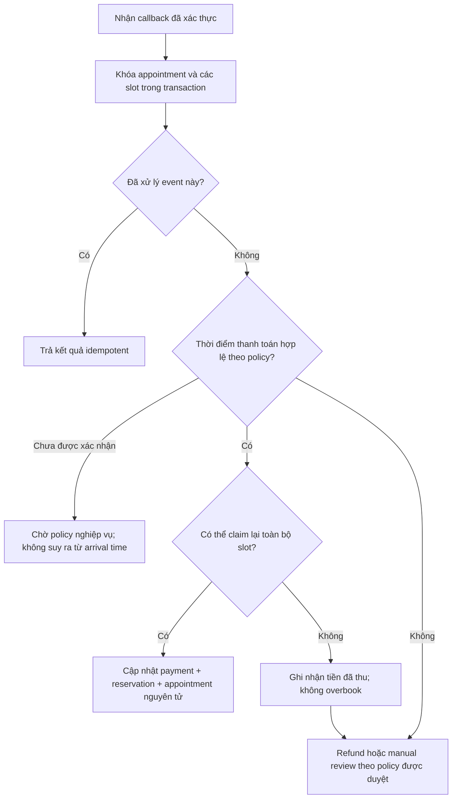

# Dự thảo chính sách nghiệp vụ đặt khám NovaCare

> **Trạng thái: DỰ THẢO — CHƯA ĐƯỢC PHÊ DUYỆT.** Đây là tài liệu để người phụ trách dự án xem xét. Các quy tắc đề xuất không có hiệu lực cho đến khi được xác nhận. Tài liệu này không tuyên bố đã triển khai hoặc kiểm thử.

## Cách đọc

- **[Đã xác minh trong source]**: hành vi thấy được trong snapshot mã nguồn đã khảo sát; không đồng nghĩa đã xác minh môi trường production.
- **[Đề xuất thiết kế]**: phương án được khuyến nghị để thống nhất hành vi và bảo vệ capacity.
- **[Chưa có quyết định nghiệp vụ]**: cần người phụ trách dự án/nghiệp vụ/thanh toán xác nhận.

`AppointmentStatus` mô tả trạng thái lịch hẹn; `PaymentStatus` mô tả giao dịch; `SlotStatus` mô tả tình trạng khung giờ. Ba khái niệm này không tự thay thế trạng thái vòng đời giữ suất (`Reservation Lifecycle`) đề xuất trong tài liệu.

**Căn cứ source:** [schema.prisma](./nova-care-backend/prisma/schema.prisma#L26), [appointments.service.ts](./nova-care-backend/src/modules/appointments/appointments.service.ts#L26), [payments.service.ts](./nova-care-backend/src/modules/payments/payments.service.ts#L96), [hospital-admin.service.ts](./nova-care-backend/src/modules/hospital-admin/hospital-admin.service.ts#L527), [admin-appointments.service.ts](./nova-care-backend/src/modules/admin/admin-appointments.service.ts#L427), [appointment-slots.service.ts](./nova-care-backend/src/modules/appointment-slots/appointment-slots.service.ts#L263).

## Tóm tắt D1–D10

| ID | Chủ đề | Hướng đề xuất để xem xét | Tình trạng |
|---|---|---|---|
| D1 | Trạng thái chiếm capacity | Tách vòng đời reservation khỏi appointment/payment; chỉ reservation đang giữ/đã cấp suất mới chiếm chỗ. | Chờ phê duyệt |
| D2 | Thời hạn giữ suất | Hold bắt đầu khi tạo booking commit; thời hạn hiện tại 15 phút chỉ tiếp tục nếu được duyệt; dùng một quy tắc thời điểm hết hạn thống nhất. | Chờ phê duyệt |
| D3 | Hủy và giải phóng | Một transition hủy thành công giải phóng toàn bộ slot đúng một lần; refund là luồng riêng. | Chờ phê duyệt |
| D4 | Đổi lịch | Chỉ đổi khi toàn bộ slot mới giữ được; nếu không, giữ nguyên lịch cũ. | Chờ phê duyệt |
| D5 | Dịch vụ nhiều slot | Một lịch chiếm một tập slot liên tiếp; giữ, đổi và giải phóng cả tập nguyên tử. | Chờ phê duyệt |
| D6 | Thanh toán muộn | Không xác nhận một lịch nếu không còn cấp được slot; dùng policy timestamp/provider và quy trình bù trừ đã duyệt. | Chờ phê duyệt |
| D7 | Refund/manual review | Tách trạng thái tiền khỏi trạng thái lịch; refund có thể idempotent hoặc chuyển người xử lý. | Chờ phê duyệt |
| D8 | Lịch trùng cùng bệnh nhân | Cân nhắc chặn overlap của các reservation đang hoạt động theo toàn bộ khoảng khám. | Chờ phê duyệt |
| D9 | Giảm capacity/khóa slot | Không nhận booking mới khi slot bị khóa; không tự làm mất chỗ đã cấp; giảm capacity dưới occupancy cần bị từ chối hoặc có quy trình ngoại lệ được duyệt. | Chờ phê duyệt |
| D10 | Hoàn tất/no-show và occupancy | Cần quyết định counter là chỗ đang chiếm hay số liệu lịch sử; không dùng một giá trị cho cả hai mục đích. | Chờ phê duyệt |

---

## D1. Trạng thái nào chiếm capacity?

- **[Đã xác minh trong source]** `AppointmentStatus` gồm `PENDING`, `AWAITING_PAYMENT`, `CONFIRMED`, `PAID`, `COMPLETED`, `CANCELLED`, `EXPIRED`, `NO_SHOW`, `FAILED`, `REFUNDED`. `create()` đặt lịch ở `AWAITING_PAYMENT` và tăng `bookedCount`; confirm/paid đổi trạng thái nhưng không đổi count. Các luồng hủy/hết hạn xử lý count khác nhau. Không thấy một quy tắc occupancy duy nhất áp dụng cho mọi writer.
- **[Đề xuất thiết kế]** Dùng vòng đời giữ suất riêng: `HELD` (đang giữ, có hạn), `BOOKED` (đã được xác nhận và vẫn chiếm chỗ), `RELEASED` (không còn chiếm chỗ), và `CONSUMED` (lượt khám đã được sử dụng, không tính là chỗ tương lai). `AppointmentStatus` và `PaymentStatus` tiếp tục phản ánh nghiệp vụ tương ứng, không tự quyết định counter.
- **Ví dụ:** một lịch `AWAITING_PAYMENT` đã giữ slot là `HELD`; sau khi thanh toán hợp lệ, appointment có thể thành `PAID`, reservation thành `BOOKED`, nhưng tổng số chỗ bị chiếm vẫn là một.
- **Hậu quả nếu không áp dụng:** cùng trạng thái appointment có thể được tính khác nhau bởi query create, cancel, expiry và admin; counter và số lịch đang thực sự giữ chỗ có thể lệch.
- **[Chưa có quyết định nghiệp vụ]** Cần duyệt mapping cho từng trạng thái trong bảng phía dưới, đặc biệt `PENDING`, `NO_SHOW`, `FAILED`, `REFUNDED`, và thời điểm `COMPLETED` ngừng chiếm capacity.

## D2. Bắt đầu và kết thúc giữ chỗ

- **[Đã xác minh trong source]** Create tạo `AWAITING_PAYMENT`, đặt `expiresAt` bằng thời điểm hiện tại cộng 15 phút và tăng count trong transaction. Expiry query hiện dùng `expiresAt < now`; chưa xác minh có worker/scheduler production tự gọi sweep.
- **[Đề xuất thiết kế]** Nếu giữ thời hạn, bắt đầu tính từ lúc giao dịch tạo hold commit thành công. Quy ước thời điểm hết hạn duy nhất, khuyến nghị hold hết hiệu lực khi `now >= expiresAt`, và payment/expiry cùng kiểm tra điều kiện này. Giữ 15 phút chỉ là giá trị hiện tại cần xem xét, không mặc nhiên là chính sách đã duyệt.
- **Ví dụ:** hold tạo lúc 10:00, TTL được duyệt là 15 phút; thời điểm 10:15 trở đi không được coi là hold còn hiệu lực theo quy ước đề xuất.
- **Hậu quả nếu không áp dụng:** client, callback và worker có thể hiểu khác nhau ở thời điểm biên; suất có thể bị giữ quá lâu hoặc giải phóng trước khi payment được chấp nhận.
- **[Chưa có quyết định nghiệp vụ]** Duyệt TTL, thời điểm bắt đầu, grace period, việc gia hạn, payment `PROCESSING` có ảnh hưởng thời hạn không và cách chạy expiry.

## D3. Hủy lịch và giải phóng slot

- **[Đã xác minh trong source]** Patient cancel cho phép `PENDING`, `AWAITING_PAYMENT`, `CONFIRMED`, `PAID`; với trạng thái ngoài `AWAITING_PAYMENT` yêu cầu hủy ít nhất hai giờ trước giờ khám và từ chối khi encounter đã được tiếp nhận. Nhánh này giảm các slot junction nếu có. Hospital-admin yêu cầu lý do và có CAS trạng thái nhưng giảm slot chính; admin generic status update có thể đổi status mà không giải phóng count.
- **[Đề xuất thiết kế]** Chỉ transition từ reservation đang chiếm chỗ sang `RELEASED` mới giảm count, và giảm đúng một lần cho mọi slot thuộc lịch trong cùng transaction. Hủy lặp trả trạng thái cuối/idempotent. Quy trình refund, nếu có, chạy riêng sau khi trạng thái booking đã nhất quán.
- **Ví dụ:** người bệnh hủy lịch dịch vụ 45 phút chiếm ba slot. Khi hủy hợp lệ, cả ba slot được giải phóng cùng lúc; retry cùng yêu cầu không giảm count lần thứ hai.
- **Hậu quả nếu không áp dụng:** double release, mất cập nhật đồng thời hoặc lệch count giữa các kênh; slot phụ của lịch nhiều slot có thể vẫn bị giữ.
- **[Chưa có quyết định nghiệp vụ]** Duyệt deadline hai giờ, ngoại lệ lịch chưa thanh toán, quyền override của cơ sở, yêu cầu lý do, điều kiện encounter, phí hủy và refund.

## D4. Đổi lịch

- **[Đã xác minh trong source]** Chỉ lịch `CONFIRMED`/`PAID` được đổi. Slot mới được kiểm tra ngoài transaction; trong transaction giảm count slot cũ, tăng slot mới và đổi `Appointment.slotId`. Không thấy cập nhật `AppointmentSlotBooking`, vì vậy lịch nhiều slot có thể còn junction cũ.
- **[Đề xuất thiết kế]** Giữ reservation cũ cho đến khi toàn bộ slot mới đã được khóa và claim thành công. Thay membership/counter cũ-mới trong một transaction. Nếu một slot đích không còn sức chứa, rollback toàn bộ và giữ nguyên lịch cũ.
- **Ví dụ:** lịch cũ chiếm 09:00–09:30; lịch mới yêu cầu 10:00–10:30. Chỉ khi cả hai slot của cửa sổ mới còn chỗ thì lịch được chuyển; nếu một slot đã đầy, người bệnh vẫn giữ lịch 09:00.
- **Hậu quả nếu không áp dụng:** có thể overbook slot đích, mất lịch cũ, hoặc `slotId` không khớp danh sách slot được chiếm.
- **[Chưa có quyết định nghiệp vụ]** Lịch đã trả tiền có giữ nguyên paid state không; đổi dịch vụ/thời lượng/phòng có cho phép không; thay đổi giá/refund; giới hạn thời gian đổi.

## D5. Dịch vụ sử dụng nhiều slot liên tiếp

- **[Đã xác minh trong source]** Create suy ra thời lượng dịch vụ (mặc định 30 phút) trên lưới slot 15 phút, khóa/cập nhật nhiều slot và tạo `AppointmentSlotBooking` cho từng slot trong transaction. Patient cancel tìm junction; expiry và hospital-admin cancel chỉ giảm slot chính; reschedule cũng chỉ đổi slot chính và không đổi junction.
- **[Đề xuất thiết kế]** Một appointment/reservation là một đơn vị nghiệp vụ chiếm toàn bộ tập slot liên tiếp. Create, reschedule, cancel và expiry phải cập nhật đủ tập slot nguyên tử; bất kỳ slot nào không hợp lệ thì không giữ một phần.
- **Ví dụ:** dịch vụ cần ba slot liên tiếp. Nếu slot thứ ba đã đầy, lịch không được giữ hai slot đầu.
- **Hậu quả nếu không áp dụng:** slot phụ có thể bị giữ sau hủy/hết hạn, junction và lịch chính có thể trỏ tới các cửa sổ khác nhau, hoặc dịch vụ bị đặt thiếu thời lượng.
- **[Chưa có quyết định nghiệp vụ]** Duyệt granularity 15 phút, quy tắc làm tròn duration, sức chứa có thể khác giữa các slot, xử lý khoảng trống trong cửa sổ và ràng buộc clinic room/service.

## D6. Thanh toán đến muộn và callback lặp

- **[Đã xác minh trong source]** VNPay IPN kiểm tra chữ ký; nếu thành công, cập nhật payment thành `PAID` và appointment thành `PAID` trong transaction. Đoạn xử lý không kiểm tra appointment state/expiry trước khi cập nhật. Kiểm tra payment đã `PAID` nằm trước transaction. Endpoint `simulate-success` cũng đặt trạng thái paid mà không gate theo expiry trong đoạn đã khảo sát.
- **[Đề xuất thiết kế]** Callback phải idempotent theo định danh giao dịch/sự kiện của provider. Trong transaction cần đọc lại trạng thái appointment, reservation, thời hạn và toàn bộ slot. Tiền được provider xác nhận không tự động chứng minh còn suất. Nếu cần cấp lại sau expiry, phải claim lại toàn bộ slot thành công; nếu slot đã được cấp cho lịch khác thì không overbook và chuyển sang quy trình refund/review theo quyết định được duyệt.
- **Ví dụ:** hold hết hạn, slot được người khác đặt, sau đó callback thanh toán thành công đến. Lịch thứ nhất không được đánh dấu như một booking đã có slot nếu không thể cấp lại; khoản thu cần được xử lý theo policy đã duyệt.
- **Hậu quả nếu không áp dụng:** appointment `PAID` có thể không có reservation thực tế, callback trùng có thể tạo transition/thông báo lặp, hoặc hai người được hứa cùng một suất.
- **[Chưa có quyết định nghiệp vụ]** Duyệt timestamp đáng tin dùng (settlement time hay callback arrival), grace period, có thử re-claim không, ưu tiên khi thanh toán trước hạn nhưng callback trễ, và response IPN khi đã thu tiền nhưng không cấp được suất.

## D7. Refund hoặc manual review

- **[Đã xác minh trong source]** Enum payment và appointment có `REFUNDED`, nhưng trong luồng payment/IPN đã đối chiếu chưa thấy workflow refund end-to-end. Patient cancel lịch đã trả tiền chỉ thông báo liên hệ cơ sở để kiểm tra hoàn tiền.
- **[Đề xuất thiết kế]** Tách trạng thái refund khỏi trạng thái cấp suất. Refund không tự giải phóng hoặc cấp lại slot. Dùng thao tác provider idempotent và audit; nếu chưa thể tự động hoàn tiền an toàn thì tạo case manual review có người chịu trách nhiệm. Không giữ transaction DB mở trong lúc gọi payment provider.
- **Ví dụ:** provider báo đã thu tiền nhưng hold đã hết hạn và slot đã được đặt lại. Booking không chiếm thêm slot; khoản tiền được ghi nhận và chuyển sang refund/review.
- **Hậu quả nếu không áp dụng:** tiền đã thu có thể không gắn với kết quả lịch rõ ràng; retry refund có thể hoàn hai lần hoặc không có ai theo dõi.
- **[Chưa có quyết định nghiệp vụ]** Chọn auto-refund hay manual review, full/partial refund, SLA, quyền duyệt, trạng thái appointment tương ứng và cách xử lý lỗi từ provider.

## D8. Lịch trùng của cùng bệnh nhân

- **[Đã xác minh trong source]** Create/reschedule truy vấn overlap theo `patientProfileId`, nhưng không khóa profile để serialize hai lệnh trên slot khác nhau. Query dựa trên appointment/primary slot interval và loại trừ `CANCELLED`, `EXPIRED`, `COMPLETED`; các status khác có thể tiếp tục được xem là overlap.
- **[Đề xuất thiết kế]** Nếu nghiệp vụ muốn ngăn lịch trùng, xác định rõ đối tượng so khớp (patient profile hay user) và kiểm tra toàn bộ khoảng khám/membership. Chỉ lịch đang giữ hoặc đã cấp suất mới chặn lịch mới; thao tác đồng thời cần được serialize theo đối tượng được chọn.
- **Ví dụ:** hai thiết bị gửi cùng lúc hai booking cho cùng hồ sơ bệnh nhân, ở hai slot ID khác nhau nhưng giờ khám giao nhau. Theo đề xuất hard-block, tối đa một booking được chấp nhận.
- **Hậu quả nếu không áp dụng:** query overlap đơn lẻ có thể cho cả hai request đồng thời đi qua; slot chính có thể không phản ánh đủ thời lượng dịch vụ nhiều slot.
- **[Chưa có quyết định nghiệp vụ]** Chặn theo patient profile hay theo user; lịch của người phụ thuộc dùng chung tài khoản có ảnh hưởng nhau không; trạng thái hold có chặn không; có quyền override không.

## D9. Giảm capacity, khóa hoặc vô hiệu slot

- **[Đã xác minh trong source]** `updateSlot()` kiểm tra capacity mới với `bookedCount` trước khi update nhưng không khóa slot cùng transaction; có thể cập nhật `isAvailable`/`isActive`. `SlotStatusService` có thể trả `CONFLICTED` khi slot inactive còn booking, nhưng cập nhật slot không luôn gọi resolver. API đọc availability lọc boolean/active/count; create còn kiểm tra `SlotStatus`.
- **[Đề xuất thiết kế]** Slot update phải khóa hàng và so với occupancy hiện hành. Giảm capacity dưới số reservation đang chiếm được đề xuất từ chối. Khóa/disable ngăn nhận booking mới nhưng không tự hủy các lịch đã giữ; nếu slot có reservation thì đưa vào trạng thái xung đột để nhân viên xử lý. Tất cả API đọc/ghi phải dùng cùng quy tắc khả dụng.
- **Ví dụ:** slot capacity 3, đang có 2 reservation. Đổi capacity xuống 1 bị từ chối; block slot có thể ngăn booking mới nhưng không âm thầm xóa hai reservation hiện tại.
- **Hậu quả nếu không áp dụng:** capacity có thể thấp hơn occupancy; API có thể hiển thị slot nhưng create từ chối, hoặc ngược lại; lịch hiện có bị ảnh hưởng không có quy trình thông báo.
- **[Chưa có quyết định nghiệp vụ]** Có cho phép giảm dưới occupancy bằng ngoại lệ không; block slot đang có người đặt được xử lý/ưu tiên ra sao; ai được thao tác và có cần chuyển lịch/refund không.

## D10. Hoàn tất, no-show và ý nghĩa số đếm

- **[Đã xác minh trong source]** `complete()` đặt appointment `COMPLETED` nhưng không giảm `bookedCount`; các luồng đặt `NO_SHOW` cũng không giảm count trong đoạn đối chiếu, và có luồng cho phép khôi phục `NO_SHOW` sang `PAID`/`CONFIRMED`. Query overlap không loại `NO_SHOW`.
- **[Đề xuất thiết kế]** Chọn một nghĩa cho `bookedCount`. Nếu là occupancy hiện tại, khi lượt khám kết thúc hoặc no-show đủ điều kiện, chuyển reservation sang trạng thái terminal không chiếm capacity; giữ lịch sử qua appointment/status history hoặc metric riêng. Không dùng counter này đồng thời làm tổng số lượt đặt trong lịch sử.
- **Ví dụ:** sau khi lượt 09:00 kết thúc, slot không còn là chỗ tương lai cần giữ; bộ đếm occupancy có thể giảm, trong khi appointment và lịch sử vẫn lưu trạng thái `COMPLETED`.
- **Hậu quả nếu không áp dụng:** slot có thể mãi trông đầy nếu counter là occupancy; hoặc số chỗ tương lai bị tính sai nếu counter là số lịch tích lũy.
- **[Chưa có quyết định nghiệp vụ]** Appointment ngừng chiếm lúc nào; no-show có giữ chỗ đến hết slot/grace không; hiện có báo cáo nào đang diễn giải `bookedCount` như số lịch lịch sử không.

---

## Bảng trạng thái Appointment → Reservation Lifecycle (dự thảo)

Các lifecycle dưới đây là **nhãn khái niệm đề xuất**, chưa phải enum đã thêm vào hệ thống. “Chiếm chỗ?” trong cột đề xuất chỉ có hiệu lực sau khi được duyệt.

| AppointmentStatus | Hành vi hiện xác minh | Reservation Lifecycle đề xuất | Chiếm capacity theo đề xuất | Ghi chú/chờ duyệt |
|---|---|---|---|---|
| `PENDING` | Có thể thanh toán/hủy và được query overlap; create chính không đặt trạng thái này. | `HELD` nếu đã claim slot; nếu chỉ là draft thì không có reservation đang chiếm. | Tùy việc đã claim hay chưa. | Xác minh legacy/nguồn tạo `PENDING`. |
| `AWAITING_PAYMENT` | Create tăng count; có `expiresAt`. | `HELD` | Có đến khi hết hạn hoặc kết thúc theo policy. | Duyệt TTL, equality và payment `PROCESSING`. |
| `CONFIRMED` | Confirm chỉ đổi status; không đổi count. | `BOOKED` | Có | Xác định confirm có bắt buộc payment không. |
| `PAID` | IPN/simulate đổi status; không đổi count. | `BOOKED` nếu reservation còn hợp lệ. | Có khi đã cấp chỗ; không chỉ dựa vào paid status. | Late payment cần re-claim/refund policy. |
| `COMPLETED` | Đổi status; count không giảm trong luồng đã đọc. | `CONSUMED` | Không còn occupancy tương lai (đề xuất). | Duyệt thời điểm kết thúc/giải phóng count. |
| `CANCELLED` | Hủy patient release junction; các kênh khác không đồng nhất. | `RELEASED` | Không | Chỉ khi transition hủy hợp lệ thắng CAS. |
| `EXPIRED` | Expiry giảm slot chính trong sweep. | `RELEASED` | Không | Release mọi slot đúng một lần. |
| `NO_SHOW` | Admin ghi nhận; count không giảm trong đoạn đã đọc; có thể revert. | `BOOKED` đến hết slot/grace rồi `CONSUMED` hoặc `RELEASED` | Chưa chốt | Cần chốt no-show grace và nghiệp vụ lịch sử. |
| `FAILED` | Có enum; không thấy transition occupancy thống nhất. | `RELEASED` chỉ khi appointment/reservation thực sự đóng. | Chưa chốt đến khi transition | Payment FAILED không tự đồng nghĩa appointment FAILED. |
| `REFUNDED` | Enum payment/appointment tồn tại; không thấy refund flow hoàn chỉnh. | Không suy ra lifecycle; thường cần trạng thái lịch riêng `RELEASED` nếu lịch bị hủy. | Chưa chốt | Refund là kết quả tài chính, không tự đồng nghĩa release. |

### Mapping PaymentStatus và SlotStatus để tránh nhầm khái niệm

| Enum | Giá trị hiện có | Quan hệ với reservation đề xuất |
|---|---|---|
| `PaymentStatus` | `PENDING`, `PROCESSING`, `PAID`, `FAILED`, `REFUNDED`, `EXPIRED` | Mô tả payment attempt/settlement. Không tự claim hoặc release capacity. `FAILED` có thể vẫn còn hold đến expiry tùy policy; `PAID` không đảm bảo slot vẫn cấp được. |
| `SlotStatus` | `AVAILABLE`, `FULL`, `BLOCKED`, `CONFLICTED`, `CANCELLED` | Mô tả khả năng nhận booking của slot. `FULL` ngăn claim; `BLOCKED`/`CANCELLED` ngăn claim mới; `CONFLICTED` cần xử lý reservation hiện có. Slot status không thay lifecycle của appointment. |

## Luồng xử lý đề xuất

> Các sơ đồ dưới đây là thiết kế, không phải mô tả rằng luồng đã được triển khai.

### 1. Đặt lịch và giữ suất

```mermaid
sequenceDiagram
  actor P as Bệnh nhân (Web/Android)
  participant API as Booking API
  participant S as BookingCommandService (đề xuất)
  participant DB as PostgreSQL
  P->>API: POST booking + idempotency key
  API->>S: createBooking
  S->>DB: Transaction; khóa slot/cửa sổ theo thứ tự
  S->>DB: Đọc lại capacity, status, overlap
  alt Tất cả slot hợp lệ
    S->>DB: Tạo appointment + HELD + membership + count + history
    S->>DB: Ghi outbox event (nếu được duyệt)
    DB-->>S: Commit
    S-->>P: Booking/hold + expiresAt
  else Thiếu slot hoặc xung đột
    S->>DB: Rollback toàn bộ
    S-->>P: Conflict; không có partial hold
  end
```

### 2. Thanh toán thành công đúng hạn

```mermaid
sequenceDiagram
  participant Provider as Payment Provider
  participant API as IPN Adapter
  participant S as BookingCommandService (đề xuất)
  participant DB as PostgreSQL
  Provider->>API: Callback đã ký
  API->>API: Xác minh signature/reference/amount theo provider
  API->>S: applyPaymentEvent (event ID)
  S->>DB: Transaction; khóa appointment rồi các slot
  S->>DB: Kiểm tra hold còn hiệu lực và event chưa xử lý
  S->>DB: Payment PAID + reservation BOOKED + history/outbox
  DB-->>S: Commit
  API-->>Provider: ACK theo contract đã duyệt
```

### 3. Hết hạn giữ suất

```mermaid
sequenceDiagram
  participant W as Expiry Sweeper/Worker (đề xuất)
  participant S as BookingCommandService
  participant DB as PostgreSQL
  W->>DB: Lấy batch hold đến hạn
  W->>S: expireReservation(id)
  S->>DB: Transaction; khóa appointment và mọi membership slot
  S->>DB: Đọc lại expiry/payment/status
  alt Hold vẫn quá hạn và chưa được xác nhận
    S->>DB: CAS HELD->RELEASED; decrement mọi slot; history/outbox
    DB-->>S: Commit
  else Payment/transition đã thắng
    S->>DB: No-op idempotent
  end
```

### 4. Thanh toán đến muộn



### 5. Hủy lịch

```mermaid
sequenceDiagram
  actor A as Bệnh nhân/Admin/Cơ sở
  participant API as Kênh API
  participant S as BookingCommandService (đề xuất)
  participant DB as PostgreSQL
  A->>API: Cancel + lý do/actor context
  API->>S: cancelBooking
  S->>DB: Transaction; khóa appointment rồi toàn bộ slot membership
  S->>DB: Kiểm tra quyền, trạng thái, điều kiện hủy
  alt Transition hủy hợp lệ và chưa release
    S->>DB: CAS trạng thái; release tất cả slot; history/outbox
    DB-->>S: Commit
    S-->>A: Kết quả hủy
  else Đã xử lý hoặc không đủ điều kiện
    S-->>A: Trả trạng thái cuối hoặc business conflict
  end
```

### 6. Đổi lịch nhiều slot

```mermaid
sequenceDiagram
  actor P as Bệnh nhân
  participant S as BookingCommandService (đề xuất)
  participant DB as PostgreSQL
  P->>S: reschedule(appointment, target window)
  S->>DB: Transaction; khóa appointment
  S->>DB: Lấy tập slot cũ; tính tập slot mới
  S->>DB: Khóa hợp old/new theo thứ tự toàn cục
  S->>DB: Kiểm tra capacity/status cho slot mới
  alt Toàn bộ slot mới claim được
    S->>DB: Cập nhật hiệu old\new và new\old
    S->>DB: Cập nhật junction + primary slot + history
    DB-->>S: Commit
    S-->>P: Lịch đã đổi
  else Có slot mới không hợp lệ
    S->>DB: Rollback; giữ nguyên tập slot cũ
    S-->>P: Conflict; lịch cũ không đổi
  end
```

## Câu hỏi ngắn để phê duyệt

Vui lòng trả lời theo mã để chốt bản chính sách:

1. **D1:** Có duyệt `HELD`/`BOOKED` là chiếm capacity, `RELEASED`/`CONSUMED` không chiếm không? `NO_SHOW` và `COMPLETED` giải phóng lúc nào?
2. **D2:** Hold có tiếp tục là 15 phút không? Tính từ lúc tạo booking hay lúc bắt đầu payment? Hết hạn tại `now >= expiresAt` và có grace/gia hạn không?
3. **D3:** Deadline hủy bệnh nhân có tiếp tục là 2 giờ? Những vai trò nào được override và hủy lịch đã tiếp nhận ra sao?
4. **D4:** Đổi lịch đã thanh toán có giữ `PAID` không? Nếu giá/dịch vụ đổi thì hoàn/thu chênh lệch thế nào?
5. **D5:** Duyệt một reservation giữ toàn bộ cửa sổ slot 15 phút nguyên tử? Nếu không đủ slot thì báo conflict hay tìm cửa sổ khác?
6. **D6:** Khi callback đến muộn, dùng timestamp settlement của provider hay thời điểm callback? Có re-claim khi slot còn trống không?
7. **D7:** Nếu đã thu tiền nhưng không còn slot, chọn auto-refund hay manual review? Ai chịu trách nhiệm và thời hạn xử lý?
8. **D8:** Chặn lịch trùng theo patient profile hay theo user? Lịch `AWAITING_PAYMENT` có chặn lịch khác không?
9. **D9:** Có cho giảm capacity dưới số reservation đang giữ hoặc block slot đang có lịch không? Nếu có, quy trình chuyển/hủy/ưu tiên thế nào?
10. **D10:** `bookedCount` là occupancy hiện tại hay số lịch tích lũy? No-show giữ chỗ đến thời điểm nào?

## Tài liệu liên quan

[BUSINESS_RULES_DECISIONS.md](./BUSINESS_RULES_DECISIONS.md), [PROPOSED_ARCHITECTURE.md](./PROPOSED_ARCHITECTURE.md), [CONFLICT_RESOLUTION_DESIGN.md](./CONFLICT_RESOLUTION_DESIGN.md), [TECHNOLOGY_COMPARISON.md](./TECHNOLOGY_COMPARISON.md), [EXPERIMENTAL_TEST_PLAN.md](./EXPERIMENTAL_TEST_PLAN.md), [RESEARCH_CONTRIBUTIONS.md](./RESEARCH_CONTRIBUTIONS.md).
