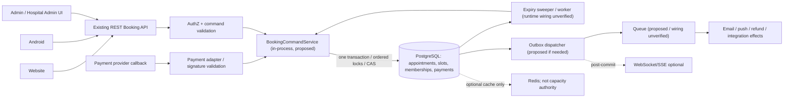

# Rà soát chính sách nghiệp vụ tổng hợp D1–D10 — NovaCare

**Trạng thái tài liệu:** phân tích và policy candidate để xin phê duyệt; chưa phải chính sách có hiệu lực.
**Giới hạn công việc:** chỉ đọc tài liệu và source; không sửa code/schema/migration, không truy cập hoặc thay đổi database, không benchmark.
**Source snapshot:** branch `develop`, HEAD `585dcd8db9d612b4d35d758fe7d285b4762298b6` cộng các thay đổi chưa commit được ghi tại baseline. Không giả định source snapshot trùng với production.
**Kết luận ngắn:** vấn đề kỹ thuật và các điểm writer rời rạc đã được nhận diện đủ để chốt hướng kiến trúc và chuẩn bị phê duyệt policy. Chưa đủ cơ sở để chốt truth table, schema/backfill, correctness oracle hoặc bắt đầu thay đổi booking behavior vì các quyết định nghiệp vụ và một số sự kiện runtime/provider còn chưa xác minh.

## 1. Executive Summary

### Đã xác minh trong source snapshot

- NovaCare dùng NestJS/Prisma và PostgreSQL cho appointment/slot/payment. Có web, Android và các endpoint quản trị; mọi đường triển khai và số backend instance thực tế chưa xác minh.
- `AppointmentStatus`, `PaymentStatus`, `SlotStatus`, `AppointmentSlot.bookedCount/capacity/version`, primary `Appointment.slotId`, `expiresAt`, `AppointmentSlotBooking` và unique nullable `Appointment.idempotencyKey` hiện hữu trong schema.
- Create thông thường có transaction và row locks, nhưng AI Pre-exam, cancel, reschedule, expiry, payment callback, refund, admin và slot/schedule writers không cùng thực thi một lifecycle/locking protocol.
- Một số writer chỉ thay đổi primary slot; membership multi-slot không được duy trì đồng nhất. Raw junction count không phải occupancy truth.
- Source có QueueService và expiry processor class nhưng chưa tìm thấy cấu hình Bull queue/processor/scheduler được wire để thực thi expiry. Runtime production, số replica và provider behavior chưa xác minh.
- Không có kết quả data inventory hay performance benchmark trong các tài liệu đầu vào.

### Policy candidate tổng hợp

1. PostgreSQL là authority về quyền chiếm slot; transaction là ranh giới atomicity.
2. `bookedCount` là projection số reservation đang chiếm capacity, không phải lịch sử. Lịch sử được giữ độc lập.
3. Appointment lifecycle, payment lifecycle và occupancy lifecycle là các khái niệm riêng. Payment callback không tự tạo hoặc giải phóng occupancy.
4. Một reservation multi-slot được claim, reschedule, release hoặc consume nguyên tử trên mọi membership.
5. Mọi mutation ảnh hưởng occupancy đi qua một Booking Command path nội bộ. Dùng ordered row locks và conditional/CAS guards; Redis lock không phải điều kiện correctness mặc định.
6. Cancellation, expiry, payment success/late payment, completion/no-show và refund phải cạnh tranh bằng transition transaction/idempotent; chỉ transition thắng mới được thay đổi occupancy.
7. Không đánh dấu nội dung nào là `APPROVED`. Cần owner phê duyệt business truth table và các ngoại lệ trước khi thiết kế data migration/cutover.

### Quyết định cần chú ý trước tiên

- Chốt nghĩa `bookedCount`, lifecycle trạng thái nào chiếm capacity, và mốc `CONSUMED` (D1/D10).
- Chọn TTL 15/30 phút hay policy khác; mốc bắt đầu, đúng thời điểm hết hạn, grace/renewal và `PROCESSING` (D2).
- Chốt thanh toán đến muộn, provider timestamp/ACK, re-claim, refund/manual review (D6/D7).
- Chốt granularity và cửa sổ multi-slot; lịch trùng bệnh nhân; thay đổi capacity/slot đã đặt (D5/D8/D9).
- Pin source/deployment snapshot và xác minh worker/provider/runtime; không thể kết luận production behavior chỉ từ repo.

## 2. Phạm vi, nguồn và giới hạn xác minh

### Tài liệu đầu vào đã tìm thấy và đối chiếu

1. [BASELINE_AND_OCCUPANCY_INVENTORY.md](./BASELINE_AND_OCCUPANCY_INVENTORY.md)
2. [BUSINESS_RULES_REVIEW_D1_D10.md](./BUSINESS_RULES_REVIEW_D1_D10.md)
3. [D1_OCCUPANCY_POLICY_ANALYSIS.md](./D1_OCCUPANCY_POLICY_ANALYSIS.md)
4. [BUSINESS_RULES_DECISIONS.md](./BUSINESS_RULES_DECISIONS.md)
5. [APPROVED_BOOKING_POLICY_DRAFT.md](./APPROVED_BOOKING_POLICY_DRAFT.md)
6. [IMPLEMENTATION_READINESS.md](./IMPLEMENTATION_READINESS.md)
7. [PROPOSED_ARCHITECTURE.md](./PROPOSED_ARCHITECTURE.md)
8. [CONFLICT_RESOLUTION_DESIGN.md](./CONFLICT_RESOLUTION_DESIGN.md)
9. [EXPERIMENTAL_TEST_PLAN.md](./EXPERIMENTAL_TEST_PLAN.md)
10. [RESEARCH_CONTRIBUTIONS.md](./RESEARCH_CONTRIBUTIONS.md)
11. [TECHNOLOGY_COMPARISON.md](./TECHNOLOGY_COMPARISON.md)

Tất cả tài liệu được yêu cầu đều tìm thấy. File liên quan `D2_HOLD_TTL_POLICY_ANALYSIS.md` chưa tồn tại tại thời điểm kiểm kê; D2 được tổng hợp từ các tài liệu đầu vào và source thay vì xem một phân tích D2 riêng là bằng chứng.

### Source chính đã đối chiếu

- Enum/model: [schema.prisma](./nova-care-backend/prisma/schema.prisma#L26), [Appointment/AppointmentSlot](./nova-care-backend/prisma/schema.prisma#L298), [AppointmentSlotBooking/PaymentTransaction](./nova-care-backend/prisma/schema.prisma#L375).
- Create/cancel/reschedule/expiry/complete: [AppointmentsService.create](./nova-care-backend/src/modules/appointments/appointments.service.ts#L26), [cancel](./nova-care-backend/src/modules/appointments/appointments.service.ts#L546), [reschedule](./nova-care-backend/src/modules/appointments/appointments.service.ts#L662), [expiry](./nova-care-backend/src/modules/appointments/appointments.service.ts#L770), [complete](./nova-care-backend/src/modules/appointments/appointments.service.ts#L844).
- AI Pre-exam create: [PreExamService.createAppointmentFromPreExam](./nova-care-backend/src/modules/pre-exam/pre-exam.service.ts#L201).
- Payment IPN/refund: [PaymentsService.handleIpn](./nova-care-backend/src/modules/payments/payments.service.ts#L96), [AdminPaymentsService.refund](./nova-care-backend/src/modules/admin/admin-payments.service.ts#L75).
- Admin/hospital-admin status: [AdminAppointmentsService.updateStatus](./nova-care-backend/src/modules/admin/admin-appointments.service.ts#L427), [HospitalAdminService.updateAppointmentStatus](./nova-care-backend/src/modules/hospital-admin/hospital-admin.service.ts#L527).
- Slot/capacity/schedule: [AppointmentSlotsService.updateSlot](./nova-care-backend/src/modules/appointment-slots/appointment-slots.service.ts#L263), [ScheduleReconciliationService](./nova-care-backend/src/modules/schedules/schedule-reconciliation.service.ts#L15).
- Queue/expiry: [QueueModule](./nova-care-backend/src/queue/queue.module.ts#L1), [QueueService](./nova-care-backend/src/queue/queue.service.ts#L1), [ExpireAppointmentsProcessor](./nova-care-backend/src/queue/expire-appointments.processor.ts#L1), [appointments controller expiry endpoint](./nova-care-backend/src/modules/appointments/appointments.controller.ts#L168).

### Giới hạn

- Branch `develop`, HEAD và modified/untracked files được ghi trong baseline; admin/hospital-admin source đang modified. Các bảng dưới đây nói về working tree đã kiểm tra và chỉ nêu khác biệt HEAD khi tài liệu baseline xác nhận, không đại diện production.
- Không truy cập DB, provider dashboard, deployment manifests/runtime, production logs hoặc scheduler bên ngoài repo. Không biết data drift, migration đã áp dụng, số API instances, VNPay callback contract đang dùng hay expiry job có chạy ngoài repo không.
- `VERIFIED` trong tài liệu này có nghĩa là hiện trạng/hành vi được xác minh trong source snapshot, không có nghĩa business policy đã duyệt.

## 3. Baseline nghiệp vụ D1–D10

| D | Hiện trạng đã xác minh trong source snapshot | Rủi ro/giới hạn chính |
|---|---|---|
| **D1 Occupancy** | Create thường tăng `bookedCount`; status/payment/admin/expiry writers cập nhật không thống nhất. `AppointmentSlotBooking` được tạo bởi create thường, nhưng cancel/expiry giữ lại rows. | Không có status-to-occupancy truth table; không thể dùng status, counter hoặc junction row count riêng lẻ làm oracle. |
| **D2 TTL/expiry** | Create thường gán 15 phút; AI Pre-exam gán 30 phút. Cả hai expiry implementations dùng `expiresAt < now`. Có endpoint sweep; processor class và `addExpireJob()` tồn tại nhưng không thấy caller/wiring hiệu lực. | TTL/boundary khác nhau giữa các luồng; không rõ expiry thực sự được kích hoạt trong runtime; expiry không đồng bộ đầy đủ multi-slot/payment state. |
| **D3 Cancel** | Patient cancel chấp nhận `PENDING/AWAITING_PAYMENT/CONFIRMED/PAID`, áp dụng deadline 2h cho một số trạng thái và encounter check; transaction decrement junction/fallback primary bằng read-then-write, không CAS. Hospital-admin working tree có CAS nhưng chỉ giảm primary; admin generic status path không nhất quán. | Double release/lost update, đa kênh cho kết quả khác, refund tách biệt chưa được quy định. |
| **D4 Reschedule** | Chỉ `CONFIRMED/PAID`; check target ngoài transaction, sau đó decrement/increment primary và cập nhật `slotId`; không cập nhật junction hoặc khóa/guard target trong transaction. | Có thể mất tính đúng của counter/membership hoặc overbook target; lịch cũ/new không có all-or-nothing guarantee nghiệp vụ. |
| **D5 Multi-slot** | Create thường dùng service duration/default 30 phút và candidate window liên tiếp, tạo junction/increment từng slot; AI Pre-exam dùng primary một slot, không junction. Expiry/hospital cancel chỉ xử lý primary; reschedule không đổi membership. | Schedule reconciliation tạo lưới 30 phút trong khi create logic giả định lưới 15 phút; granularity, duration, primary/junction semantics chưa thống nhất. |
| **D6 Payment success/late/duplicate** | VNPay IPN kiểm HMAC; đọc payment trước transaction, nếu đã `PAID` thì trả already confirmed. Success transaction ghi payment và appointment `PAID`, `paidAt` theo thời gian xử lý; đoạn đã rà không recheck expiry/capacity, không dùng settlement timestamp/event identity trong transaction. | Callback muộn/đồng thời có thể đổi appointment đã hết hạn/hủy sang `PAID`; duplicate đồng thời có thể qua precheck; amount/currency/provider semantics cần xác minh theo integration contract. |
| **D7 Failure/refund/reconciliation** | Payment failure IPN ghi `PaymentStatus.FAILED`, không release appointment hold; admin refund ghi Payment/Appointment `REFUNDED` và history, không thấy release occupancy hoặc provider refund call trong method được rà. | Payment failure không đồng nghĩa booking failure; refund và cancel bị gộp/không rõ; không có workflow rõ cho tiền đã thu nhưng không cấp được suất. |
| **D8 Patient overlap** | Create/reschedule query theo `patientProfileId`, dùng primary slot interval và loại trừ `CANCELLED/EXPIRED/COMPLETED`; không serialize theo profile. Không thấy cùng check trong AI Pre-exam flow. | Hai request khác slot có thể cùng qua check; multi-slot interval có thể không được phản ánh đầy đủ; chưa rõ scope profile/user/dependent và status nào block. |
| **D9 Capacity/schedule** | `updateSlot()` đọc rồi kiểm tra capacity so với snapshot `bookedCount`, sau đó ghi ngoài transaction; status/availability có thể cập nhật riêng. Room assignment và reconciliation có các đường riêng. Reconciliation upsert slot có thể cập nhật `endTime/capacity/isActive` của slot tồn tại. | Race với booking; capacity có thể thay đổi dưới occupancy thực tế; availability/status predicates lệch nhau; thay lịch làm việc có thể ảnh hưởng slot đang được đặt. |
| **D10 Complete/no-show/revert** | Complete đổi `COMPLETED`, không thấy decrement. Admin/hospital-admin no-show không release count trong đoạn rà; revert `NO_SHOW → PAID/CONFIRMED` không thấy re-claim. | Counter live occupancy sẽ lưu lại sau terminal transition; revert có thể khôi phục status dù slot đã được cấp lại; mốc consume/grace chưa có. |

`PaymentStatus.PROCESSING` có trong enum nhưng không thấy được dùng bởi các payment writers đã rà. Không được coi nó là trạng thái runtime hoạt động hoặc gia hạn hold nếu chưa có evidence.

## 4. Quan hệ và xung đột giữa D1–D10

| Mối liên hệ | Xung đột/điều kiện phụ thuộc | Cách thống nhất cần duyệt |
|---|---|---|
| **D1 ↔ D2** | Nếu `AWAITING_PAYMENT` chiếm chỗ, TTL là ranh giới occupancy. Nếu payment URL hoặc `PROCESSING` tự gia hạn thì counter phải tiếp tục khớp. | Chốt hold bắt đầu khi claim commit, TTL, boundary, grace/renewal, payment-processing policy. |
| **D1 ↔ D3** | Release trong cancel chỉ đúng nếu reservation đang chiếm; status `CANCELLED` một mình không chứng minh đã/được release. | Cancel command CAS lifecycle, release tất cả memberships/counter đúng một lần; cancel policy/refund policy tách nhau. |
| **D1 ↔ D4** | Reschedule là chuyển occupancy giữa tập slot cũ/mới; release slot cũ trước khi target chắc chắn có thể làm mất booking. | Claim target toàn bộ trước; trong một transaction chỉ áp dụng `old \ new` và `new \ old`; giữ lịch cũ nếu target fail. |
| **D1 ↔ D5** | Counter là theo từng slot còn appointment có primary slot và nhiều membership; junction không có marker active/released. | Chốt tập membership chuẩn và occupancy oracle; multi-slot all-or-none; không dùng raw junction count cho lịch cũ. |
| **D2 ↔ D6** | Expiry và callback cùng có thể kết thúc/giữ reservation; arrival time khác settlement time; ở đúng `expiresAt` source hiện khác với đề xuất `<=`. | Một aggregate/appointment lock và transition transaction xác định winner; provider timestamp/ACK/grace cần phê duyệt. |
| **D6 ↔ D7** | Payment thành công sau release có thể tạo tiền đã thu nhưng booking không còn chỗ; payment failed có thể vẫn còn retry. | Payment event idempotent; không ghi nhận booking PAID nếu không có occupancy hợp lệ; late/no-capacity phải đi refund hoặc manual review theo policy. |
| **D3 ↔ D7** | Hủy lịch và hoàn tiền không nhất thiết đồng thời; source admin refund đổi cả appointment status thành `REFUNDED`. | Quy định refund là financial operation; cancellation/release là booking operation. Xác nhận appointment status sau refund và refund provider lifecycle. |
| **D4 ↔ D6/D7** | Đổi lịch PAID có thể đổi giá/service; payment đã capture không tự khớp giá/target mới. | Phê duyệt reschedule eligibility, reprice, payment delta/refund và transaction boundaries. |
| **D5 ↔ D8** | Overlap phải xét full interval/membership, không chỉ primary interval; multi-slot capacity khác nhau có thể làm conflict phân đoạn. | Duyệt interval model, patient scope và serialization profile; overlap test trên toàn cửa sổ. |
| **D1 ↔ D9** | Nếu counter là occupancy, không thể tùy ý hạ capacity dưới active count hoặc sửa status để giả trống. | Serialize slot edit với booking; reject capacity < occupancy hoặc quy trình exception ưu tiên/chuyển/hủy được duyệt. |
| **D1 ↔ D10** | Cần phân biệt `RELEASED` (chỗ nhường lại) với `CONSUMED` (đã sử dụng); cả hai không còn chiếm capacity tương lai nếu `bookedCount` là live occupancy. | Chốt mốc consume/NO_SHOW grace/revert; analytics lấy từ appointment/history, không từ live counter. |
| **D8 ↔ D3/D4** | Cancel/reschedule đồng thời với create khác của cùng bệnh nhân có thể vượt overlap check dù mỗi slot capacity đúng. | Nếu overlap là invariant, serialize theo patient profile hoặc cơ chế DB tương đương; xác định status block và dependent-profile scope. |
| **D9 ↔ D5** | Schedule reconciliation có thể đổi interval/capacity của slot đang có membership; room session có thể ràng buộc slot riêng. | Khóa slot khi reconcile; không đổi slot đang giữ nếu không có policy xử lý booking; chuẩn hóa slot granularity trước. |

### Điểm không nhất quán trong tài liệu cần làm rõ

1. **`CONSUMED`:** `CONFLICT_RESOLUTION_DESIGN.md` nói `CONSUMED` cần làm rõ “chiếm historical count hay không”, trong khi [D1_OCCUPANCY_POLICY_ANALYSIS.md](./D1_OCCUPANCY_POLICY_ANALYSIS.md) đề xuất `bookedCount` là live occupancy và `CONSUMED` không chiếm capacity tương lai. Policy tổng hợp khuyến nghị định nghĩa rõ: consumed không tính trong `bookedCount`; lịch sử được lưu độc lập. Đây vẫn chờ duyệt.
2. **D1/D10 ownership:** [BUSINESS_RULES_DECISIONS.md](./BUSINESS_RULES_DECISIONS.md) còn nêu lựa chọn “active occupancy hay historical total”; D1 analysis đã đề xuất rõ live occupancy nhưng không có approval. Nên dùng D1 làm policy candidate mới nhất, không ghi nó thành quyết định đã chốt.
3. **D2 boundary:** source và baseline dùng `< now`; conflict design đề nghị `<= now`. Cả hai tài liệu draft/readiness đều coi boundary là chưa duyệt.
4. **Slot granularity:** review/baseline/D1 docs ghi create logic 15-minute window nhưng schedule reconciliation dùng 30-minute base. Một số tài liệu trước đó mô tả 15 phút như “base slot” rộng hơn evidence cho phép. Cần xác minh schedule/product requirement và nguồn tạo slot thật.
5. **Tên “APPROVED”:** [APPROVED_BOOKING_POLICY_DRAFT.md](./APPROVED_BOOKING_POLICY_DRAFT.md) tự tuyên bố là draft chưa được phê duyệt; tên file không phải evidence approval.
6. **Admin behavior:** admin appointment controller/service và hospital-admin service có thay đổi chưa commit. Tài liệu phải tiếp tục phân biệt working tree với HEAD; không dùng một trạng thái làm production baseline khi chưa pin deployed commit.

## 5. Policy thống nhất đề xuất xuyên suốt vòng đời

Đây là **một candidate nhất quán** nhằm thảo luận và phê duyệt. TTL, quyền nghiệp vụ và provider/refund outcomes vẫn là tham số cần owner quyết định; không phải yêu cầu được phép triển khai ngay.

### 5.1 Lifecycle chung

```text
NOT_OCCUPYING
    │ claim appointment + full membership + counter atomically commits
    ▼
OCCUPYING (HELD or BOOKED)
    ├── eligible cancel / expiry / terminal failure ──► RELEASED
    ├── completion or approved no-show end ───────────► CONSUMED
    └── accepted payment / confirm / valid reschedule ─► OCCUPYING

RELEASED and CONSUMED do not count toward current bookedCount.
AppointmentStatus and PaymentStatus remain separate domain lifecycles.
```

`HELD/BOOKED` là lifecycle vocabulary đề xuất, không phải enum/schema đã tồn tại. Nếu chưa chọn riêng hold/confirmed reservation substate, tối thiểu cần một predicate domain duy nhất biểu diễn “đang chiếm capacity”.

### 5.2 Command policy matrix

| Nghiệp vụ | Điều kiện đầu vào / trạng thái trước | Thao tác DB và occupancy | Payment / kết quả | Thất bại, retry, duplicate | Ngoại lệ cần phê duyệt |
|---|---|---|---|---|---|
| **Create / Hold** | Profile/service/slot hợp lệ; request key hợp lệ; chưa có booking logical result. | Trong PostgreSQL transaction: kiểm idempotency; lock toàn bộ target slots theo thứ tự; đọc lại capacity/status; kiểm overlap nếu policy bật; tạo Appointment + toàn bộ membership + hold expiry + tăng counter + history/outbox. `NOT_OCCUPYING → OCCUPYING` khi commit. | Ban đầu payment có thể chưa tạo hoặc `PENDING`; không ảnh hưởng claim đã commit. Trả appointment/hold/expiry. | Rollback toàn bộ khi slot nào fail. Cùng idempotency key/payload trả cùng logical result; cùng key payload khác bị reject theo policy. | TTL, overlap scope, hold status, price/payment creation order, slot duration. |
| **Create từ AI Pre-exam** | Điều kiện create thường cộng với session/profile ownership. | Phải gọi cùng command; không precheck rồi tăng count ngoài claim transaction. Ghi đủ membership cho multi-slot theo cùng rule. | Theo cùng payment policy. | Cùng conflict/idempotency/rollback semantics như create thường. | AI-specific eligibility/fee; không tự cấp TTL riêng nếu chưa duyệt. |
| **Payment URL / payment attempt** | Appointment có reservation active và trạng thái cho phép thanh toán; ownership/auth validated. | Không thay occupancy. Payment attempt/event được ghi idempotently; URL retry không renew hold mặc định. | Payment status chuyển theo gateway contract; appointment/reservation chỉ đổi qua payment command. | Duplicate URL requests không tạo transaction mơ hồ; thất bại attempt không tự release nếu hold còn hạn. | Có gia hạn khi mở payment page/`PROCESSING`; provider timeout. |
| **Payment success đúng hạn** | Callback/authenticated event hợp lệ; reservation đang chiếm, chưa release/consume; đúng amount/reference theo provider contract. | Transaction khóa appointment rồi các slot; re-read state/expiry; apply event idempotently; appointment/payment history + reservation state cùng commit. Occupancy giữ nguyên, không increment lại. | Ghi paid theo nguồn timestamp đã duyệt, không mặc định callback arrival là settlement time. | Duplicate event no-op/reply according to provider contract; rollback nếu invariant fail; provider retry không làm side effect lặp. | Settlement timestamp source, event identity, callback ACK. |
| **Expiry** | Hold vẫn `OCCUPYING`, expiry predicate đạt, chưa có payment/transition hợp lệ thắng. | Candidate query chỉ để tìm; trong transaction lock appointment + all membership slots, re-check, CAS hold to released / appointment transition, decrement every slot once, history/outbox. | Payment attempt may be pending/failed; exact handling depends on grace and provider policy. | Two workers/sweep retries are idempotent; lost race is no-op; no stale snapshot decrement. | TTL, equality, `PROCESSING` grace, scheduler cadence/SLA. |
| **Payment callback đến muộn** | Event verified; hold is expired/released, canceled, or slot potentially reallocated. | Transaction idempotently records event; re-claim only if permitted and all target slots can be atomically claimed; otherwise do not restore booking/overbook. | If money captured but no claim: record paid funds, start approved refund/manual-review workflow. | Duplicate callback returns consistent ACK and doesn't duplicate refund/history/notification. | Settlement timestamp trust, grace, automatic re-claim, refund responsibility/SLA, ACK semantics. |
| **Cancel patient/admin/hospital** | Actor authorized; appointment state/cancel deadline/encounter condition passes. | Lock appointment and full membership; CAS lifecycle only if currently occupying; update Appointment status/history and decrement all memberships in same transaction. First transition releases; retries are no-op/conflict with no second decrement. | Refund runs separately and can be asynchronous; payment state does not determine whether cancellation release occurs. | Concurrent cancel/expiry/payment has one serialized winner; failed transaction leaves all unchanged. | 2-hour deadline, unpaid exception, role override, encounter, cancellation fees. |
| **Reschedule** | Existing active reservation and allowed appointment state; target window valid and patient-overlap policy passes. | Lock appointment; lock union of old/new slots in global order; re-read; atomically claim `new \ old`, retain `old ∩ new`, release `old \ new`; update all membership and primary slot. If target unavailable rollback, old reservation remains. | Payment/price adjustments are separate policy effects but transaction consistency of booking state must be explicit. | Duplicate commands idempotent; concurrent reschedule one wins; deadlock retry whole transaction bounded. | Paid reschedule, service/duration/price change, target search/alternative windows. |
| **Complete** | Appointment/encounter eligible and actual completion confirmed. | Transition occupancy `OCCUPYING → CONSUMED` and reduce live counter across all memberships exactly once, same transaction as relevant state/history. | Payment remains financial history; refund is not implied. | Duplicate completion is idempotent or well-defined terminal error; no second decrement. | Exact consume timestamp and completion roles. |
| **No-show / revert** | No-show eligibility, grace elapsed and contact/evidence requirements met. | Recommended to retain occupancy through relevant slot/grace; then consume/release per approved rule. Revert does not merely flip appointment status after occupancy ended: re-claim all slots atomically or route to manual/new booking. | Payment paid/unpaid does not alone choose occupancy; fee/refund is separate. | Duplicate no-show/revert idempotent; re-claim fails without partial state if capacity unavailable. | Grace period, late arrival, authority, attendance audit, remedy when slot sold. |
| **Refund / payment failure** | Verified gateway outcome/admin authorization; refund/capture references idempotent. | Does not mutate occupancy by itself. A separate cancel/expiry/consume transition controls slots. Record payment event and audit; external provider call occurs outside DB transaction with durable retry strategy if adopted. | Payment transitions independently; failure may be retryable while hold remains active. | Provider retry/idempotency; out-of-sync provider result is reconciled/manual review; no duplicate refund. | Auto vs manual, full/partial, SLA, provider support, appointment status representation. |
| **Capacity/block/schedule edit** | Authorized slot management and complete view of active occupancy. | Serialize against booking with same slot lock/guard; reject capacity below active occupancy by default; block/inactivate prevents new claims but does not silently erase existing commitments. Reconciliation must preserve/flag conflicting booked slots. | No direct payment change. | Concurrent booking/edit has serializable business outcome; retries re-read capacity and occupancy. | Exceptions, force move/cancel, provider schedule revisions, priority and notification. |

### 5.3 Candidate status principles (not an approved truth table)

- `AWAITING_PAYMENT`: candidate to occupy while an active unexpired hold exists.
- `CONFIRMED`/`PAID`: may continue an existing occupancy; do not claim based solely on status.
- `CANCELLED`/`EXPIRED`: candidate terminal appointment statuses, but release is proven only by lifecycle transition/transaction, not the enum alone.
- `COMPLETED`: candidate transition to `CONSUMED`, whose counter is excluded from current occupancy.
- `NO_SHOW`: occupancy end depends on slot end/grace and whether status is corrected.
- `PENDING`/`FAILED`/`REFUNDED`: unresolved mapping. Payment failure/refund cannot be equated automatically with appointment failure/cancellation.

This table intentionally leaves state mapping conditional until owners approve D1–D10.

## 6. Ma trận lifecycle và transition

| Event | Appointment (candidate) | Occupancy before → after | Counter effect | Payment before → after | Is it allowed to re-acquire? |
|---|---|---|---|---|---|
| Booking claim commits | `PENDING` or `AWAITING_PAYMENT` per policy | `NOT_OCCUPYING → OCCUPYING` | `+1` for every required slot | none / `PENDING` | N/A |
| Payment succeeds while hold active | `AWAITING_PAYMENT → PAID` or approved confirmed status | `OCCUPYING → OCCUPYING` | 0 | attempt → `PAID` | No, already occupies |
| Hold expires | `AWAITING_PAYMENT → EXPIRED` | `OCCUPYING → RELEASED` | `-1` per membership | unchanged/failed/expired per approved payment model | Only via explicit late-payment policy |
| Cancel commits | `CONFIRMED/PAID/... → CANCELLED` if allowed | `OCCUPYING → RELEASED` | `-1` per membership once | unchanged or refund process separate | New booking is a distinct command |
| Reschedule commits | status preserved or changed per D4 | old slots relinquished, target remains `OCCUPYING` | delta of old/new membership sets | preserve/reconcile per approved rule | Claim target before releasing old |
| Completion confirmed | `PAID/CONFIRMED → COMPLETED` | `OCCUPYING → CONSUMED` | `-1` from live occupancy | unchanged | No |
| No-show grace completed | `PAID/CONFIRMED → NO_SHOW` | `OCCUPYING → CONSUMED` or `RELEASED` per approved D10 | `-1` once at approved time | unchanged or separate fee/refund | Revert requires fresh capacity claim if already terminal |
| Refund recorded | possibly `REFUNDED` under current enum | no implicit occupancy change | 0 unless separate cancel/consume transition | `PAID → REFUNDED` | No implicit claim/release |
| Paid callback after release | appointment result depends on policy | remains `RELEASED`, or explicitly re-claim to `OCCUPYING` | 0 or guarded `+1` all slots | event recorded as paid/captured | Only if full target claim succeeds and policy allows |

`CONSUMED` is proposed to mean **no longer current capacity**, not “historical counter retained.” Preserve appointment/status/payment history independently. This resolves the semantic ambiguity in the earlier conflict design only as a proposal; owner approval is still required.

## 7. Transaction and concurrency strategy

### Recommended authority

- **PostgreSQL transaction + row locks in a global order** is the baseline serialization strategy because the appointment, slot, junction and counter data already reside in PostgreSQL.
- Add **conditional capacity updates/CAS** as a second guard: capacity must be rechecked after lock, decrement must require a valid occupying-to-terminal transition, and a failed multi-slot update rolls back the full command.
- Lock the appointment first for existing booking commands, then all affected slots in fixed order; create locks all candidate slots in that same global order. Re-read state after acquiring locks.
- Include status/lifecycle, all membership rows, counters, appointment/payment event records and history/outbox rows that must be atomic in one DB transaction. Do not call provider/network/queue while holding database locks.
- Retry deadlock/serialization failures with bounded whole-transaction retry only; do not retry business conflicts blindly.
- Availability reads are advisory snapshots. Only a successful booking command can confirm capacity.

### Idempotency

- Create idempotency lookup currently occurs before create transaction; unique nullable `idempotencyKey` exists, but key scope/payload replay semantics are not fully established.
- Expiry, cancel, reschedule and payment event transitions need database-serialized idempotency; a pre-read of `PAID` or `AWAITING_PAYMENT` is insufficient.
- Provider event ID/identity and refund provider idempotency semantics must be verified before selecting event-ledger storage.

### Redis, queue, realtime and multiple instances

- Redis distributed lock is **not recommended as the initial correctness authority**. If one PostgreSQL database owns capacity, Redis would add a lease/partition/fencing/recovery problem without making DB transaction atomic.
- Use Redis only for separately justified caching/rate limiting/fan-out; any cache is not proof of a claim.
- Queue/outbox are appropriate for email, push, refund/integration tasks and other after-commit effects. Expiry can be a periodic DB sweeper or queue-triggered command, but the same idempotent expiry transition must be used.
- WebSocket/SSE can notify clients after commit; API/database remains authoritative.
- The source does not establish how many backend instances are deployed. PostgreSQL locks/CAS must remain correct across instances; do not rely on process-local mutexes.

## 8. Kiến trúc đề xuất



Website, Android, admin surfaces, REST backend, PostgreSQL and some queue/Redis code/config are present in repository to varying degrees. `BookingCommandService`, an implemented reservation lifecycle, outbox, runtime expiry sweeper and realtime event channel are proposals, not deployed/verified components. VNPay IPN source endpoint exists; production connectivity/credentials/callback contract are not verified.

## 9. Test oracle và experimental plan

### Truth-table gate

Before asserting pass/fail for business correctness, approve:

1. Appointment/payment/reservation mapping for every status and transition.
2. Hold TTL, start event, expiry boundary, grace/renewal and payment `PROCESSING`.
3. Late payment/provider timestamp/re-claim/refund/manual-review/ACK policy.
4. Multi-slot interval rules, no-show/complete consume time, patient overlap, and capacity-edit exceptions.

Without this truth table, tests can check transaction mechanics but cannot claim the policy-level expected occupancy.

### Baseline and variants

- **V0:** frozen source baseline with exact commit, tracked diff and migration/schema state recorded.
- **V1:** PostgreSQL row locking and consistent lock order.
- **V2:** V1 + conditional update/CAS guards.
- **V3 (conditional):** V2 + Redis-assisted lock only if V1/V2 measurements show a concrete need; test Redis outage, lease expiry and fencing.

Keep DB version/config, data fixture, connection pool, API/worker replica count, request mix, machine resources and run duration controlled. Start with correctness; only performance compare variants after all satisfy the same approved oracle.

### Required correctness/concurrency scenarios

| Test family | Race/workload | Oracle / success criteria |
|---|---|---|
| Single-slot contention | Two or more users claim capacity 1; capacity C vs C+1 requests | Active occupancy never exceeds capacity; counter equals occupancy source; loser gets expected conflict. |
| Multi-slot | Competing overlapping windows, failure on last slot, create/reschedule/cancel/expiry across all slots | All-or-none membership/counter; no partial commit; target failure preserves old booking. |
| Multi-writer cancel | Patient/admin/hospital cancellation against each other, create and expiry | One legal transition wins; each membership decremented once; no drift or negative counter. |
| Payment/expiry | Callback success immediately before/at/after expiry; opposite order; callback after slot rebook | Final tuple matches approved provider-time/ACK/refund policy; no `PAID` booking without occupancy unless policy explicitly represents unresolved funds separately. |
| Duplicate/retry | Repeated create key, callback event, worker job, cancellation and reschedule | One logical operation/effect; duplicate returns stable response or documented no-op; no second release/refund/notification. |
| Failure recovery | Crash/rollback between DB writes; worker restart; queue/outbox outage; DB deadlock | No partial state; retry eventually completes or yields explicit review; no reliance on delivery exactly once. |
| Patient overlap | Same profile, overlapping multi-slot intervals; concurrent channels | No overlap contrary to approved profile/user/status scope; independent slot IDs do not bypass rule. |
| Capacity/schedule edit | Reduce capacity/block/reconcile while concurrent booking exists | No capacity below active occupancy unless explicit exception path; no silently invalidated reservation. |
| Terminal status | Complete/no-show/revert before/after slot end/grace and after slot reallocation | Counter lifecycle and history align with approved consume/revert policy. |

### Metrics to collect; no results available

- Correctness: overbook count, negative count, partial membership, duplicate release, counter drift (`bookedCount - recomputed occupancy`), patient overlap violations, paid-but-unallocated cases, refund/review outcomes.
- Performance: throughput, p50/p95/p99 latency, status/HTTP error classes, lock wait, transaction duration, deadlocks, retries, DB pool saturation.
- Background/recovery: expiry lag, worker throughput/failure/retry, outbox/queue lag and duplicate delivery; Redis acquisition/wait/fencing only for V3.

Existing test plan proposes concurrency levels and repeated runs; those are experiment configurations, not measurements. Do not report performance improvement or production guarantees before running and documenting reproducible tests on isolated synthetic data.

## 10. Research contribution and claim boundaries

### Candidate contribution

The defensible research contribution is the **domain-specific, experimentally validated policy and transition protocol** that coordinates booking, payment, expiry, administration and multi-slot occupancy across channels, plus the evaluation/reconciliation method. Candidate sub-contributions:

1. Formalized occupancy invariants and transition table for the NovaCare workflow.
2. Atomic all-or-none protocol for consecutive-slot reservation/reschedule/release.
3. Idempotent resolution of payment–expiry–rebooking races with an explicit business compensation path.
4. Reproducible correctness/performance comparison of DB lock/CAS variants and, only if justified, Redis-assisted variant.
5. Detection/reconciliation of occupancy drift independently of historical appointment records.

Transactions, row locks, CAS, Redis lock, outbox, queue and WebSocket are established techniques; none alone is a novelty claim. Research contributions are hypotheses until policy is approved, implementation exists and experiments generate evidence. Do not claim “real-time” without a latency/freshness definition, “distributed multi-channel” without deployment/channel evidence, or zero overbooking in production from bounded tests.

## 11. Bảng tổng hợp D1–D10

Status legend: `VERIFIED` = current source behavior was inspected; `PROPOSED` = coherent candidate exists; `UNRESOLVED` = required policy/runtime/data question remains; `APPROVED` = explicit approval evidence exists. These may coexist for a decision. **No `APPROVED` evidence was found.**

| Mã | Quyết định | Hiện trạng đã xác minh | Phương án đề xuất | Phụ thuộc chính | Câu hỏi cần duyệt | Trạng thái |
|---|---|---|---|---|---|---|
| **D1** | Occupancy, `bookedCount`, lifecycle | Counter writers/status paths differ; junction rows persist after release. | Live occupancy projection; independent lifecycle; payment/appointment state separate; history independent. | D2–D7, D10 and legacy data source. | Which lifecycle states count; when consume; legacy recovery? | `VERIFIED`, `PROPOSED`, `UNRESOLVED`; no `APPROVED`. |
| **D2** | Hold TTL, start, expiry, grace | Normal 15m; Pre-exam 30m; source uses `< now`; runtime expiry unverified. | One consistent TTL policy from committed claim; recommend equality expiry at `now >= expiresAt`, with transactional recheck. | D1/D6, payment provider, worker runtime. | 15/30/configurable; grace/renewal/PROCESSING; due-time and SLA? | `VERIFIED`, `PROPOSED`, `UNRESOLVED`; no `APPROVED`. |
| **D3** | Cancellation and release | Patient/admin/hospital paths differ; some release count, with different guards/scope. | Authorized cancellation transitions occupying reservation to RELEASED once, all memberships atomically; refund separate. | D1/D5/D7/D10. | Deadline, roles, encounter, fees, payment refund? | `VERIFIED`, `PROPOSED`, `UNRESOLVED`; no `APPROVED`. |
| **D4** | Reschedule | Target precheck outside transaction; primary count/slot updated, junction not. | Claim complete target before source release; atomic old/new set delta; keep old on failure. | D1/D5/D6/D8, price/service changes. | Eligibility for paid/confirmed; target duration and fee/payment difference? | `VERIFIED`, `PROPOSED`, `UNRESOLVED`; no `APPROVED`. |
| **D5** | Multi-slot/membership | Normal create creates junction; Pre-exam not; several releases/reschedule only primary. Create and schedule generator grid evidence differs. | Appointment reservation owns full contiguous membership; all-or-none claim/release/consume; primary is reference only. | D1/D4/D8/D9 and schedule model. | Base interval, duration rounding, gaps, rooms, capacity per segment? | `VERIFIED`, `PROPOSED`, `UNRESOLVED`; no `APPROVED`. |
| **D6** | Payment success, late callback, idempotency | IPN checks signature and updates PAID; precheck outside transaction; no expiry/capacity recheck or provider event identity observed. | Transactional event dedupe and reservation recheck; no implicit booking restore; re-claim only if policy permits and all slots available. | D1/D2/D5/D7 and provider contract. | Authoritative paid time, ACK, grace, re-claim, concurrent callback semantics? | `VERIFIED`, `PROPOSED`, `UNRESOLVED`; no `APPROVED`. |
| **D7** | Payment failure, refund, manual review | Failure does not release hold in IPN; admin status refund does not visibly release occupancy/provider-refund in method. | Financial lifecycle separate; failure may retry during active hold; refund/review idempotent and not occupancy command by itself. | D1/D3/D6 and provider operations. | Auto/manual, full/partial, SLA, authority, provider refund API? | `VERIFIED`, `PROPOSED`, `UNRESOLVED`; no `APPROVED`. |
| **D8** | Patient overlap | Query by profile on primary interval; no profile serialization; Pre-exam path lacks same check. | If desired as hard invariant, serialize per profile and evaluate full interval only for occupying reservations. | D1/D5/D4; dependent profiles. | Profile vs user; holds block? warning/override? | `VERIFIED`, `PROPOSED`, `UNRESOLVED`; no `APPROVED`. |
| **D9** | Capacity, block, schedule/room changes | Capacity update check/write not atomic; reconciliation can update existing capacity/end time; room and status predicates differ. | Slot edit and booking share lock/guard; reject capacity below active occupancy by default; preserve existing commitments on block. | D1/D5 and admin operation policy. | Force change exceptions, move/cancel priority, authority and notice? | `VERIFIED`, `PROPOSED`, `UNRESOLVED`; no `APPROVED`. |
| **D10** | Complete, no-show, reverse transition | Complete/no-show do not release; revert status lacks re-claim. | Live counter ends at explicit consume/no-show rule; revert after terminal requires re-claim or manual/new booking. | D1/D3/D6/D7 and clinic workflow. | Completion time, no-show grace, late arrival and correction authority? | `VERIFIED`, `PROPOSED`, `UNRESOLVED`; no `APPROVED`. |

## 12. Câu hỏi cần phê duyệt

### Core policy decisions

1. **D1:** Approve `bookedCount` as current active occupancy, with appointment/payment history independent of it? Which exact lifecycle states consume capacity?
2. **D2:** What TTL applies to every creation channel? Is the timer anchored to committed hold creation? Does a hold expire at `now >= expiresAt`? Is there renewal/grace, including for payment `PROCESSING` or an opened gateway page?
3. **D3:** Keep the 2-hour self-cancel deadline? Which actors can override, and how are accepted encounters/fees handled?
4. **D4/D5:** Which appointment states can be rescheduled, and what is the official slot granularity, service-duration rule, primary-slot meaning and multi-slot all-or-none policy?
5. **D6:** Which provider timestamp determines timely payment? Can a late payment re-claim if capacity remains? What if the slot has been sold again, and what IPN ACK behavior is required?
6. **D7:** Auto-refund or manual review if captured funds cannot obtain a slot? Full/partial refund, responsible actor, SLA, retry and provider failure handling?
7. **D8:** Overlap by patient profile or user/dependent profiles? Do active unpaid holds block? Allow staff override?
8. **D9:** May capacity be reduced below active occupancy, or an occupied slot be blocked/removed? If yes, what order of relocation/cancellation, authority and notification?
9. **D10:** When is a visit consumed? How long does no-show retain a slot? Can no-show be reverted after the slot is reallocated?

### Governance / evidence

10. Who is the authorized approver for booking, clinical operations and payment/refund policy, and what artifact records approval/version/effective date?
11. Which commit/build and deployment configuration represents the system to be studied? Are the current modified admin/hospital-admin files intended to be part of the baseline?
12. Which runtime worker/scheduler, API replicas, Redis/queue configuration and VNPay contract are actually deployed? Who can provide evidence without exposing secrets?
13. On a safe DB snapshot, what are the counts of ambiguous legacy records/counter drift, and who approves manual mapping before any backfill?

## 13. Implementation readiness

### May proceed now without changing booking behavior

- Obtain policy owner answers and record an approval artifact.
- Pin a clean/reproducible source commit and deployment/runtime snapshot.
- Verify provider settlement fields/duplicate callback contract and expiry scheduler/worker wiring.
- Prepare read-only occupancy diagnostics on an isolated DB copy; classify structural anomaly separately from policy-dependent mismatch.
- Refine a logical model and API compatibility plan without applying DDL.

### Must not start as a behavior/schema cutover yet

- Do not derive a legacy occupancy ledger or backfill solely from AppointmentStatus, PaymentStatus, `bookedCount`, or raw junction counts.
- Do not add a reservation enum/table, CHECK constraint, outbox/payment event/refund schema or provider callback behavior before needs and semantics are approved.
- Do not switch any writer while old and new writers can mutate the same counter without coordinated rollout.
- Do not run performance comparison until policy-based correctness oracle is fixed and V0 baseline is reproducible.

**Readiness decision:** policy approval, runtime/deployment verification, and safe data inventory are blockers. Architecture direction can be refined; implementation and migration are not yet ready.

## 14. Roadmap

1. **Approve policy:** resolve D1–D10 questions; publish one versioned truth table for Appointment, Payment, occupancy, slot and actor transitions.
2. **Pin baseline:** identify deployed commit/schema and inspect working diffs; capture API/client/provider/worker/replica configuration without secrets.
3. **Inventory safe data:** run only read-only queries on a production-like isolated copy; reconcile counter, primary slot, every membership and payment facts; review ambiguous records with owner.
4. **Finalize logical/API design:** decide the minimum persistence needed (reuse or extend current structures only after semantics); map every writer to one command path; define compatibility and rollout/rollback.
5. **Implement incrementally after authorization:** first shared lifecycle commands and transaction protocol, then all patient/pre-exam/admin/payment/expiry/reschedule/capacity writers; add audit/metrics and durable external effects only as required.
6. **Prove correctness:** integration/property/concurrency tests on PostgreSQL, including multi-slot, duplicate requests/events, cancel/expiry/payment races, rollback and capacity edits.
7. **Shadow/reconcile and controlled cutover:** observe computed occupancy without writing, resolve drift, cut over all writers, monitor reconciliation/expiry lag/payment review, and retain rollback safeguards.
8. **Run experiments:** compare controlled V0/V1/V2; consider V3 Redis only if measured evidence justifies it. Publish methods, raw aggregate artifacts, uncertainty and environment limits; do not invent results.

## 15. Final conclusion

The architectural/concurrency problem is understood at the source-code level well enough to propose a coherent single-authority policy and an experiment plan. The main research question can be stated as: **how can a multi-channel booking system preserve capacity and payment/appointment consistency when create, reschedule, cancel, expiry, administrative actions and payment callbacks race, especially for multi-slot appointments?**

The policy itself is **not fully settled**. D1–D10 have source evidence and candidate solutions, but no evidence of authorized approval was found. D2 timing/provider semantics, D5 slot granularity, D6/D7 financial compensation, D8 overlap scope, D9 forced schedule changes, and D10 consume/no-show/revert are material open decisions. Therefore the next step is policy approval plus runtime and data verification—not code implementation or migration.

No benchmark results, production claims or implementation outcomes are asserted in this document.
