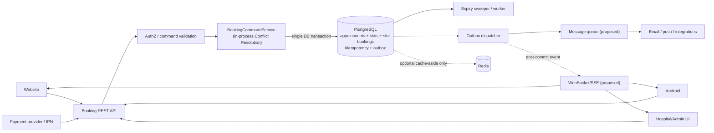

# Kiến trúc đề xuất xử lý tranh chấp suất khám

**Trạng thái tài liệu:** thiết kế đề xuất; chưa triển khai, chưa benchmark.  
**Căn cứ:** [SYSTEM_ARCHITECTURE_AUDIT.md](./SYSTEM_ARCHITECTURE_AUDIT.md) và kiểm tra lại các đoạn source được dẫn.  
**Phạm vi:** tạo, đổi, hủy, hết hạn, thanh toán/IPN, quản trị và lịch khám chiếm nhiều slot.

## 1. Mục tiêu và nguyên tắc

1. PostgreSQL là **nguồn sự thật duy nhất** cho quyền sử dụng suất khám và trạng thái giữ chỗ.
2. Mọi kênh gọi cùng một Booking Command API/service. Không kênh nào tự thay đổi `bookedCount`, trạng thái giữ chỗ hay quan hệ slot-booking.
3. Mỗi thay đổi appointment, danh sách slot chiếm dụng, bộ đếm và lịch sử được commit hoặc rollback trong cùng transaction.
4. Redis, queue và WebSocket/SSE không quyết định ai được suất. Chúng hỗ trợ cache/thông báo, công việc nền và cập nhật giao diện sau commit.
5. Multi-slot là một reservation nguyên tử: tất cả slot được giữ/giải phóng cùng nhau.
6. Các trạng thái chiếm capacity và thanh toán muộn là quyết định nghiệp vụ. Đề xuất bên dưới được ghi rõ là chính sách ứng viên, không phải quy tắc đã xác nhận.

## 2. Bằng chứng hiện trạng đã đối chiếu

- `AppointmentsService.create()` dùng transaction và `SELECT ... FOR UPDATE` cho slot chính cùng các slot trong cửa sổ; kiểm tra status/capacity rồi tạo appointment `AWAITING_PAYMENT`, junction và tăng count trong transaction: [appointments.service.ts](./nova-care-backend/src/modules/appointments/appointments.service.ts#L26), [appointments.service.ts](./nova-care-backend/src/modules/appointments/appointments.service.ts#L53), [appointments.service.ts](./nova-care-backend/src/modules/appointments/appointments.service.ts#L104), [appointments.service.ts](./nova-care-backend/src/modules/appointments/appointments.service.ts#L181), [appointments.service.ts](./nova-care-backend/src/modules/appointments/appointments.service.ts#L213).
- Patient cancel đọc số lượng rồi ghi giá trị tuyệt đối; reschedule kiểm tra slot mới ngoài transaction và tăng count trong transaction mà không có capacity guard: [appointments.service.ts](./nova-care-backend/src/modules/appointments/appointments.service.ts#L585), [appointments.service.ts](./nova-care-backend/src/modules/appointments/appointments.service.ts#L681), [appointments.service.ts](./nova-care-backend/src/modules/appointments/appointments.service.ts#L713).
- Expiry cập nhật appointment và giảm slot chính, không đọc toàn bộ junction trong phương thức này: [appointments.service.ts](./nova-care-backend/src/modules/appointments/appointments.service.ts#L770).
- IPN thành công cập nhật payment và appointment sang `PAID`; đoạn được khảo sát không kiểm tra trạng thái appointment/expiry trước khi cập nhật: [payments.service.ts](./nova-care-backend/src/modules/payments/payments.service.ts#L99), [payments.service.ts](./nova-care-backend/src/modules/payments/payments.service.ts#L136).
- `AppointmentSlotBooking` liên kết appointment với nhiều slot; `AppointmentSlot` có `capacity`, `bookedCount`, `status`, `version`: [schema.prisma](./nova-care-backend/prisma/schema.prisma#L352), [schema.prisma](./nova-care-backend/prisma/schema.prisma#L377).
- Các controller/service admin và hospital-admin có đường cập nhật trạng thái riêng; cần đưa chúng qua cùng command path trước khi bảo đảm đồng nhất toàn hệ thống: [admin-appointments.service.ts](./nova-care-backend/src/modules/admin/admin-appointments.service.ts#L427), [hospital-admin.service.ts](./nova-care-backend/src/modules/hospital-admin/hospital-admin.service.ts#L600).
- Redis được khai báo trong môi trường và BullMQ có trong dependency, nhưng QueueModule hiện không đăng ký queue provider/worker trong source khảo sát: [queue.module.ts](./nova-care-backend/src/queue/queue.module.ts#L1), [queue.service.ts](./nova-care-backend/src/queue/queue.service.ts#L7).

**Lưu ý:** một số file backend đang có thay đổi chưa commit. Cần xác nhận source trên là snapshot muốn nghiên cứu trước khi triển khai.

## 3. Thành phần: hiện có và đề xuất

| Thành phần | Hiện trạng được quan sát | Vai trò đề xuất |
|---|---|---|
| Website | Gọi REST API đặt/xem/hủy/đổi lịch. | Chỉ gửi command đến Booking API; không tự giữ suất bằng cache. |
| Android | Gọi cùng nhóm REST API. | Dùng cùng hợp đồng idempotency, lỗi conflict và quy tắc trạng thái như web. |
| Giao diện quản trị | Có endpoint/service cập nhật trạng thái riêng. | Các lệnh hủy/đổi trạng thái có tác động occupancy phải gọi cùng Booking Command API/service; quyền và audit context được truyền rõ ràng. |
| Booking API | NestJS appointments và slot APIs hiện có. | Mặt ngoài xác thực/ủy quyền/validation; không chứa logic occupancy trùng lặp. |
| Conflict Resolution Service | Chưa thấy service chuyên trách dùng chung. | Module ứng dụng đồng bộ (ví dụ `BookingCommandService`) thực hiện transition, khóa, kiểm tra capacity, multi-slot và lịch sử. Không cần triển khai thành microservice riêng ở giai đoạn đầu. |
| PostgreSQL/Prisma | Đã có; slot lock được dùng trong create. | Nguồn chân lý; transaction và row locks/conditional updates bảo vệ invariants; lưu idempotency và outbox. |
| Redis | Có cấu hình/deployment; chưa có bằng chứng lock booking đang được dùng. | Tùy chọn cho cache slot đọc, rate limiting hoặc fan-out. Cache phải invalidation/version-aware và không được cấp quyền đặt suất. Không đưa Redis lock vào đường correctness ban đầu. |
| Message queue | Dependency/service có dấu vết; worker wiring chưa xác nhận. | Sau khi có outbox, dùng để gửi thông báo, xử lý integration và các tác vụ nền có thể retry. Queue delivery là at-least-once; consumer idempotent. |
| Expiry worker | Có sweep/processor code nhưng chưa xác nhận scheduler/worker hoạt động. | Quét định kỳ DB các hold tới hạn; queue delay có thể đánh thức sớm nhưng không phải nguồn sự thật. |
| WebSocket/SSE | Chưa thấy channel realtime cho trạng thái suất. | Phát sự kiện sau commit để cập nhật UI. Client phải đọc lại API; mất event không làm sai occupancy. |
| Outbox/Event Processing | Chưa thấy outbox đặt lịch trong source được kiểm tra. | Ghi event cùng transaction với thay đổi appointment/slot; dispatcher publish rồi đánh dấu; retry và consumer dedupe. |

Mọi thành phần được gắn nhãn “proposed” là thiết kế, không phải hiện trạng đã triển khai.

## 4. Invariants và chính sách cần xác nhận

### Invariants kỹ thuật đề xuất

- Với mọi slot `s`, `0 <= occupied(s) <= capacity(s)`.
- Counter, nếu tiếp tục duy trì `bookedCount`, bằng số reservation đang chiếm slot theo một định nghĩa nghiệp vụ thống nhất; chỉ thay đổi trong transaction.
- Một reservation chỉ chuyển từ occupying sang released tối đa một lần. Lệnh lặp trả kết quả idempotent hoặc “đã xử lý”, không decrement lần nữa.
- Appointment nhiều slot có cùng một lifecycle reservation. Không có trạng thái chỉ một phần slot được giữ hoặc giải phóng sau commit.
- `status`, `expiresAt`, payment state, slot membership và counter được cập nhật theo transition hợp lệ, không qua các service tự ghi rời rạc.
- Mọi command client có `idempotencyKey` ổn định qua retry mạng. Unique conflict sẽ được xử lý bằng cách đọc/trả kết quả của request đã commit nếu cùng chủ thể và cùng nội dung.
- Slot không khả dụng, inactive, blocked hoặc nằm ngoài khung thời gian dịch vụ không thể được claim, kể cả khi `bookedCount < capacity`.

### Cần chủ sở hữu nghiệp vụ xác nhận

1. **Trạng thái chiếm capacity:** hiện create đặt `AWAITING_PAYMENT`; code có `PENDING`, `CONFIRMED`, `PAID`, `COMPLETED`, `NO_SHOW`, `FAILED`, `REFUNDED`... và một số query loại trừ các trạng thái khác nhau. Xác nhận trạng thái nào bắt đầu/kết thúc chiếm suất. Đề xuất mô hình khái niệm `HELD -> BOOKED -> CONSUMED` hoặc `RELEASED` tách khỏi enum appointment.
2. **Hold 15 phút:** code hiện gán `expiresAt = now + 15 phút`. Xác nhận thời hạn này, bắt đầu đếm từ lúc tạo hay lúc bắt đầu thanh toán, và có gia hạn hay không.
3. **Thanh toán muộn:** xác nhận dùng thời gian thanh toán do nhà cung cấp ghi nhận hay thời gian IPN đến; nếu đã giải phóng và bán suất cho người khác thì ưu tiên ai; refund tự động hay xử lý thủ công. Chính sách ứng viên chi tiết tại [CONFLICT_RESOLUTION_DESIGN.md](./CONFLICT_RESOLUTION_DESIGN.md#6-thanh-toán-callback-muộn).
4. **No-show/completed:** code không thống nhất việc count biểu thị chỗ đang giữ hay lịch sử số chỗ đã tiêu thụ. Xác nhận khi nào counter giảm và có cần counter lịch sử riêng.
5. **Hủy của bệnh viện/admin:** xác nhận vai trò được phép hủy trạng thái nào, quy tắc hoàn tiền, lý do bắt buộc và cách giải phóng nhiều slot.
6. **Đổi lịch:** xác nhận appointment đã thanh toán có giữ trạng thái paid, có thay đổi phí/hoàn tiền hay không; thiết kế mặc định giữ nguyên trạng thái và payment, chỉ chuyển reservation nguyên tử.
7. **Dịch vụ nhiều slot:** xác nhận duration, granularity 15 phút, capacity có thể khác giữa các slot, và có được chọn phương án giờ bắt đầu khác khi cửa sổ đầu tiên không khả dụng hay phải báo conflict.
8. **Lịch trùng của cùng bệnh nhân:** xác nhận chặn overlap ở mức patient profile, user hay cả hai, kể cả lịch `AWAITING_PAYMENT`.
9. **Sửa capacity/khóa slot:** xác nhận hành vi nếu giảm capacity thấp hơn occupied count hoặc block slot đang có reservation.

## 5. Hướng khuyến nghị

Giai đoạn đầu nên là **modular monolith + PostgreSQL transaction + lock slot có thứ tự + conditional counter updates + compare-and-set trạng thái + outbox**. Đây là mở rộng gần với cấu trúc NestJS/Prisma hiện có, không buộc tách microservice hay phụ thuộc Redis để bảo đảm đúng. Queue, Redis cache và realtime chỉ bổ sung khi cần, sau khi semantics DB được thống nhất.

Chi tiết luồng/điểm khóa tại [CONFLICT_RESOLUTION_DESIGN.md](./CONFLICT_RESOLUTION_DESIGN.md); so sánh lựa chọn tại [TECHNOLOGY_COMPARISON.md](./TECHNOLOGY_COMPARISON.md).
