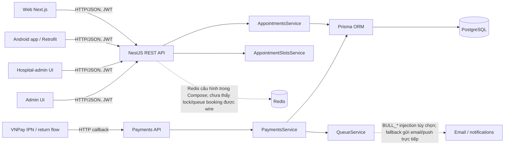

# Kiểm toán kiến trúc hệ thống đặt khám NovaCare

**Đề tài nghiên cứu:** “Giải pháp thiết kế kiến trúc phân tán đa kênh và xử lý tranh chấp suất khám thời gian thực trong hệ thống y tế số.”  
**Phạm vi:** khảo sát source code hiện có trong working tree; đây là kiểm toán tĩnh, không chạy tải hoặc truy vấn cơ sở dữ liệu.  
**Ngày khảo sát:** 2026-11-09.

> **Giới hạn snapshot:** working tree có nhiều thay đổi chưa commit, trong đó có `hospital-admin.service.ts`, `admin-appointments.service.ts` và các controller liên quan. Báo cáo mô tả đúng source hiện đang đọc; cần đối chiếu diff/phiên bản đã triển khai trước khi coi các hành vi ở những file đang sửa là hành vi production. Báo cáo không đọc hoặc công bố giá trị bí mật từ file môi trường/cấu hình.

## 1. Kiến trúc hiện tại



- **Frontend:** ứng dụng web trong `nova-care-web` gọi REST endpoint qua `apiClient`; ứng dụng Android gọi cùng các endpoint qua Retrofit. Mã tham khảo: [appointment.service.ts](./nova-care-web/src/services/appointment.service.ts#L1), [ApiService.kt](./mobile/app/src/main/java/com/example/kltn_novacare/data/remote/ApiService.kt#L257).
- **Backend:** NestJS module hóa theo appointments, appointment-slots, payments, hospital-admin, admin, notifications và integration; ứng dụng đăng ký các module trong [app.module.ts](./nova-care-backend/src/app.module.ts#L1). API khởi tạo JWT guard, validation pipe, CORS và HTTP middleware/interceptor tại [main.ts](./nova-care-backend/src/main.ts#L10).
- **Database:** PostgreSQL qua Prisma; schema khai báo datasource PostgreSQL và model lịch hẹn/slot/thanh toán trong [schema.prisma](./nova-care-backend/prisma/schema.prisma#L312).
- **Triển khai phát hiện được:** `docker-compose.yml` khai báo dịch vụ PostgreSQL, API và Redis; API phụ thuộc vào PostgreSQL/Redis. Điều đó chỉ xác nhận Redis có trong môi trường Compose, không chứng minh Redis được dùng để khóa suất. Cấu hình có các biến Redis tại [configuration.ts](./nova-care-backend/src/config/configuration.ts#L29).
- **Queue:** `package.json` có dependency BullMQ, `QueueService` nhận các token `BULL_*` dạng optional, và QueueModule đăng ký service/processor. Tuy nhiên QueueModule hiện không đăng ký `BullModule`/queue provider; `ExpireAppointmentsProcessor` không có decorator đăng ký processor trong source được khảo sát. Không tìm thấy lời gọi `addExpireJob` từ luồng tạo đặt khám. Vì vậy không thể kết luận có worker BullMQ đang chạy hoặc job hết hạn được tự động lập lịch. Xem [queue.module.ts](./nova-care-backend/src/queue/queue.module.ts#L1), [queue.service.ts](./nova-care-backend/src/queue/queue.service.ts#L7), [expire-appointments.processor.ts](./nova-care-backend/src/queue/expire-appointments.processor.ts#L1).
- **Giao tiếp thời gian thực:** luồng đặt khám khảo sát là HTTP request/response. Không tìm thấy WebSocket/SSE riêng cho cập nhật trạng thái đặt khám; một gateway WebSocket cho tư vấn không phải bằng chứng về đồng bộ suất khám.
- **HIS/đối tác:** có module integration và adapter cho dữ liệu y tế; trong các thư mục `partner-his-server`, `standalone-his-server` và module integration không tìm thấy endpoint tạo đặt khám theo các mẫu route/từ khóa đã khảo sát. Cần xác minh giao thức đối tác ngoài các source này trước khi kết luận mọi kênh HIS đều không thể đặt khám.

## 2. Sơ đồ luồng đặt khám

```mermaid
sequenceDiagram
  actor Patient as Bệnh nhân (Web/Android)
  participant API as AppointmentsController
  participant Svc as AppointmentsService
  participant DB as PostgreSQL
  participant Pay as PaymentsService / VNPay
  participant Exp as Expiry sweep

  Patient->>API: GET appointment-slots/available
  API->>DB: Lọc slot đang khả dụng
  DB-->>Patient: Danh sách slot (snapshot tại thời điểm đọc)
  Patient->>API: POST appointments (JWT)
  API->>Svc: create(userId, DTO)
  Svc->>DB: Kiểm tra hồ sơ + idempotency key
  Svc->>DB: Transaction; SELECT slot FOR UPDATE
  Svc->>DB: Khóa slot liên tiếp; kiểm tra status/capacity
  Svc->>DB: Tạo appointment AWAITING_PAYMENT, expiresAt +15 phút
  Svc->>DB: Tạo slotBookings, tăng bookedCount, cập nhật status
  DB-->>Patient: Appointment đang chờ thanh toán
  Patient->>Pay: Tạo URL thanh toán
  Pay->>DB: Tạo/cập nhật payment transaction
  VNPay-->>Pay: IPN callback
  Pay->>DB: Cập nhật payment và trạng thái appointment
  Exp->>DB: Tìm appointment AWAITING_PAYMENT quá hạn
  Exp->>DB: Đặt EXPIRED và giảm bookedCount
```

### Diễn giải theo bước

1. Web/mobile lấy slot trống qua `GET /api/v1/appointment-slots/available`; đây là kết quả đọc, không phải giữ chỗ. Controller public và service lọc `isAvailable`, `isActive`, `bookedCount < capacity`: [appointment-slots.controller.ts](./nova-care-backend/src/modules/appointment-slots/appointment-slots.controller.ts#L103), [appointment-slots.service.ts](./nova-care-backend/src/modules/appointment-slots/appointment-slots.service.ts#L301).
2. `POST /api/v1/appointments` xác thực hồ sơ bệnh nhân, kiểm tra idempotency key, rồi mở Prisma transaction. Service khóa slot chính bằng `SELECT ... FOR UPDATE`, tìm cửa sổ slot liên tiếp theo thời lượng dịch vụ, khóa các slot đó, đọc lại và kiểm tra `status`/`bookedCount`/`capacity`: [appointments.controller.ts](./nova-care-backend/src/modules/appointments/appointments.controller.ts#L24), [appointments.service.ts](./nova-care-backend/src/modules/appointments/appointments.service.ts#L26).
3. Nếu hợp lệ, service tạo appointment trạng thái `AWAITING_PAYMENT`, đặt `expiresAt` sau 15 phút, tạo `AppointmentSlotBooking` cho từng slot sử dụng và tăng bộ đếm trong cùng transaction: [appointments.service.ts](./nova-care-backend/src/modules/appointments/appointments.service.ts#L181), [appointments.service.ts](./nova-care-backend/src/modules/appointments/appointments.service.ts#L213).
4. Thanh toán VNPay được khởi tạo qua `POST /api/v1/payments/create`; IPN có GET/POST endpoint public. Khi callback hợp lệ, service cập nhật transaction thanh toán và appointment sang `PAID`: [payments.controller.ts](./nova-care-backend/src/modules/payments/payments.controller.ts#L30), [payments.service.ts](./nova-care-backend/src/modules/payments/payments.service.ts#L17), [payments.service.ts](./nova-care-backend/src/modules/payments/payments.service.ts#L99).
5. Hủy của bệnh nhân đi qua `PATCH /api/v1/appointments/:id/cancel`; service tìm tất cả slot junction để giải phóng và cập nhật trạng thái trong transaction. Đổi lịch đi qua `PATCH /api/v1/appointments/:id/reschedule`: [appointments.controller.ts](./nova-care-backend/src/modules/appointments/appointments.controller.ts#L102), [appointments.service.ts](./nova-care-backend/src/modules/appointments/appointments.service.ts#L546).
6. Hết hạn được xử lý bởi `expirePendingAppointments()`, tìm `AWAITING_PAYMENT` có `expiresAt < now`, rồi cập nhật trạng thái và giảm bộ đếm. Endpoint `POST /api/v1/appointments/expire-pending` gọi sweep này; không thấy cron hoặc lời gọi từ tạo appointment: [appointments.controller.ts](./nova-care-backend/src/modules/appointments/appointments.controller.ts#L168), [appointments.service.ts](./nova-care-backend/src/modules/appointments/appointments.service.ts#L770).

## 3. Module, API và file code liên quan

| Thành phần | API/điểm vào | File chính |
|---|---|---|
| Đọc suất trống | `GET /api/v1/appointment-slots/available` | [appointment-slots.controller.ts](./nova-care-backend/src/modules/appointment-slots/appointment-slots.controller.ts#L103), [appointment-slots.service.ts](./nova-care-backend/src/modules/appointment-slots/appointment-slots.service.ts#L301) |
| Tạo lịch | `POST /api/v1/appointments` | [appointments.controller.ts](./nova-care-backend/src/modules/appointments/appointments.controller.ts#L24), [appointments.service.ts](./nova-care-backend/src/modules/appointments/appointments.service.ts#L26) |
| Xem lịch | `GET /api/v1/appointments/me`, `/upcoming`, `/history`, `/:id` | [appointments.controller.ts](./nova-care-backend/src/modules/appointments/appointments.controller.ts#L42) |
| Hủy / đổi lịch | `PATCH /api/v1/appointments/:id/cancel`, `/:id/reschedule` | [appointments.controller.ts](./nova-care-backend/src/modules/appointments/appointments.controller.ts#L102), [appointments.service.ts](./nova-care-backend/src/modules/appointments/appointments.service.ts#L546) |
| Xác nhận | `PATCH /api/v1/appointments/:id/confirm` (đánh dấu `@Public`) | [appointments.controller.ts](./nova-care-backend/src/modules/appointments/appointments.controller.ts#L124), [appointments.service.ts](./nova-care-backend/src/modules/appointments/appointments.service.ts#L266) |
| Hết hạn | `POST /api/v1/appointments/expire-pending` | [appointments.controller.ts](./nova-care-backend/src/modules/appointments/appointments.controller.ts#L168) |
| Thanh toán | `POST /api/v1/payments/create`; VNPay IPN GET/POST; `POST /simulate-success` public; `GET /status/:appointmentId` public | [payments.controller.ts](./nova-care-backend/src/modules/payments/payments.controller.ts#L34), [payments.service.ts](./nova-care-backend/src/modules/payments/payments.service.ts#L17) |
| Quản trị bệnh viện | `GET /api/v1/hospital-admin/appointments`; `PATCH /appointments/:id/status` | [hospital-admin.controller.ts](./nova-care-backend/src/modules/hospital-admin/hospital-admin.controller.ts#L117) |
| Quản trị hệ thống | `PATCH /api/v1/admin/appointments/:id/status` | [admin-appointments.controller.ts](./nova-care-backend/src/modules/admin/admin-appointments.controller.ts#L98), [admin-appointments.service.ts](./nova-care-backend/src/modules/admin/admin-appointments.service.ts#L427) |
| Frontend web/mobile | Gọi các endpoint booking/payment nói trên | [appointment.service.ts](./nova-care-web/src/services/appointment.service.ts#L1), [ApiService.kt](./mobile/app/src/main/java/com/example/kltn_novacare/data/remote/ApiService.kt#L257) |

`AppointmentsController` có JWT guard ở cấp controller, nhưng `confirm` được đánh dấu public. Payments controller gắn guard JWT riêng cho tạo URL, còn IPN, trạng thái thanh toán và mô phỏng thành công được đánh dấu public. Mô phỏng thanh toán là một đường cập nhật trạng thái khác với callback VNPay và cần được loại khỏi benchmark production hoặc kiểm soát môi trường khi chạy thử nghiệm.

## 4. Cấu trúc dữ liệu suất khám

- `AppointmentSlot`: `doctorWorkplaceId`, `startTime`, `endTime`, `capacity`, `bookedCount`, `isAvailable`, `isActive`, `status`, `version`; unique `(doctorWorkplaceId, startTime)`. Xem [schema.prisma](./nova-care-backend/prisma/schema.prisma#L352).
- `Appointment`: tham chiếu slot chính qua `slotId`, hồ sơ bệnh nhân, người dùng, trạng thái, `idempotencyKey` unique nullable, `expiresAt`, chi phí và thời điểm cập nhật. Xem [schema.prisma](./nova-care-backend/prisma/schema.prisma#L312).
- `AppointmentSlotBooking`: bảng liên kết appointment-slot, unique `(appointmentId, slotId)`, cho phép một lịch chiếm nhiều slot cơ sở. Xem [schema.prisma](./nova-care-backend/prisma/schema.prisma#L377).
- `PaymentTransaction`: unique một transaction trên mỗi appointment qua `appointmentId`; lưu amount, method, status và mã giao dịch. Xem [schema.prisma](./nova-care-backend/prisma/schema.prisma#L420).
- Enum appointment có `PENDING`, `AWAITING_PAYMENT`, `CONFIRMED`, `PAID`, `COMPLETED`, `CANCELLED`, `EXPIRED`, `FAILED` và trạng thái khác: [schema.prisma](./nova-care-backend/prisma/schema.prisma#L26).
- Trong model/schema và migration được tìm thấy, không thấy CHECK constraint đảm bảo `bookedCount <= capacity` hoặc `bookedCount >= 0`. Unique constraint cho `slotBookings` ngăn bản ghi junction trùng cặp appointment-slot, nhưng không tự đảm bảo tổng số booking đang hiệu lực không vượt capacity.

## 5. Các tình huống tranh chấp và bằng chứng

| Tình huống | Cơ chế/điểm mã nguồn | Đánh giá |
|---|---|---|
| Hai người đặt đồng thời một slot qua `create` | Transaction khóa slot chính và slot yêu cầu bằng `FOR UPDATE`, sau đó đọc lại và kiểm tra capacity trước khi tăng count: [appointments.service.ts](./nova-care-backend/src/modules/appointments/appointments.service.ts#L53), [appointments.service.ts](./nova-care-backend/src/modules/appointments/appointments.service.ts#L104), [appointments.service.ts](./nova-care-backend/src/modules/appointments/appointments.service.ts#L117). | **Có bảo vệ đáng kể** cho hai request đi cùng luồng này, với điều kiện DB hỗ trợ/áp dụng đúng row lock và transaction. Chưa có concurrency integration test trong bộ test được tìm thấy. |
| Nhiều người đặt cùng bác sĩ/khung giờ, capacity lớn hơn 1 | Cùng kiểm tra `bookedCount >= capacity` sau khi khóa hàng; mỗi slot tăng count trong transaction: [appointments.service.ts](./nova-care-backend/src/modules/appointments/appointments.service.ts#L117), [appointments.service.ts](./nova-care-backend/src/modules/appointments/appointments.service.ts#L225). | Cơ chế tương tự bảo vệ luồng create. Cần kiểm chứng nhiều request và capacity lớn hơn 1 trên PostgreSQL thật. |
| Hai người đổi lịch cùng vào một slot mới | Slot mới được đọc và kiểm tra availability **trước** transaction; trong transaction chỉ increment count, không khóa slot mới và không có điều kiện `bookedCount < capacity`: [appointments.service.ts](./nova-care-backend/src/modules/appointments/appointments.service.ts#L681), [appointments.service.ts](./nova-care-backend/src/modules/appointments/appointments.service.ts#L713). | **Có nguy cơ vượt capacity** nếu đổi lịch đồng thời với nhau hoặc với create. |
| Hai người cùng giữ chỗ chưa thanh toán | Create chiếm count ngay khi tạo appointment `AWAITING_PAYMENT`; giữ 15 phút theo `expiresAt`: [appointments.service.ts](./nova-care-backend/src/modules/appointments/appointments.service.ts#L181). | Đây là reservation có thời hạn, không phải hold record/lease riêng. Việc giải phóng phụ thuộc worker/sweep; trễ hoặc lỗi xử lý làm slot bị giữ lâu hơn. |
| Hai worker quét cùng appointment hết hạn | Danh sách hết hạn được đọc trước các transaction; mỗi transaction cập nhật appointment không kiểm tra lại trạng thái cũ rồi giảm count: [appointments.service.ts](./nova-care-backend/src/modules/appointments/appointments.service.ts#L770), [appointments.service.ts](./nova-care-backend/src/modules/appointments/appointments.service.ts#L784). | Có thể hai worker xử lý cùng một bản ghi và giảm count lặp. Chưa thấy claim/lock/CAS để chỉ một worker thắng. |
| Hết hạn appointment nhiều slot | Create ghi tất cả slot vào junction, nhưng expiry chỉ giảm `appointment.slotId` (slot chính): [appointments.service.ts](./nova-care-backend/src/modules/appointments/appointments.service.ts#L213), [appointments.service.ts](./nova-care-backend/src/modules/appointments/appointments.service.ts#L796). | **Rủi ro lệch occupancy**: các slot phụ của dịch vụ dài có thể vẫn bị tính là đã đặt sau expiry. |
| Patient hủy đồng thời với request khác | Hủy lấy appointment trước transaction, sau đó update trạng thái bằng `update` thường; slot count đọc trong transaction và ghi giá trị tuyệt đối `max(0, count - 1)`: [appointments.service.ts](./nova-care-backend/src/modules/appointments/appointments.service.ts#L546), [appointments.service.ts](./nova-care-backend/src/modules/appointments/appointments.service.ts#L585). | Không có compare-and-set trạng thái; thao tác lặp/cạnh tranh có thể giải phóng lặp hoặc ghi đè một cập nhật count đồng thời. |
| Admin hủy / Hospital-admin hủy | Trong source hiện tại, `AdminAppointmentsService.updateStatus` cập nhật trạng thái nhưng không cập nhật bookedCount trong nhánh đổi trạng thái: [admin-appointments.service.ts](./nova-care-backend/src/modules/admin/admin-appointments.service.ts#L427). Hospital-admin cancellation có compare-and-set trạng thái, giảm count có điều kiện, nhưng chỉ slot chính: [hospital-admin.service.ts](./nova-care-backend/src/modules/hospital-admin/hospital-admin.service.ts#L600). | Các kênh cập nhật trạng thái không có cùng quy trình giải phóng slot; có thể sinh trạng thái hẹn `CANCELLED` nhưng occupancy khác nhau theo đường gọi. **Hai file này đang có thay đổi chưa commit trong working tree.** |
| IPN thanh toán đến cùng lúc hoặc sau khi hết hạn/hủy | `handleIpn` kiểm tra chữ ký và transaction đã PAID; nếu thành công thì cập nhật appointment sang PAID mà không kiểm tra trạng thái appointment hiện tại hoặc `expiresAt`: [payments.service.ts](./nova-care-backend/src/modules/payments/payments.service.ts#L99), [payments.service.ts](./nova-care-backend/src/modules/payments/payments.service.ts#L136). | Có thể IPN muộn đưa lịch đã hết hạn/hủy về PAID; cạnh tranh với expiry có thể gây trạng thái và occupancy không nhất quán. |
| Xác nhận công khai và hết hạn | `confirm()` chỉ yêu cầu trạng thái `AWAITING_PAYMENT`, không kiểm tra `expiresAt`; endpoint được đánh dấu `@Public`: [appointments.controller.ts](./nova-care-backend/src/modules/appointments/appointments.controller.ts#L124), [appointments.service.ts](./nova-care-backend/src/modules/appointments/appointments.service.ts#L266). | Có đường cập nhật trạng thái khác cần đối chiếu với thanh toán và expiry; cần xác minh quy tắc nghiệp vụ thực tế của API confirm. |
| Hai slot khác nhau của cùng bệnh nhân nhưng thời gian giao nhau | Kiểm tra appointment overlap trong transaction nhưng không có khóa theo hồ sơ bệnh nhân hoặc ràng buộc DB tương ứng: [appointments.service.ts](./nova-care-backend/src/modules/appointments/appointments.service.ts#L134). | Hai request cùng bệnh nhân trên các slot khác nhau có thể cùng vượt qua kiểm tra. Đây là đặt trùng lịch bệnh nhân, khác với overbooking capacity của slot. |
| Helper cập nhật count của slot | `updateBookedCount` đọc, tính và kiểm tra count trước rồi ghi giá trị tuyệt đối; không nằm trong một transaction/conditional update: [appointment-slots.service.ts](./nova-care-backend/src/modules/appointment-slots/appointment-slots.service.ts#L350). | Chỉ có rủi ro nếu phương thức được gọi; chưa tìm thấy call site trong controller/service được khảo sát. Nếu được gọi đồng thời với đặt/hủy, có thể ghi đè count hoặc vượt capacity. |
| Cùng idempotency key đồng thời | Lookup key nằm trước transaction; DB có unique nullable key: [appointments.service.ts](./nova-care-backend/src/modules/appointments/appointments.service.ts#L42), [schema.prisma](./nova-care-backend/prisma/schema.prisma#L327). | Unique ngăn hai bản ghi cùng key, nhưng request thua race có thể lỗi unique thay vì trả appointment đã có. |

**Khả năng deadlock cần kiểm thử:** create khóa slot đầu tiên trước, rồi khóa toàn bộ candidate slots trong truy vấn khác. Hai giao dịch bắt đầu từ hai slot giao nhau có thể giữ khóa theo thứ tự khác nhau và chờ lẫn nhau. PostgreSQL sẽ phát hiện deadlock và hủy một transaction nếu tình huống xảy ra; cần đo tỷ lệ lỗi/retry trên DB thật, không kết luận deadlock chắc chắn chỉ từ tĩnh mã.

## 6. Cơ chế bảo vệ hiện có

1. Row-level lock PostgreSQL trong đường tạo lịch chính; kiểm tra capacity/status sau khóa trong cùng transaction.
2. Tạo appointment, junction booking, tăng `bookedCount` và cập nhật status nằm trong transaction.
3. Idempotency key unique, booking code unique và unique constraint trên từng cặp appointment-slot.
4. Quyền sở hữu patient profile và quyền sở hữu lịch được kiểm tra trong các thao tác bệnh nhân.
5. Một số luồng cập nhật dùng transaction và ghi lịch sử trạng thái.
6. Hospital-admin cancellation trong snapshot dùng `updateMany` với status cũ làm điều kiện và decrement có điều kiện `bookedCount > 0`; cơ chế này chỉ áp dụng nhánh/file cụ thể, không được chia sẻ cho mọi đường cập nhật.
7. API có JWT guard, validation pipe và throttler module; không thấy bằng chứng những cấu hình này thay thế được khóa/transaction ở tầng dữ liệu.

## 7. Đánh giá hiện trạng và vấn đề chưa giải quyết

- **Đã xử lý một phần:** tranh chấp cùng slot qua endpoint create chính được bảo vệ tốt hơn so với mẫu check-then-write đơn giản nhờ khóa hàng và transaction.
- **Chưa có bảo đảm end-to-end:** đổi lịch, patient cancellation, admin cancellation, hospital-admin cancellation, expiry và callback thanh toán không cùng dùng một quy tắc nguyên tử nhất quán.
- **Có nguy cơ overbooking:** rõ nhất ở reschedule và `updateBookedCount`; các luồng hủy/expiry có thể làm bộ đếm lệch xuống, từ đó mở suất quá sớm. Dù create chính có lock, một luồng khác cập nhật count không an toàn vẫn làm hỏng invariants dùng chung.
- **Có nguy cơ lệch trạng thái giữa kênh:** admin/hospital-admin/patient/payment/expiry cập nhật appointment từ các service khác nhau. Không thấy một lớp chuyển trạng thái tập trung hoặc outbox/event ordering đảm bảo mọi thay đổi đều đồng bộ với occupancy.
- **Queue/Redis chưa chứng minh là cơ chế đồng bộ:** Redis service và dependency BullMQ có tồn tại, nhưng không thấy queue provider/processor được đăng ký trong QueueModule, không thấy distributed lock, và không thấy job hết hạn được enqueue từ lúc tạo.
- **Cơ chế hết hạn chưa có lịch chạy được xác nhận:** hiện có endpoint sweep và processor class, nhưng không thấy cron/worker wiring. Cần xác minh cách triển khai thực tế gọi endpoint/processor ở môi trường chạy.
- **Thiếu DB invariant:** không thấy constraint đảm bảo count nằm trong `[0, capacity]` hoặc khớp với số booking còn hiệu lực; `version` có trong schema nhưng không thấy dùng optimistic concurrency trong luồng đặt.
- **Thiếu thử nghiệm đồng thời:** test hiện có kiểm tra tạo/hủy theo logic đơn lẻ; không thấy test tranh chấp thật trên PostgreSQL nhiều kết nối. Ví dụ: [appointments.service.spec.ts](./nova-care-backend/test/unit/appointments.service.spec.ts#L128), [appointments.controller.spec.ts](./nova-care-backend/test/integration/appointments.controller.spec.ts#L32), [appointments-cancellation.spec.ts](./nova-care-backend/src/modules/appointments/appointments-cancellation.spec.ts#L1).
- **Không có số liệu hiệu năng:** báo cáo này không chạy benchmark và không đưa ra thông lượng, độ trễ hoặc tỷ lệ lỗi giả định.

## 8. Kịch bản thực nghiệm tiếp theo

Chạy trên PostgreSQL cùng cấu hình ứng dụng sẽ đo; không dùng mô hình giả lập đơn thuần để tuyên bố hiệu quả production.

1. **Cùng slot, capacity = 1:** đồng thời gửi 2/10/50/100 request create; xác nhận tối đa một reservation hoạt động, các request còn lại nhận 409 phù hợp.
2. **Cùng slot, capacity > 1:** gửi số request lớn hơn capacity; kiểm tra `bookedCount <= capacity`, số appointment hoạt động đúng capacity, không duplicate junction.
3. **Đặt cùng bác sĩ trong các slot giao nhau / dịch vụ nhiều slot:** thử các start time khác nhau có candidate window giao nhau; ghi nhận overbooking, deadlock, thời gian chờ lock và retry.
4. **Create đối đầu reschedule:** chạy nhiều reschedule vào slot gần đầy đồng thời với create; kiểm tra tổng count và appointment-slot junction sau mỗi vòng.
5. **Hủy đối đầu create:** hủy nhiều lần cùng appointment và song song với đặt mới trên cùng slot; xác minh không decrement lặp, không mất increment.
6. **Đa kênh hủy:** gọi patient cancel, admin status, hospital-admin status; so sánh appointment status, tất cả junction và `bookedCount`.
7. **Expiry đối đầu IPN/confirm/create:** điều khiển thời gian quanh `expiresAt`; chạy hai worker expiry; callback thành công trước/sau expiry; kiểm tra trạng thái cuối cùng và occupancy.
8. **Idempotency:** gửi đồng thời cùng key và cùng payload; yêu cầu các response hội tụ về cùng appointment thay vì tạo trùng hoặc trả lỗi không kiểm soát.
9. **Xung đột lịch bệnh nhân:** cùng patient profile đặt đồng thời hai slot khác nhau có khoảng thời gian giao nhau.
10. **Thu thập chỉ số:** request/s, p50/p95/p99 latency, tỷ lệ 409/5xx/timeouts, lock-wait/deadlock, số appointment hoạt động, count trong từng slot, số junction, và chênh lệch giữa count với nguồn occupancy được tính lại. Ghi rõ seed, cấu hình máy/DB, số worker/connection, phiên bản code và thời gian đo.

Trước khi thiết kế kiến trúc phân tán mới, cần chốt invariant nghiệp vụ (slot đơn hay đa-slot; trạng thái nào chiếm capacity; chính sách thanh toán muộn), xác minh triển khai queue/Redis đang chạy, và xây test đồng thời tích hợp để tái hiện các race trên.