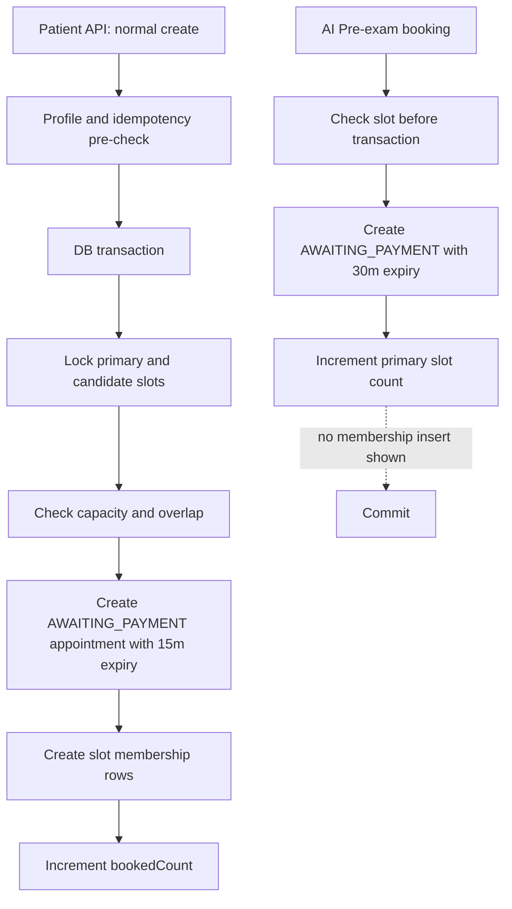
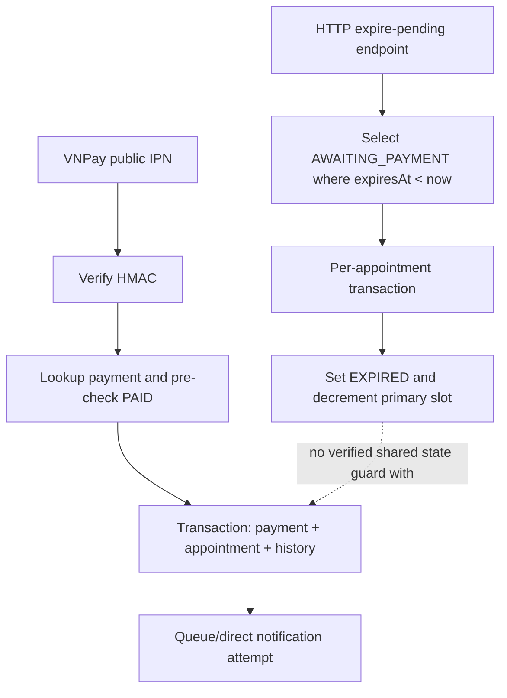

# Technical Baseline Verification (T1–T10)

## 1. Executive Summary

This report verifies the repository snapshot and source paths relevant to booking correctness. It does **not** establish deployed behavior or production data state.

| Area | Finding |
|---|---|
| Repository baseline | Branch and HEAD are identifiable, but the working tree is materially dirty. The current source snapshot is not reproducible from HEAD alone. |
| Runtime topology | Compose files declare PostgreSQL, Redis, API, and web services. No deployment evidence was available to verify active services, replicas, or worker processes. |
| Expiry | Expiry code and an HTTP trigger exist. No registered BullMQ consumer, scheduler, or runtime execution evidence was found in the repository review. |
| Redis/BullMQ | Dependencies and configuration are present, but application queue registration/wiring is not evidenced. Redis is not shown as a booking correctness lock. |
| Payment | Source implements VNPay IPN signature checking and state updates. Provider timestamp/event semantics, provider ACK/retry behavior, and live integration are unverified. A public payment simulator route is also present. |
| Occupancy writers | Multiple application and administrative paths modify appointments, slots, counters, memberships, capacity, or availability. They do not all use the same transaction/guard strategy. |
| Database state | Prisma schema/migrations can be inspected, but applied migration state and live occupancy consistency were not queried. |
| Idempotency | Create has a unique nullable key and a pre-transaction lookup. Several other transitions lack a demonstrated conditional state transition or event-level deduplication. |

**No runtime fact is marked `RUNTIME_VERIFIED`.** No database connection, SQL query, migration, seed, payment request, or benchmark was run for this verification.

## 2. Baseline and Scope

### 2.1 Git snapshot

Captured before this report was created:

- Branch: `develop`.
- HEAD: `585dcd8db9d612b4d35d758fe7d285b4762298b6`.
- Working tree: 14 tracked paths modified and 30 paths untracked.
- Therefore, this report describes the **current working tree where noted**, not a clean commit, production deployment, or immutable experiment baseline.
- This report is a new untracked deliverable; no pre-existing modifications were reverted or overwritten.

Modified tracked paths at capture time:

1. `nova-care-backend/prisma/migrations/20260919163000_add_scheduling_and_availability_engine/migration.sql`
2. `nova-care-backend/prisma/migrations/20261001190000_add_scoped_patient_consent/migration.sql`
3. `nova-care-backend/prisma/migrations/20261005090000_add_telemedicine_consultations/migration.sql`
4. `nova-care-backend/prisma/migrations/20261006090000_password_reset/migration.sql`
5. `nova-care-backend/src/modules/admin/admin-appointments.controller.ts`
6. `nova-care-backend/src/modules/admin/admin-appointments.service.ts`
7. `nova-care-backend/src/modules/hospital-admin/hospital-admin.service.ts`
8. `nova-care-web/package.json`
9. `nova-care-web/src/app/(hospital-admin)/hospital-admin/appointments/page.tsx`
10. `nova-care-web/src/components/admin/AdminSidebar.tsx`
11. `nova-care-web/src/components/admin/schedules/AppointmentDetailDrawer.tsx`
12. `nova-care-web/src/components/admin/schedules/AppointmentTab.tsx`
13. `nova-care-web/src/components/layout/Footer.tsx`
14. `nova-care-web/src/services/admin.service.ts`

Untracked paths at capture time:

`APPROVED_BOOKING_POLICY_DRAFT.md`, `BASELINE_AND_OCCUPANCY_INVENTORY.md`, `BUSINESS_RULES_DECISIONS.md`, `BUSINESS_RULES_REVIEW_D1_D10.md`, `CONFLICT_RESOLUTION_DESIGN.md`, `CONSOLIDATED_BUSINESS_POLICY_REVIEW.md`, `D1_OCCUPANCY_POLICY_ANALYSIS.md`, `EXPERIMENTAL_TEST_PLAN.md`, `IMPLEMENTATION_READINESS.md`, `POLICY_APPROVAL_MATRIX.md`, `PROPOSED_ARCHITECTURE.md`, `RESEARCH_CONTRIBUTIONS.md`, `SYSTEM_ARCHITECTURE_AUDIT.md`, `TECHNOLOGY_COMPARISON.md`, `TRANS-JOUR.doc`, `docs/NovaCare_catalog.svg`, `docs/NovaCare_clinical_history.svg`, `docs/NovaCare_core.svg`, `docs/NovaCare_partner.svg`, `docs/NovaCare_screening_passport.svg`, `docs/NovaCare_telemedicine.svg`, `docs/admin-hospital-sequence.puml`, `docs/nova-care-schema-catalog.puml`, `docs/nova-care-schema-class-diagram.puml`, `docs/nova-care-schema-clinical-history.puml`, `docs/nova-care-schema-core.puml`, `docs/nova-care-schema-partner.puml`, `docs/nova-care-schema-screening-passport.puml`, `docs/nova-care-schema-telemedicine.puml`, and `nova-care-backend/src/modules/admin/admin-appointments.controller.spec.ts`.

The policy inputs reviewed include [POLICY_APPROVAL_MATRIX.md](POLICY_APPROVAL_MATRIX.md), [BASELINE_AND_OCCUPANCY_INVENTORY.md](BASELINE_AND_OCCUPANCY_INVENTORY.md), and [CONSOLIDATED_BUSINESS_POLICY_REVIEW.md](CONSOLIDATED_BUSINESS_POLICY_REVIEW.md). Their proposals are not treated as source behavior or approval evidence.

### 2.2 Evidence status vocabulary

- `VERIFIED_FROM_SOURCE`: directly supported by the checked repository snapshot.
- `CONFIGURED_NOT_RUNTIME_VERIFIED`: configuration/declarations exist, but actual runtime use was not observed.
- `RUNTIME_VERIFIED`: observed in an authorized running environment. **None in this report.**
- `EXTERNAL_DEPENDENCY`: behavior depends on an external provider, deployment, or owner-controlled system.
- `NOT_VERIFIED`: evidence is insufficient to make the claim.
- `NOT_APPLICABLE`: not applicable to that specific question; the reason is stated.

## 3. T1–T10 Results

| ID | Topic | Status | Verified result | Evidence gap / consequence |
|---|---|---|---|---|
| T1 | Baseline | `VERIFIED_FROM_SOURCE`; reproducibility `NOT_VERIFIED` | Current branch/HEAD and dirty worktree were inspected. Several relevant backend files and migrations are modified, and research documents are untracked. | Select and preserve a clean, immutable source snapshot before claiming a reproducible baseline. Do not equate HEAD with the working-tree behavior described below. |
| T2 | Deployment topology | `CONFIGURED_NOT_RUNTIME_VERIFIED`; `NOT_VERIFIED` | Compose declarations include PostgreSQL, Redis, API, and web services. The checked production Compose file has one API service declaration. | This does not show whether Compose is used, how many API replicas run, whether another orchestrator is used, or whether separate workers run. No deployment evidence was available. |
| T3 | Expiry worker | `VERIFIED_FROM_SOURCE`; runtime `NOT_VERIFIED` | Service scan uses `expiresAt < now`; an HTTP endpoint invokes it. A processor class exists, but no scheduler/call path was found that proves automatic invocation. | Expiry timing, job execution, retries, and duplicate-worker behavior in deployment remain unverified. |
| T4 | Redis/BullMQ | `CONFIGURED_NOT_RUNTIME_VERIFIED`; booking lock `NOT_VERIFIED` | Dependencies, configuration, queue-related classes, and Redis Compose declarations exist. `QueueModule` provides classes but no Bull queue registration or processor decorator was found in the reviewed source. `addExpireJob()` has no caller found in the source search. | Installed packages and declarations do not establish active Redis connections, registered consumers, or distributed locking. |
| T5 | VNPay | `VERIFIED_FROM_SOURCE`; provider/runtime `EXTERNAL_DEPENDENCY` and `NOT_VERIFIED` | IPN endpoint is public, signature computation/check is implemented, payment fields are updated transactionally, and an ACK-shaped response is returned. | Provider settlement timestamp/event identity, real callback configuration, retries/ACK interpretation, and actual transactions require provider/deployment evidence. No live call was made. |
| T6 | Database schema | `VERIFIED_FROM_SOURCE`; applied state `NOT_VERIFIED` | Prisma models and migration files describe appointments, slots, slot memberships, payments, uniqueness, indexes, and relations. The migrations directory has a lock file. | No database metadata was queried. Repository migrations (including modified working-tree migrations) do not prove which schema has been applied. |
| T7 | Occupancy data | `NOT_VERIFIED` | Schema and writer logic expose fields needed for diagnostics: appointment status/primary `slotId`, `AppointmentSlotBooking`, and `bookedCount`. | No safe database was provided and no SQL was run. No claim is made about live drift, overbooking, negative counts, or stale holds. |
| T8 | Booking writers | `VERIFIED_FROM_SOURCE` for paths found; completeness outside repository `NOT_VERIFIED` | Normal and Pre-exam creation, patient cancel/reschedule, expiry, payment, admin/hospital-admin transitions, slot/schedule/capacity changes, and seed/test scripts were reviewed. | Working-tree changes affect some administrative behavior; external or deployed writers outside the checked repository remain possible. |
| T9 | Integration boundaries | `VERIFIED_FROM_SOURCE`; external operation `EXTERNAL_DEPENDENCY` / `NOT_VERIFIED` | HIS catalog fetch/sync, VNPay IPN, LiveKit consultation webhook, SMS, and email integrations are represented in source. The HIS catalog path updates catalog entities; no appointment callback path from HIS was verified in the reviewed integration code. | Credentials, endpoints, provider contracts, deployed integrations, and out-of-repository writers are unknown. |
| T10 | Idempotency | `VERIFIED_FROM_SOURCE` for mechanisms present; effectiveness `NOT_VERIFIED` | Create key uniqueness, a create pre-check, selected admin no-op/CAS paths, and LiveKit event audit deduplication exist. | Cancel/expiry/payment callback/reschedule paths do not uniformly demonstrate atomic idempotent transitions. Concurrency behavior and external event replay were not tested. |

### 3.1 T1 — Baseline and reproducibility

The Git snapshot listed in §2.1 is directly observed. The source under examination includes uncommitted changes to hospital-admin cancellation/status handling, admin appointment handling, and four migrations, among other UI changes. Research documents are not committed at HEAD. Consequently:

- Any report, test, or later benchmark must name the exact commit **and** the working-tree patch set (or use a clean commit).
- Production release SHA/image, database migration state, and parity with this checkout are `NOT_VERIFIED`.
- No Git operation changed or discarded existing work.

### 3.2 T2 — Deployment topology

The root [docker-compose.prod.yml](docker-compose.prod.yml#L1) declares PostgreSQL, Redis, an API service, and a web service; the backend [docker-compose.yml](nova-care-backend/docker-compose.yml#L1) also declares Redis and database configuration. The application reads Redis host/port settings in [configuration.ts](nova-care-backend/src/config/configuration.ts#L30), and package dependencies include BullMQ/ioredis in [package.json](nova-care-backend/package.json#L43). These are `CONFIGURED_NOT_RUNTIME_VERIFIED`, not evidence of an active deployment or replica count. A single Compose service declaration does not rule out manual scaling, another orchestrator, or separate worker processes.

The checked configuration includes credential-shaped literal defaults in deployment/example files. Values are intentionally omitted here. Their validity or use is `NOT_VERIFIED`; the configuration owner should establish whether any are active and rotate them through the approved process if necessary. No credential was used.

### 3.3 T3 — Expiry processing

The normal booking path sets a 15-minute expiry and the Pre-exam path sets a 30-minute expiry:

- [appointments.service.ts](nova-care-backend/src/modules/appointments/appointments.service.ts#L197) sets `expiresAt` on the normal create path.
- [pre-exam.service.ts](nova-care-backend/src/modules/pre-exam/pre-exam.service.ts#L201) sets the longer Pre-exam hold.

The service scan selects `AWAITING_PAYMENT` appointments with `expiresAt < now`, then updates appointment and primary slot counter inside a transaction. The processor follows a similar query/update pattern. Relevant code is in [appointments.service.ts](nova-care-backend/src/modules/appointments/appointments.service.ts#L770) and [expire-appointments.processor.ts](nova-care-backend/src/queue/expire-appointments.processor.ts#L12).

`POST /api/v1/appointments/expire-pending` is wired to the service method in [appointments.controller.ts](nova-care-backend/src/modules/appointments/appointments.controller.ts#L168). `QueueModule` is imported by [app.module.ts](nova-care-backend/src/app.module.ts#L49) and lists the processor as a provider in [queue.module.ts](nova-care-backend/src/queue/queue.module.ts#L1), while [queue.service.ts](nova-care-backend/src/queue/queue.service.ts#L39) defines `addExpireJob()`. The checked source did not establish a cron registration, BullMQ worker registration, processor decorator, or caller for `addExpireJob()`. Thus an HTTP-triggered/manual call is source-supported; automatic runtime execution is not.

The expiry predicate is strict `<`, so equality at exactly `expiresAt` is not selected by this scan. Expiry releases the primary `slotId` counter, not a complete multi-slot membership set. No atomic compare-and-set on appointment status is apparent in the service/processor transition; runtime race outcomes are not verified.

### 3.4 T4 — Redis and BullMQ

The backend has Redis/BullMQ-related configuration and dependencies. `QueueModule` only declares providers; no `BullModule.forRoot`, `registerQueue`, `@Processor`, or `WorkerHost` registration was found in the checked source search. Queue fields in `QueueService` are optional injected tokens. Email/push queue methods attempt direct fallbacks on errors; `addExpireJob()` logs an error but does not show a direct expiry fallback.

There is no source evidence that Redis participates in booking-slot correctness, provides a distributed lock, or is an authoritative occupancy store. Runtime Redis connectivity, queue health, consumer count, and job execution are `NOT_VERIFIED`.

### 3.5 T5 — VNPay callback and payment state

The payment controller exposes public GET and POST IPN handlers and a public `simulate-success` route; see [payments.controller.ts](nova-care-backend/src/modules/payments/payments.controller.ts#L49). No outbound request to VNPay is needed to establish those declarations, and none was made.

The IPN handler checks an HMAC signature, looks up the payment, returns a duplicate/already-confirmed response when it observes `PAID`, then transactionally updates payment and appointment and records history. It stores a VNPay transaction number and callback payload. `paidAt` is assigned using handler processing time rather than a verified provider settlement timestamp. See [payments.service.ts](nova-care-backend/src/modules/payments/payments.service.ts#L100).

The source does not establish:

- The provider's canonical event identifier or timestamp semantics.
- Whether a transaction number is guaranteed unique for callback deduplication.
- Provider retry timing, exact ACK acceptance rules, or the deployed callback URL.
- That the checked configuration is live or connected to a real merchant account.
- That a refund call reaches VNPay; the admin refund path changes local records only in the inspected implementation.

The simulator directly marks the payment and appointment `PAID` and records history in [payments.service.ts](nova-care-backend/src/modules/payments/payments.service.ts#L210). It is declared `@Public()` in the controller; no environment gate is visible on that route in the inspected code. Whether an external gateway, reverse proxy, or deployment policy blocks it is `NOT_VERIFIED`.

### 3.6 T6 — Schema, migration, transaction, and concurrency evidence

The Prisma schema in [schema.prisma](nova-care-backend/prisma/schema.prisma#L312) defines:

- `Appointment`: status, primary `slotId`, nullable unique `idempotencyKey`, nullable `expiresAt`, and relations to slot membership and payment.
- `AppointmentSlot`: `capacity`, `bookedCount`, `status`, `isAvailable`, `isActive`, and `version`; unique `(doctorWorkplaceId, startTime)`.
- `AppointmentSlotBooking`: unique `(appointmentId, slotId)` and an index on `slotId`, but no active/released state.
- `PaymentTransaction`: unique `appointmentId` and unique `transactionCode`.

See [schema.prisma](nova-care-backend/prisma/schema.prisma#L312), [schema.prisma](nova-care-backend/prisma/schema.prisma#L352), [schema.prisma](nova-care-backend/prisma/schema.prisma#L377), and [schema.prisma](nova-care-backend/prisma/schema.prisma#L420). The migration source creates the slot-booking unique index and foreign keys in [migration.sql](nova-care-backend/prisma/migrations/20260919163000_add_scheduling_and_availability_engine/migration.sql#L151).

Normal booking uses a database transaction and raw `SELECT ... FOR UPDATE` for primary and candidate slots before capacity checks and writes; see [appointments.service.ts](nova-care-backend/src/modules/appointments/appointments.service.ts#L50). This is source evidence for that path only. Pre-exam creation prechecks availability outside its transaction and increments the counter without a shown slot row lock in [pre-exam.service.ts](nova-care-backend/src/modules/pre-exam/pre-exam.service.ts#L201). Other transitions use different strategies.

No `CHECK` constraint enforcing nonnegative `bookedCount` or `bookedCount <= capacity` was found in the checked migration search. This is a repository observation, not a claim about a deployed database or manually-added constraint. A `version` field in the model does not itself prove optimistic concurrency is used.

The Prisma migration lock file exists, but no migration status command or database query was run. Four migration files are modified in the worktree. Applied migrations, actual indexes/constraints, and schema drift are all `NOT_VERIFIED`.

### 3.7 T7 — Occupancy data and safe diagnostics

The intended data sources for a read-only diagnostic are `appointments`, `appointment_slot_bookings`, `appointment_slots`, and `payment_transactions`. A raw junction count is **not** an approved occupancy oracle: normal multi-slot booking adds memberships, while the Pre-exam create path increments a primary slot without creating a membership row; terminal status semantics are also not approved. Use an isolated clone/snapshot, a read-only DB role, a time-bounded session, and owner-approved patient-data handling. Do not run these queries against production without explicit authorization.

The following statements are `SELECT`-only templates and were **not executed**:

```sql
-- 1. Appointment and payment status inventory.
SELECT a."status" AS appointment_status,
       p."status" AS payment_status,
       COUNT(*) AS row_count
FROM "appointments" a
LEFT JOIN "payment_transactions" p ON p."appointmentId" = a."id"
GROUP BY a."status", p."status"
ORDER BY a."status", p."status";

-- 2. Counter values outside basic range or above configured capacity.
SELECT s."id", s."capacity", s."bookedCount", s."status"
FROM "appointment_slots" s
WHERE s."bookedCount" < 0
   OR s."bookedCount" > s."capacity"
ORDER BY s."startTime";

-- 3. Potential active appointments without a primary-slot membership row.
-- Diagnostic only: this is not a violation until membership policy is approved.
SELECT a."id", a."status", a."slotId", a."expiresAt"
FROM "appointments" a
WHERE a."status" NOT IN ('CANCELLED', 'EXPIRED', 'COMPLETED')
  AND NOT EXISTS (
    SELECT 1
    FROM "appointment_slot_bookings" b
    WHERE b."appointmentId" = a."id"
      AND b."slotId" = a."slotId"
  )
ORDER BY a."createdAt";

-- 4. Raw membership counts compared to stored counters.
-- Do not interpret raw membership count as occupancy without policy classification.
SELECT s."id", s."bookedCount",
       COUNT(b."id") AS raw_membership_count
FROM "appointment_slots" s
LEFT JOIN "appointment_slot_bookings" b ON b."slotId" = s."id"
GROUP BY s."id", s."bookedCount"
HAVING s."bookedCount" <> COUNT(b."id")
ORDER BY s."id";

-- 5. Expired-but-still-awaiting-payment candidates; uses the database clock.
SELECT a."id", a."status", a."expiresAt", a."slotId"
FROM "appointments" a
WHERE a."status" = 'AWAITING_PAYMENT'
  AND a."expiresAt" < CURRENT_TIMESTAMP
ORDER BY a."expiresAt";

-- 6. Payment/appointment status combinations for owner review.
SELECT a."id", a."status" AS appointment_status,
       p."status" AS payment_status, p."paidAt"
FROM "appointments" a
JOIN "payment_transactions" p ON p."appointmentId" = a."id"
WHERE (a."status" = 'PAID' AND p."status" <> 'PAID')
   OR (p."status" = 'PAID' AND a."status" <> 'PAID')
ORDER BY a."updatedAt";
```

Query 4 will naturally surface expected differences if membership rows are not created for every booking or if released memberships are retained. Results require classification before being called drift. Query 3 can also flag Pre-exam records by current implementation; it is not proof of data corruption.

### 3.8 T8 — Booking, occupancy, and capacity writers

The table lists repository paths found, with evidence limited to the current source snapshot. It is not proof that each path is exposed or used in production.

| Actor / path | Fields or records written | Transaction / guard evidence | Consistency concern to verify |
|---|---|---|---|
| Patient normal create — [appointments.service.ts](nova-care-backend/src/modules/appointments/appointments.service.ts#L27) | Appointment, membership rows, `bookedCount`, slot availability/status | Transaction; row locks on slot rows; capacity recheck. | Multi-slot lock order and retries; create idempotency precheck is outside transaction. |
| AI Pre-exam create — [pre-exam.service.ts](nova-care-backend/src/modules/pre-exam/pre-exam.service.ts#L201) | Appointment, history, primary `bookedCount` | Transaction, but availability precheck is outside it; no row lock shown; no membership insert shown. | Concurrent overbooking and counter/membership parity require testing. |
| Patient cancel — [appointments.service.ts](nova-care-backend/src/modules/appointments/appointments.service.ts#L546) | Appointment status; decrements each membership or primary slot fallback; history/notification | Transaction, but appointment is unconditionally updated after a prior read; decrement uses read then write and clamps at zero. | Concurrent duplicate cancellation can race; junction rows are retained; payment/refund is not automatically settled by this path. |
| Patient reschedule — [appointments.service.ts](nova-care-backend/src/modules/appointments/appointments.service.ts#L662) | Old/new primary slot counts and Appointment `slotId` | New slot and overlap checks precede the transaction; transaction updates counters and appointment. | Target slot is not re-locked/rechecked in the shown transaction; multi-slot membership is not updated. |
| Expiry service and processor — [appointments.service.ts](nova-care-backend/src/modules/appointments/appointments.service.ts#L770), [expire-appointments.processor.ts](nova-care-backend/src/queue/expire-appointments.processor.ts#L12) | Appointment status, primary slot counter/availability, history | Transaction per appointment; no conditional status CAS shown; processor uses a previously read counter snapshot. | Duplicate execution, multi-slot release, and concurrent payment/cancel races can diverge. |
| VNPay callback / simulator — [payments.service.ts](nova-care-backend/src/modules/payments/payments.service.ts#L100), [payments.service.ts](nova-care-backend/src/modules/payments/payments.service.ts#L210) | Payment state, Appointment state, status history, notification jobs | Payment/appointment/history transaction; callback reads `PAID` before transaction. Simulator writes paid state without a shown expiry/capacity guard. | Duplicate callback side effects and late-payment/expiry ordering need runtime and test evidence. |
| Admin appointment status — [admin-appointments.service.ts](nova-care-backend/src/modules/admin/admin-appointments.service.ts#L427) | Appointment status, timestamps, history | Transaction; generic status update uses `update`, while `NO_SHOW` has a sequential early no-op. | Generic status transition does not show occupancy adjustment; current file is modified in worktree. |
| Hospital-admin cancellation/status — [hospital-admin.service.ts](nova-care-backend/src/modules/hospital-admin/hospital-admin.service.ts#L527) | Appointment status/history; cancellation decrements primary slot counter | In the current worktree, cancellation uses transactional conditional `updateMany` on prior status and guarded decrement. Other status updates follow a different branch. | Current worktree change is not at HEAD; cancellation only addresses primary slot in shown code, not all memberships. |
| Slot edit / capacity — [appointment-slots.service.ts](nova-care-backend/src/modules/appointment-slots/appointment-slots.service.ts#L263) | Capacity, `isAvailable`, `isActive`, slot metadata | Read then update; no lock/CAS shown in this method. | Capacity can race with booking; availability may be based on stale count. |
| Room-session assignment — [clinic-rooms.module.ts](nova-care-backend/src/modules/schedules/clinic-rooms.module.ts#L49) | Slot capacity and room session | Transaction with row locks on room and slot; rejects a slot with nonzero count. | This path is guarded, but does not establish all capacity-writer behavior. |
| Schedule reconciliation — [schedule-reconciliation.service.ts](nova-care-backend/src/modules/schedules/schedule-reconciliation.service.ts#L82) | Creates/upserts slots; updates date/end time/capacity/isActive | Per-slot upsert; no encompassing transaction/slot lock shown. | Existing booked slots can have capacity changed by reconciliation; verify deployed invocation and business policy. |
| Schedule change cleanup — [doctor-schedules.service.ts](nova-care-backend/src/modules/doctor-schedules/doctor-schedules.service.ts#L235) | Deactivates future slots selected with `bookedCount: 0` | `updateMany`; surrounding method has a broad local catch. | Candidate query and update are not one transaction; determine if new booking can race the purge. |
| Slot status synchronization — [slot-status.service.ts](nova-care-backend/src/modules/schedules/slot-status.service.ts#L81) | Slot `status` and `isAvailable` | Reads slot then writes derived status; no compare-and-set shown. | Snapshot may become stale concurrent with booking/capacity mutation. |
| Slot generation — [doctors.service.ts](nova-care-backend/src/modules/doctors/doctors.service.ts#L303) | Creates slots with initial capacity/count/availability | `createMany` with duplicate skipping. | Source evidence for generation only; no runtime invocation evidence. |
| Seed/maintenance/test scripts — [seed.ts](nova-care-backend/prisma/seed.ts#L127), [fix-slots.js](nova-care-backend/scripts/fix-slots.js#L1), and `scripts/test-phase2.ts` | Seed may delete/create appointments/payments; maintenance may delete unbooked slots and change times; test script creates appointment. | Not treated as runtime application paths. | Do not run against real data. Confirm deployment pipeline does not execute seed or maintenance scripts unexpectedly. |

Completion and no-show do not generally release occupancy in the reviewed status-update flows. This may be appropriate for a historical appointment but does not settle the approved point at which a slot stops consuming capacity. Administrative cancellation and generic status routes are separate writers and must be included in any later invariant/test oracle.

### 3.9 T9 — Integration boundaries

| Boundary | Source evidence | What is not established |
|---|---|---|
| Web/API clients | Appointment controller exposes create, cancel, reschedule, confirm, and expiry service routes in [appointments.controller.ts](nova-care-backend/src/modules/appointments/appointments.controller.ts#L22). | Which client versions or channels are currently deployed, and whether any bypass this API. |
| AI Pre-exam | Separate appointment creation path in [pre-exam.service.ts](nova-care-backend/src/modules/pre-exam/pre-exam.service.ts#L201). | Runtime traffic volume and whether all generated appointments use this path. |
| VNPay | Public GET/POST IPN endpoint and local signature handler in [payments.controller.ts](nova-care-backend/src/modules/payments/payments.controller.ts#L64). | Live merchant integration, provider event contract, actual retries, and settlement data. |
| HIS | Catalog handshake/sync calls a configured external catalog endpoint in [catalog-sync.service.ts](nova-care-backend/src/modules/integration/catalog-sync/catalog-sync.service.ts#L41), then updates hospital/catalog records. | Whether deployed HIS systems make appointment/occupancy writes through another service; no such callback path was verified here. |
| Mock fulfillment | Patient-facing mock completion path updates appointment and encounter records in [appointments.service.ts](nova-care-backend/src/modules/appointments/appointments.service.ts#L1205). | Whether demo route is reachable in production. The source contains a production/demo environment check in [appointments.controller.ts](nova-care-backend/src/modules/appointments/appointments.controller.ts#L156), but deployed environment values are unknown. |
| LiveKit consultation | Consultation webhook validates a signed event and deduplicates selected audit events by event identifier in [consultation-video.service.ts](nova-care-backend/src/modules/consultations/consultation-video.service.ts#L81). | Provider runtime configuration. This path is not evidence of booking occupancy updates. |
| SMS/email/notifications | External notification services and queue/direct fallback paths exist. | Delivery, retry, and duplicate notification behavior in deployment. These are side effects, not occupancy authority. |

### 3.10 T10 — Idempotency and duplicate processing

| Operation | Source protection found | Remaining gap |
|---|---|---|
| Create appointment | Unique nullable `Appointment.idempotencyKey`; lookup before normal create transaction. | Same-key concurrent requests can both miss the lookup; the unique constraint may reject a later insert, but no explicit conflict recovery was verified. Payload equivalence/scope is not demonstrated. Pre-exam path has no corresponding key in the inspected method. |
| Patient cancel | Validates status after a read, then updates by ID and decrements occupancy in a transaction. | No conditional status update/CAS is shown on this path; repeated concurrent cancellation may attempt duplicate release. |
| Hospital-admin cancel | Current worktree uses `updateMany` guarded by prior status and checks affected row count inside a transaction. | This is an uncommitted source state and only decrements the primary slot in the inspected implementation. |
| Expiry | Query selects only `AWAITING_PAYMENT` and expired rows. | The subsequent update is by ID rather than a conditional status transition; simultaneous workers can use stale snapshots and both write history/decrement. |
| Reschedule | No request idempotency key found in the method. | Repeated requests and races need a policy and a conditional update/transaction test. |
| VNPay callback | A pre-transaction check returns when the payment is already `PAID`; unique payment/transaction fields exist. | Check is outside the write transaction; no provider event ID deduplication found; concurrent duplicate callbacks can race state/history/notification writes. |
| Simulator | Can mark payment and appointment paid and append history. | No idempotency/event key or visible production environment gate on the public controller route. |
| Admin status/no-show | Sequential duplicate `NO_SHOW` returns early; selected cancellation path uses CAS in current hospital-admin working tree. | Generic admin status updates are not uniformly conditional; early reads do not prove concurrency safety. |
| LiveKit audit | Selected join audit records are searched by event ID before insertion. | This applies to consultation audit logging, not appointment/payment/occupancy transitions. |

## 4. Source-Supported Flow Diagrams

### 4.1 Booking creation and occupancy



### 4.2 Expiry and payment



These are source-flow diagrams, not proof that requests, callbacks, queues, or expiry jobs execute in a deployed environment.

## 5. Unverified Evidence and Research Impact

### 5.1 Evidence required

1. **Immutable baseline:** release/commit SHA, exact diff inclusion, build artifact identity, and a clean source snapshot for repeatable comparison.
2. **Runtime topology:** redacted deployment manifests/replica metadata, process roles, and worker/scheduler inventory.
3. **Expiry runtime:** deployed invocation mechanism, job/worker registration, execution logs/metrics, retry behavior, and owner-approved failure/recovery evidence.
4. **Redis/BullMQ runtime:** application connection initialization, queue registration/consumer ownership, health/metrics, and actual call paths. Do not provide passwords or tokens.
5. **Payment provider:** current official provider contract for event identity, timestamp, duplicate delivery, and ACK semantics; redacted sandbox/test evidence only.
6. **Database:** DBA-provided read-only migration/schema metadata and a safe clone/snapshot for occupancy diagnostics. Do not infer applied migrations from the repository.
7. **Writer completeness:** deployment-level confirmation of scheduled jobs, legacy services, admin tools, integration clients, and manual processes that can write appointment/slot state.
8. **Data policy:** approved definition of active occupancy, status terminality, multi-slot membership, refund semantics, and capacity-change behavior before interpreting SQL results.

### 5.2 Effect on research claims

- The repository demonstrates a mixed concurrency design: row locks are used for normal creation, while other writers use prechecks, ordinary updates, or conditional updates. This is a defensible research problem statement, not proof of observed production overbooking.
- No empirical overbooking, counter drift, latency, throughput, or recovery result exists from this verification.
- Redis/BullMQ cannot yet be framed as an implemented distributed correctness mechanism. A database-only solution should remain in the experimental comparison unless runtime evidence demonstrates a current Redis role.
- Expiry/payment and cancel/expiry races are source-supported candidate scenarios. Their actual outcomes, incidence, and severity need deterministic tests and safe data inspection.
- Do not claim production is distributed or multi-instance, and do not claim a fix improves correctness/performance until tested on a pinned baseline with an approved oracle.

## 6. Technical Blockers Before Schema/API Design

1. Pin the research baseline and explicitly decide whether uncommitted backend changes and migrations are included.
2. Obtain authorized runtime topology and worker/scheduler evidence; otherwise scope claims to repository source only.
3. Reconcile all booking writers and define a single transition contract for occupancy, membership, appointment, and payment.
4. Approve the occupancy oracle and terminal-state semantics before using `bookedCount` or raw membership counts as truth.
5. Confirm payment provider event identity/timestamp/ACK contract and define late-payment behavior.
6. Inspect actual database migration/schema status and run diagnostics only on an approved clone with read-only credentials.
7. Decide how to handle the public simulator route and sanitize/verify credential-shaped literals in configuration through the responsible owners.
8. Add deterministic correctness tests for concurrent normal/Pre-exam create, cancel/expiry, payment/expiry, duplicate callbacks, reschedule, multi-slot rollback, and capacity changes before performance benchmarking.

## 7. Readiness Conclusion

**Ready:** continue source-level analysis and design a testable transition contract, provided all proposals remain explicitly unapproved.

**Not ready:** assert production runtime behavior; claim Redis/BullMQ or expiry automation is active; certify migration/data state; claim there is actual production occupancy drift or overbooking; or begin schema/API implementation as if T1–T10 were fully verified.

At present, T1 source identity and much of the source behavior are verifiable, but runtime topology, database state, external provider contracts, and writer completeness beyond this repository remain open. The next safe step is to pin an approved baseline and obtain sanitized, read-only evidence for deployment and database state before any implementation decision.
