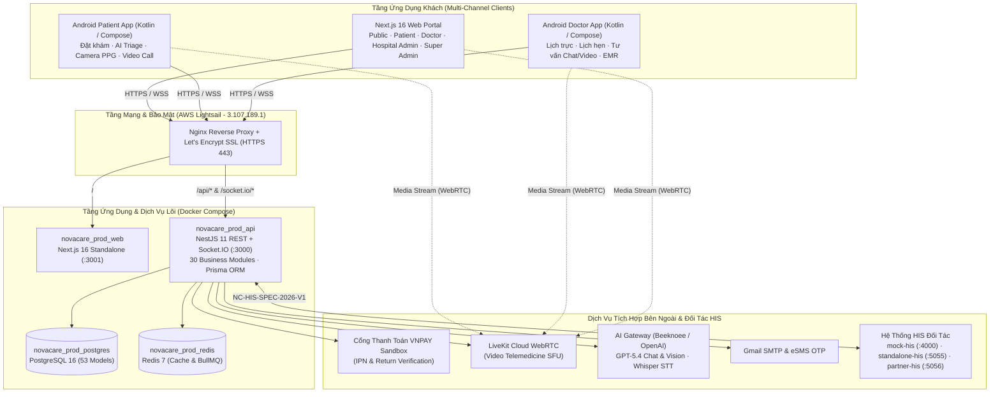
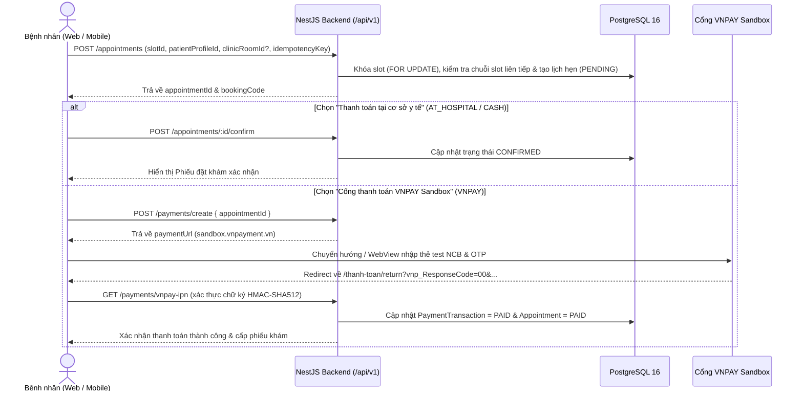
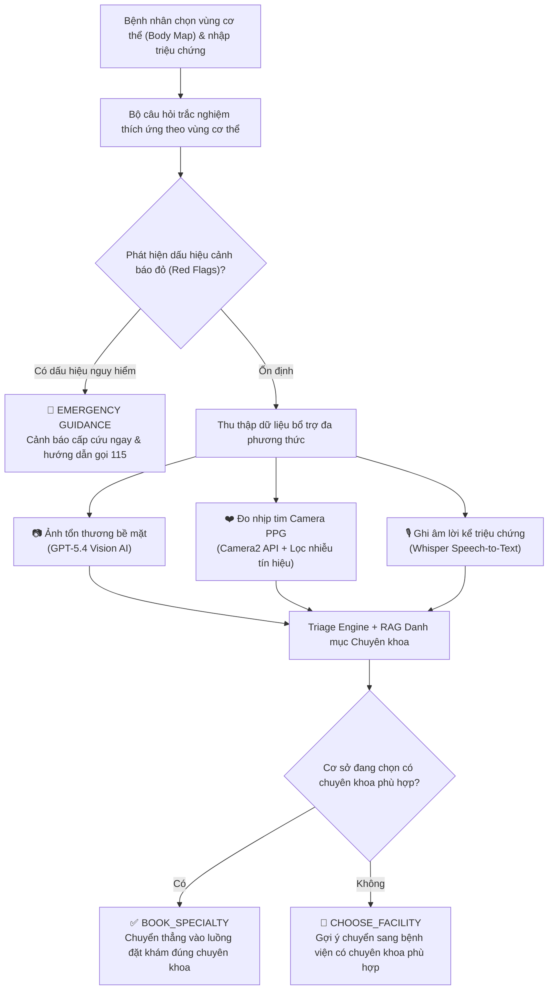

# 🏥 NovaCare — Nền Tảng Y Tế Số & Đặt Lịch Khám Thông Minh Đa Kênh

[](https://nodejs.org/)
[](https://nestjs.com/)
[](https://nextjs.org/)
[](https://react.dev/)
[](https://kotlinlang.org/)
[](https://www.postgresql.org/)
[](https://www.prisma.io/)
[](https://www.docker.com/)
[](https://novacare-health.me)

> **Khóa luận tốt nghiệp — Ngành Hệ thống Thông tin (HTTT):**  
> **NovaCare** là hệ sinh thái y tế số đa kênh kết nối **Người bệnh**, **Bác sĩ**, **Cơ sở y tế** và **Quản trị viên nền tảng**. Hệ thống tích hợp quy trình đặt lịch khám chuẩn hóa (Khám dịch vụ, Khám theo bác sĩ, Khám ngoài giờ), thanh toán trực tuyến **VNPAY Sandbox** / tại cơ sở, sàng lọc tiền khám bằng **AI đa phương thức (Multimodal AI + Camera PPG + Whisper Voice)**, hội chẩn từ xa **Telemedicine (LiveKit WebRTC + Socket.IO)**, kiểm duyệt đánh giá chất lượng và liên thông dữ liệu bệnh viện chuẩn **NC-HIS-SPEC-2026-V1**.

---

## 🌐 Môi Trường Production (AWS Lightsail)

| Dịch vụ | Địa chỉ truy cập | Ghi chú |
| :--- | :--- | :--- |
| **Web Portal (Bệnh nhân / Bác sĩ / Quản trị)** | [https://novacare-health.me](https://novacare-health.me) | Next.js 16 Standalone + SSL Let's Encrypt |
| **Cổng Quản trị (Admin / Hospital Admin)** | [https://novacare-health.me/admin](https://novacare-health.me/admin) | Quản lý cơ sở, phòng khám, đặt lịch, đánh giá |
| **Backend REST API** | `https://novacare-health.me/api/v1` | NestJS 11 + PostgreSQL 16 + Redis 7 |
| **Swagger API Docs** | [https://novacare-health.me/api-docs](https://novacare-health.me/api-docs) | Đặc tả OpenAPI tự động |
| **Realtime Socket.IO** | `wss://novacare-health.me/socket.io/` | Chat tư vấn, trạng thái trực tuyến, thông báo |
| **Video Telemedicine** | LiveKit Cloud (`wss://novacare-x8f7xvc9.livekit.cloud`) | WebRTC SFU đa nền tảng (Web & Android) |

---

## 📑 Mục lục

1. [Kiến trúc tổng thể hệ thống](#-kiến-trúc-tổng-thể-hệ-thống)
2. [Ngăn xếp công nghệ (Tech Stack)](#-ngăn-xếp-công-nghệ-tech-stack)
3. [Cấu trúc thư mục & các thành phần](#-cấu-trúc-thư-mục--các-thành-phần)
4. [Các tính năng cốt lõi & phân hệ nghiệp vụ](#-các-tính-năng-cốt-lõi--phân-hệ-nghiệp-vụ)
5. [Luồng đặt lịch & thanh toán đồng bộ Web — Mobile](#-luồng-đặt-lịch--thanh-toán-đồng-bộ-web--mobile)
6. [Quy trình Sàng lọc tiền khám AI (Multimodal Screening v3)](#-quy-trình-sàng-lọc-tiền-khám-ai-multimodal-screening-v3)
7. [Liên thông HIS & Hộ chiếu y tế điện tử](#-liên-thông-his--hộ-chiếu-y-tế-điện-tử)
8. [Hướng dẫn cài đặt & chạy Local Development](#-hướng-dẫn-cài-đặt--chạy-local-development)
9. [Triển khai Production trên AWS Lightsail với Docker](#-triển-khai-production-trên-aws-lightsail-với-docker)
10. [Tài khoản kiểm thử & dữ liệu mẫu](#-tài-khoản-kiểm-thử--dữ-liệu-mẫu)

---

## 🏛 Kiến trúc tổng thể hệ thống

Hệ sinh thái NovaCare vận hành theo kiến trúc **Modular Monolith** (30 module nghiệp vụ NestJS, 53 bảng dữ liệu & 28 enum trên PostgreSQL) kết hợp đa ứng dụng khách (**Web Portal Next.js**, **Android Patient App**, **Android Doctor App**) và các máy chủ **HIS đối tác độc lập**:



---

## 🛠 Ngăn xếp công nghệ (Tech Stack)

| Phân hệ | Công nghệ & Phiên bản chính | Vai trò trong hệ thống |
| :--- | :--- | :--- |
| **Backend API** (`nova-care-backend`) | **NestJS 11**, TypeScript 5.7, **Prisma ORM 6.2**, Passport JWT, Argon2, Helmet, Throttler, Swagger | 30 module nghiệp vụ REST API, phân quyền RBAC (`PATIENT`, `DOCTOR`, `HOSPITAL_ADMIN`, `ADMIN`), chống đặt trùng (`idempotencyKey`) |
| **Database & Queue** | **PostgreSQL 16 Alpine**, **Redis 7 Alpine**, BullMQ 5.80, IORedis 5.11 | Lưu trữ 53 model dữ liệu quan hệ, hàng đợi gửi email/nhắc lịch & tự động hủy slot quá hạn |
| **Realtime & Video** | **Socket.IO 4.8**, **LiveKit Server SDK 2.19** / **LiveKit Client 2.22** / **LiveKit Android 2.28** | Nhắn tin tư vấn bác sĩ-bệnh nhân thời gian thực, trạng thái gõ/đã đọc, phòng gọi Video Telemedicine |
| **Multimodal AI** | OpenAI SDK 7.2 (Beeknoee API Gateway), **GPT-5.4** (Chat & Vision), **Whisper-1** | Trợ lý sàng lọc tiền khám đa phương thức, phân tích ảnh tổn thương, phiên âm giọng nói, quy tắc Red Flag & gợi ý chuyên khoa |
| **Web Portal** (`nova-care-web`) | **Next.js 16.2 (App Router, Webpack)**, **React 19.2**, **Tailwind CSS v4**, Radix UI, TanStack Query v5, Zustand v5, Recharts, Three.js, Playwright | 6 nhóm cổng giao diện (Công khai, Xác thực, Bệnh nhân, Bác sĩ, Quản trị Bệnh viện, Quản trị Hệ thống) |
| **Mobile Apps** (`mobile`) | **Kotlin**, **Jetpack Compose (Material 3)**, Android SDK `minSdk 29` (Android 10+) / `targetSdk 36`, Retrofit 2, OkHttp 4, Coil, ZXing, Camera2 API | Gồm **2 ứng dụng riêng biệt**: App Bệnh nhân (`:app`) và App Bác sĩ (`:doctorApp`), hỗ trợ chuyển đổi nóng `Server AWS` ↔ `Cáp USB (Local)` |
| **Thanh toán & Thông báo** | **VNPAY Sandbox**, Nodemailer (Gmail SMTP), eSMS API, Firebase Admin SDK | Thanh toán trực tuyến có đối soát IPN, gửi email xác nhận đặt khám, mã OTP SMS |
| **HIS Simulation** | Next.js 16 (`mock-his :4000`), Node.js HTTP (`standalone-his-server :5055`, `partner-his-server :5056`) | Giả lập máy chủ bệnh viện đối tác theo chuẩn đặc tả liên thông **NC-HIS-SPEC-2026-V1** |
| **Hạ tầng triển khai** | **AWS Lightsail** (Ubuntu 22.04, 2 vCPUs, 4GB RAM + 4GB Swap, 80GB SSD), Docker Compose, Nginx, Certbot | Đóng gói 4 container production, chứng chỉ SSL tự động gia hạn, tường lửa 2 lớp (UFW + Lightsail Firewall) |

---

## 📂 Cấu trúc thư mục & các thành phần

```text
NovaCare/
├── deploy/                                 # Cấu hình triển khai VPS
│   ├── nginx/novacare.conf                 # Nginx Reverse Proxy (HTTP->HTTPS, /api/, /socket.io/, /_next/static/)
│   └── DEPLOYMENT_GUIDE.md                 # Tài liệu hướng dẫn triển khai Linux VPS
├── docker-compose.prod.yml                 # Docker Compose Production (postgres, redis, api, web)
├── docs/                                   # Báo cáo KLTN, tài liệu đặc tả Use Case, ERD, slides & scripts kiểm thử
├── scripts/                                # Script đối chiếu schema Prisma <-> ERD <-> tài liệu kỹ thuật
│
├── nova-care-backend/                      # Backend API chính (NestJS 11 + Prisma 6)
│   ├── docker-compose.yml                  # Docker Compose phát triển cục bộ (postgres, redis, api, prisma-studio)
│   ├── prisma/
│   │   ├── schema.prisma                   # 53 models & 28 enums PostgreSQL
│   │   ├── seed.ts                         # Nạp dữ liệu chuẩn (5 BV, 11 chi nhánh, 12 CK, 264 BS, 26.400 slots)
│   │   ├── seed-clinic-rooms.ts            # Nạp 120 phòng khám + phiên Dịch vụ (3.820) & Ngoài giờ (1.440)
│   │   └── create-doctor-accounts.ts       # Tiện ích tạo bổ sung tài khoản DOCTOR còn thiếu
│   └── src/
│       ├── common/                         # Guards (JWT/RBAC), Interceptors, Exception Filters, Decorators
│       ├── config/                         # Cấu hình biến môi trường tập trung
│       ├── database/                       # PrismaService
│       ├── queue/                          # BullMQ QueueService & Processors (Email, Push, Expire)
│       └── modules/                        # 30 module nghiệp vụ độc lập
│
├── nova-care-web/                          # Web Portal (Next.js 16 App Router)
│   └── src/
│       ├── app/
│       │   ├── (public)/                   # Trang chủ, Cơ sở y tế, Đặt khám cơ sở, Bác sĩ, Chuyên khoa, Thanh toán
│       │   ├── (auth)/                     # Đăng nhập, Đăng ký OTP, Quên mật khẩu
│       │   ├── (dashboard)/                # Hồ sơ bệnh nhân, Lịch khám, Lịch sử khám, Tư vấn, Đánh giá, Thông báo
│       │   ├── (doctor)/                   # Cổng Bác sĩ trên Web (/doctor/*)
│       │   ├── (hospital-admin)/           # Cổng Quản trị Cơ sở Y tế (/hospital-admin/*)
│       │   └── (admin)/                    # Cổng Super Admin (/admin/*: Phòng khám & Dịch vụ, Kiểm duyệt đánh giá, HIS...)
│       ├── components/                     # UI Kit, Booking Flow, Review Widgets, Admin Components
│       ├── config/                         # bookingTypes.ts (3 hình thức chuẩn), navigation.ts
│       ├── services/                       # API Clients (appointment, payment, after-hours, review, admin...)
│       └── stores/                         # Zustand Auth & Booking Stores
│
├── mobile/                                 # Workspace Gradle gồm 2 ứng dụng Android Native
│   ├── app/                                # App Bệnh nhân (com.example.kltn_novacare)
│   │   └── src/main/java/com/example/kltn_novacare/
│   │       ├── data/remote/                # ApiClient (Dual-mode AWS/USB), ConsultationRealtimeTransport
│   │       └── ui/screens/                 # Auth, Home, Booking, Payment (VNPAY), Screening (PPG/Voice/Vision), Consultation
│   └── doctorApp/                          # App Bác sĩ (com.novacare.doctor)
│       └── src/main/java/com/novacare/doctor/
│           ├── data/                       # DoctorApiClient (Dual-mode AWS/USB), DoctorConsultationRealtime
│           └── ui/                         # Dashboard, Lịch trực, Chi tiết lịch hẹn, Tư vấn Video/Chat
│
├── mock-his/                               # Giao diện & API giả lập HIS bệnh viện (Next.js, Port 4000)
├── standalone-his-server/                  # Máy chủ HIS độc lập BV Tâm Anh (Node.js, Port 5055)
└── partner-his-server/                     # Máy chủ HIS đối tác BV Hoàn Mỹ (Node.js, Port 5056)
```

---

## ⭐ Các tính năng cốt lõi & phân hệ nghiệp vụ

### 1. Danh mục 30 Module Backend (`nova-care-backend/src/modules`)

| Nhóm nghiệp vụ | Các module thực tế | Chức năng chính |
| :--- | :--- | :--- |
| **Xác thực & Tài khoản** | `auth`, `users`, `patient-profiles` | Đăng ký/đăng nhập JWT (Access + Refresh Token), Argon2, OTP Email/SMS, hồ sơ người thân, mã PIN bảo vệ hồ sơ, `patientCode` định danh duy nhất |
| **Danh mục Y tế** | `hospitals`, `hospital-branches`, `specialties`, `doctors`, `doctor-workplaces`, `medical-services`, `health-packages`, `search` | Quản lý đa cơ sở, đa chi nhánh, chuyên khoa, bác sĩ theo nơi công tác, dịch vụ chuyên khoa, gói khám sức khỏe & tìm kiếm hợp nhất |
| **Lập lịch, Phòng khám & Đặt hẹn** | `doctor-schedules`, `appointment-slots`, `schedules` (`ClinicRoomsModule`), `appointments` | Sinh slot tự động, quản lý phòng khám thực tế (`DV-` / `NG-`), cấu hình chuyên khoa ngoài giờ, cửa sổ slot liên tiếp (`contiguousSlotWindow`), giữ chỗ chống trùng lặp (`idempotencyKey`), check-in & chính sách vắng mặt (no-show) |
| **Thanh toán** | `payments` | Khởi tạo giao dịch **VNPAY Sandbox**, đối soát IPN/Return URL (`/payments/vnpay-ipn`), thanh toán tại cơ sở y tế & tra cứu trạng thái giao dịch |
| **Sàng lọc tiền khám AI** | `pre-exam`, `pre-exam-v2`, `ai` | Sàng lọc đa phương thức v3: Body Map, câu hỏi thích ứng, phát hiện Red Flags cấp cứu, phân tích ảnh tổn thương (Vision AI), ghi âm Whisper STT, tích hợp chỉ số nhịp tim PPG |
| **Khám từ xa (Telemedicine)** | `consultations` | Phiên tư vấn trực tuyến, chat thời gian thực Socket.IO (đã nhận/đã đọc/đang nhập, đính kèm tệp), phòng gọi video LiveKit WebRTC |
| **Bệnh án & Liên thông HIS** | `clinical`, `medical-passport`, `integration` | Đợt khám lâm sàng (`MedicalEncounter`), chẩn đoán, sinh hiệu/xét nghiệm (`Observation`), đơn thuốc, đồng thuận chia sẻ có phạm vi (`PatientConsent`) & đồng bộ HIS đối tác |
| **Đánh giá & Kiểm duyệt** | `reviews` | Đánh giá bác sĩ & cơ sở y tế sau lượt khám hoàn tất theo bộ tiêu chí chi tiết (`ReviewCriteriaScore`), phản hồi chính thức, báo cáo vi phạm & nhật ký kiểm duyệt |
| **Quản trị & Đối tác** | `admin`, `hospital-admin`, `doctor-portal`, `partner-requests`, `notifications`, `email` | Cổng Super Admin, Cổng Quản trị Bệnh viện, Cổng Bác sĩ, đăng ký & phê duyệt bệnh viện đối tác, thông báo đẩy & email SMTP |

---

### 2. Các cổng ứng dụng theo vai trò người dùng

| Vai trò | Nền tảng hỗ trợ | Quyền hạn & tính năng chính |
| :--- | :--- | :--- |
| **Người bệnh (`PATIENT`)** | Web Portal + Android Patient App (`:app`) | Sàng lọc tiền khám AI (Body Map, PPG, Voice, Vision), đặt khám 3 hình thức, thanh toán VNPAY/tại cơ sở, tư vấn video/chat, hộ chiếu bệnh án & đồng thuận chia sẻ liên viện, đánh giá bác sĩ/cơ sở |
| **Bác sĩ (`DOCTOR`)** | Web Doctor Portal (`/doctor`) + Android Doctor App (`:doctorApp`) | Xem tổng quan lịch trực, danh sách lịch hẹn theo ngày/trạng thái, xem kết quả sàng lọc tiền khám AI & hồ sơ bệnh án được bệnh nhân chia sẻ, tư vấn Chat/Video LiveKit |
| **Quản trị Bệnh viện (`HOSPITAL_ADMIN`)** | Web Portal (`/hospital-admin` & `/admin/after-hours`) | Quản lý thông tin cơ sở, lịch hẹn tiếp nhận, phòng khám thực tế & phân ca khám dịch vụ / ngoài giờ, cấu hình tích hợp HIS, phản hồi đánh giá |
| **Quản trị Hệ thống (`ADMIN`)** | Web Admin Portal (`/admin`) | Quản trị toàn bộ cơ sở y tế, phê duyệt hồ sơ hợp tác bệnh viện, phân quyền người dùng, giám sát đặt lịch & thanh toán, quản lý phòng khám/dịch vụ, kiểm duyệt đánh giá, theo dõi Audit Logs & liên thông HIS |

---

## 💳 Luồng đặt lịch & thanh toán đồng bộ Web — Mobile

Cả **Web Portal** và **Mobile App** sử dụng thống nhất **3 hình thức đặt khám** và **2 phương thức thanh toán**:

### 3 hình thức đặt khám chuẩn toàn hệ thống

| Hình thức | Mã cấu hình | Đặc điểm nghiệp vụ |
| :--- | :--- | :--- |
| **Khám dịch vụ** | `SERVICE` | Chọn chuyên khoa → dịch vụ chuyên sâu → phòng khám thực tế (`DV-xx-01`) → khung giờ liên tiếp tương ứng thời lượng dịch vụ |
| **Khám theo bác sĩ** | `DOCTOR` | Chủ động chọn bác sĩ, xem học vị/kinh nghiệm/đánh giá & chọn khung giờ khám trực tiếp của bác sĩ |
| **Khám ngoài giờ** | `OUT_OF_HOURS` / `AFTER_HOURS` | Chỉ áp dụng **Thứ 7 & Chủ nhật** (UTC+7), mức giá đồng nhất **270.000đ / 60 phút**, gắn với phòng khám ngoài giờ (`NG-xx-01`) và chuyên khoa đã được bệnh viện bật cấu hình |

### 2 phương thức thanh toán chuẩn (đã loại bỏ MoMo)



> **Thẻ thử nghiệm VNPAY Sandbox (Ngân hàng NCB):**
> - Số thẻ: `9704198526191432198` · Chủ thẻ: `NGUYEN VAN A` · Ngày phát hành: `07/15` · OTP: `123456`
> - Ngoài cổng VNPAY thực tế, cả Web và Mobile đều có nút dự phòng **Xác nhận thanh toán mô phỏng VNPAY** (`/payments/simulate-success`) phục vụ demo khi cổng sandbox bên thứ ba bảo trì.

---

## 🧠 Quy trình Sàng lọc tiền khám AI (Multimodal Screening v3)



---

## 🔗 Liên thông HIS & Hộ chiếu y tế điện tử

NovaCare hỗ trợ đồng bộ danh mục bệnh viện đối tác và chia sẻ bệnh án liên viện theo cơ chế **Scoped Patient Consent** (bệnh nhân chọn rõ cơ sở nguồn, đợt khám, phân mục dữ liệu được phép xem và thời hạn hiệu lực):

| Máy chủ mô phỏng HIS | Cổng mặc định | Bệnh viện giả lập | Mục đích kiểm thử |
| :--- | :---: | :--- | :--- |
| `mock-his` (Next.js) | `4000` | Cổng HIS Web trực quan | Mô phỏng giao diện bác sĩ/lễ tân bệnh viện đồng bộ với NovaCare |
| `standalone-his-server` | `5055` | BV Đa khoa Tâm Anh TP.HCM | Máy chủ HIS độc lập chuẩn `NC-HIS-SPEC-2026-V1` (API Key: `tamanh_secret_2026`) |
| `partner-his-server` | `5056` | BV Đa khoa Quốc tế Hoàn Mỹ | Máy chủ HIS đối tác chuẩn `NC-HIS-SPEC-2026-V1` (API Key: `hoanmy_partner_key_2026`) |

---

## 💻 Hướng dẫn cài đặt & chạy Local Development

### Yêu cầu môi trường
- **Node.js**: `20.x` hoặc `22.x LTS`
- **Docker Desktop**: để chạy PostgreSQL 16 & Redis 7
- **Android Studio** *(nếu build Mobile)*: hỗ trợ Gradle 9 / JDK 17+ / Android SDK 36

### 1. Clone mã nguồn
```bash
git clone -b develop https://github.com/nctcode/KLTN_NovaCare.git
cd KLTN_NovaCare
```

### 2. Khởi chạy Database, Redis & Backend API (`:3000`)
```bash
cd nova-care-backend

# Khởi động PostgreSQL & Redis bằng Docker
docker compose up -d postgres redis

# Tạo file biến môi trường (hoặc dùng file .env gốc được chia sẻ nội bộ)
cp .env.example .env

# Cài dependencies, đồng bộ schema & nạp dữ liệu mẫu
npm install
npx prisma generate
npx prisma db push
npm run db:seed

# Nạp dữ liệu 120 phòng khám + lịch khám Dịch vụ & Ngoài giờ cho cả 5 bệnh viện
npx ts-node --transpile-only prisma/seed-clinic-rooms.ts

# Chạy NestJS Backend ở chế độ dev
npm run start:dev
```
- API Local: `http://localhost:3000/api/v1` · Swagger Docs: `http://localhost:3000/api-docs`

### 3. Khởi chạy Web Portal (`:3001`)
```bash
cd nova-care-web
npm install
npm run dev
```
- Truy cập Web Portal tại `http://localhost:3001` *(mặc định `next.config.ts` tự rewrite `/api/*` sang `http://localhost:3000/api/*`)*.

### 4. Khởi chạy 2 Ứng dụng Mobile Android (`:app` & `:doctorApp`)
1. Mở thư mục `mobile/` trong **Android Studio** hoặc build nhanh bằng Gradle CLI:
   ```bash
   cd mobile
   .\gradlew.bat :app:assembleDebug :doctorApp:assembleDebug
   ```
   - File APK Bệnh nhân: `mobile/app/build/outputs/apk/debug/app-debug.apk`
   - File APK Bác sĩ: `mobile/doctorApp/build/outputs/apk/debug/doctorApp-debug.apk`
2. **Chuyển đổi chế độ kết nối linh hoạt ngay trên màn hình Đăng nhập** (cả 2 app):
   - **☁️ Server AWS** *(mặc định)*: kết nối thẳng `https://novacare-health.me/api/v1/` qua Wi-Fi/4G, **không cần cắm cáp USB hay bật Docker local**.
   - **🔌 Cáp USB (Local)**: tự dùng `http://127.0.0.1:3000/api/v1/` trên điện thoại thật (kèm lệnh `adb reverse tcp:3000 tcp:3000`) hoặc `http://10.0.2.2:3000/api/v1/` trên máy ảo Android Emulator.

### 5. Khởi chạy các máy chủ HIS giả lập *(tùy chọn khi test liên thông)*
```bash
# Terminal 1 - Mock HIS Web UI (:4000)
cd mock-his && npm install && npm run dev

# Terminal 2 - Standalone HIS BV Tâm Anh (:5055)
node standalone-his-server/server.js

# Terminal 3 - Partner HIS BV Hoàn Mỹ (:5056)
node partner-his-server/server.js
```

---

## 🚀 Triển khai Production trên AWS Lightsail với Docker

Hệ thống hiện đang vận hành thực tế trên **AWS Lightsail** (`Ubuntu 22.04 LTS`, 2 vCPUs, 4GB RAM + 4GB Swap, 80GB SSD) với tên miền `https://novacare-health.me`.

```bash
# 1. Đặt file biến môi trường production cho backend
#    /opt/novacare/nova-care-backend/.env.production

# 2. Build & khởi chạy 4 container production (postgres, redis, api, web)
cd /opt/novacare
sudo docker compose -f docker-compose.prod.yml up -d --build

# 3. Đồng bộ lược đồ Prisma & nạp dữ liệu mẫu (lần đầu triển khai)
sudo docker compose -f docker-compose.prod.yml exec -T api npx prisma db push
sudo docker cp nova-care-backend/package.json novacare_prod_api:/app/package.json
sudo docker cp nova-care-backend/tsconfig.json novacare_prod_api:/app/tsconfig.json
sudo docker compose -f docker-compose.prod.yml exec -T api ./node_modules/.bin/ts-node --transpile-only prisma/seed.ts
sudo docker compose -f docker-compose.prod.yml exec -T api ./node_modules/.bin/ts-node --transpile-only prisma/seed-clinic-rooms.ts

# 4. Cập nhật nhanh riêng Web Frontend khi chỉnh sửa giao diện (không làm gián đoạn API/DB)
sudo docker compose -f docker-compose.prod.yml up -d --build --no-deps web
```

> Xem hướng dẫn cấu hình Nginx Reverse Proxy, tường lửa (UFW + AWS Lightsail mở cổng `80`/`443`) và cấp SSL Let's Encrypt chi tiết tại [deploy/DEPLOYMENT_GUIDE.md](deploy/DEPLOYMENT_GUIDE.md).

---

## 🔑 Tài khoản kiểm thử & dữ liệu mẫu

Dữ liệu khởi tạo chuẩn trên môi trường Production bao gồm: **5 bệnh viện (11 chi nhánh)** tại TP.HCM, **12 chuyên khoa**, **264 bác sĩ**, **120 phòng khám thực tế** (`60 DV` + `60 NG`), **26.400+ khung giờ khám**, **3.820 phiên Khám dịch vụ**, **1.440 phiên Khám ngoài giờ** và **50 lịch hẹn mẫu** kèm bệnh án điện tử liên thông.

| Vai trò | Email đăng nhập | Mật khẩu | Phạm vi kiểm thử |
| :--- | :--- | :--- | :--- |
| **Super Admin** | `admin@novacare.vn` | `Admin@123` | Quản trị toàn nền tảng tại `/admin` (cơ sở y tế, phòng khám & dịch vụ, kiểm duyệt đánh giá, HIS, người dùng) |
| **Người bệnh (Patient)** | `user@novacare.vn` | `Password123!` | Đặt khám Web & App Bệnh nhân, có sẵn hồ sơ người bệnh & lịch sử bệnh án liên thông |
| **Bác sĩ (Doctor)** | `doctor1@novacare.vn` → `doctor264@novacare.vn`<br>*(VD: `doctor84@novacare.vn` — PGS.TS Hoàng Thu Tâm)* | `Password123!` | Đăng nhập Web Doctor Portal (`/doctor`) và Android Doctor App (`:doctorApp`) |

---

## 👥 Thông tin đồ án

- **Đề tài:** Nghiên cứu và xây dựng Nền tảng Y tế Số & Đặt lịch khám thông minh đa kênh **NovaCare**.
- **Chương trình đào tạo:** Khóa luận Tốt nghiệp Đại học — Ngành Hệ thống Thông tin (HTTT).
- **Kho mã nguồn:** [github.com/nctcode/KLTN_NovaCare](https://github.com/nctcode/KLTN_NovaCare)

---

*© 2026 NovaCare Team. Bảo lưu mọi quyền.*
