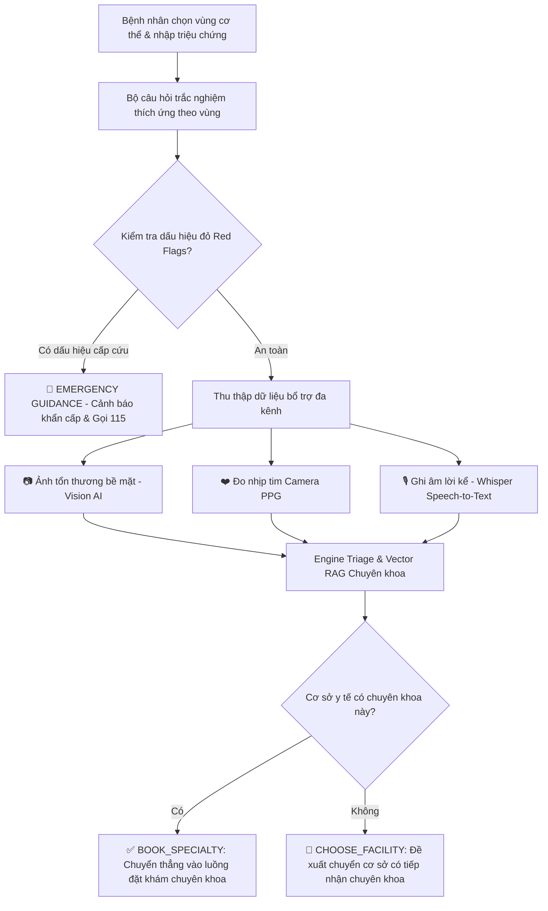

# 🏥 NovaCare — Nền Tảng Y Tế Số & Đặt Lịch Khám Thông Minh Đa Kênh

[](https://nodejs.org/)
[](https://nestjs.com/)
[](https://nextjs.org/)
[](https://kotlinlang.org/)
[](https://www.postgresql.org/)
[](https://www.prisma.io/)
[](https://www.docker.com/)
[](LICENSE)

> **Dự án Khóa luận tốt nghiệp**: Nền tảng y tế số kết nối người bệnh, bác sĩ và các cơ sở y tế thông minh. Hệ thống tích hợp công nghệ AI đa phương thức (Multimodal AI) hỗ trợ sàng lọc tiền khám, đo sinh hiệu PPG qua camera smartphone, hội chẩn từ xa Telemedicine chuẩn WebRTC và liên thông dữ liệu bệnh viện (HIS).

---

## 📌 Demo & Production Links

- 🌐 **Cổng Web Portal**: [https://novacare-health.me](https://novacare-health.me)
- 🔌 **Backend API**: [https://novacare-health.me/api/v1](https://novacare-health.me/api/v1)
- 📚 **Swagger API Docs**: [https://novacare-health.me/api-docs](https://novacare-health.me/api-docs)

---

## 📑 Mục lục

1. [Kiến trúc hệ thống](#-kiến-trúc-hệ-thống)
2. [Ngăn xếp công nghệ (Tech Stack)](#-ngăn-xếp-công-nghệ-tech-stack)
3. [Cấu trúc thư mục dự án](#-cấu-trúc-thư-mục-dự-án)
4. [Các tính năng cốt lõi](#-các-tính-năng-cốt-lõi)
5. [Quy trình Sàng lọc tiền khám AI (Multimodal Screening v3)](#-quy-trình-sàng-lọc-tiền-khám-ai-multimodal-screening-v3)
6. [Hướng dẫn cài đặt & Khởi chạy Local](#-hướng-dẫn-cài-đặt--khởi-chạy-local)
7. [Triển khai Production với Docker](#-triển-khai-production-với-docker)
8. [Tài khoản kiểm thử mẫu](#-tài-khoản-kiểm-thử-mẫu)

---

## 🏛 Kiến trúc hệ thống

Hệ sinh thái NovaCare được thiết kế theo kiến trúc Micro-services/Modular Monolith tách biệt các tầng giao diện, xử lý nghiệp vụ, quản lý dữ liệu và tích hợp đối tác y tế:

```
                                  [ Internet / Clients ]
                   ┌────────────────────────┴────────────────────────┐
                   ▼                                                 ▼
      [ Next.js 16 Web Portal ]                        [ Android App (Jetpack Compose) ]
   (Bệnh nhân / Bác sĩ / Quản trị)                   (Camera PPG / Voice / Vision Triage)
                   │                                                 │
                   └────────────────────────┬────────────────────────┘
                                            │ (HTTPS / WSS / REST API)
                                            ▼
                           [ Nginx Reverse Proxy & SSL ]
                                            │
                     ┌──────────────────────┴──────────────────────┐
                     ▼                                             ▼
       [ NestJS API Gateway & Services ]               [ LiveKit WebRTC Cloud ]
     ├─ Auth & User Management (JWT, Argon2)          (Video Telemedicine Real-time)
     ├─ Appointment & Hospital Booking Engine                      │
     ├─ Multimodal AI Screening Engine (RAG)                       │
     ├─ Telemedicine & Socket.io Messaging ────────────────────────┘
     ├─ VNPay Sandbox / VietQR Payments
     └─ HIS Interoperability & FHIR Sync
                     │
       ┌─────────────┴─────────────┐
       ▼                           ▼
[ PostgreSQL 16 ]            [ Redis 7 ]            [ External AI Gateway ]
(Prisma ORM, Data Store)   (BullMQ, Caching)       (Beeknoee / OpenAI GPT-5.4 Vision, Whisper)
```

---

## 🛠 Ngăn xếp công nghệ (Tech Stack)

### 1. Backend (`nova-care-backend`)
- **Framework**: [NestJS 11](https://nestjs.com/) (Kiến trúc Module, Dependency Injection, Interceptors, Guards).
- **Ngôn ngữ**: TypeScript 5.x.
- **ORM & Database**: [Prisma ORM 6.x](https://www.prisma.io/) kết nối [PostgreSQL 16](https://www.postgresql.org/).
- **Bộ nhớ đệm & Hàng đợi**: [Redis 7](https://redis.io/) + [BullMQ](https://docs.bullmq.io/).
- **Giao tiếp thời gian thực**: WebSocket / [Socket.io](https://socket.io/) (Tin nhắn tư vấn, thông báo tức thì).
- **Hội nghị truyền hình**: [LiveKit Server & SDK](https://livekit.io/) (Chuẩn WebRTC P2P/SFU tối ưu băng thông).
- **Trí tuệ nhân tạo (AI)**:
  - **Vision LLM**: OpenAI / Beeknoee API (`gpt-5.4`) nhận diện tổn thương da, mắt, tai mũi họng.
  - **Speech-to-Text**: Whisper model phiên âm lời kể triệu chứng bệnh nhân.
  - **Phân loại & Định hướng chuyên khoa**: Vector RAG kết hợp bảng quy tắc y tế đa cấp độ (Emergency / Urgent / Consult).
- **Thanh toán**: Tích hợp Cổng thanh toán quốc gia **VNPay Sandbox** và VietQR.
- **Tài liệu API**: OpenAPI / Swagger tự động sinh tại `/api-docs`.

### 2. Frontend Web (`nova-care-web`)
- **Framework**: [Next.js 16 (App Router)](https://nextjs.org/) + React 19.
- **Ngôn ngữ**: TypeScript.
- **Giao diện & Styling**: TailwindCSS, CSS Variables, Lucide Icons, Framer Motion animations.
- **Quản lý trạng thái**: Zustand & React Hooks.
- **Tối ưu hóa**: Next.js Standalone Output Docker, SSR/SSG kết hợp, TurboPack bundler.

### 3. Mobile App (`mobile`)
- **Nền tảng**: Android Native (Hỗ trợ Android 8.0 trở lên).
- **Ngôn ngữ**: [Kotlin](https://kotlinlang.org/).
- **UI Toolkit**: [Jetpack Compose](https://developer.android.com/jetpack/compose) hoàn toàn hiện đại (Material 3).
- **Mạng & Xử lý bất đồng bộ**: Retrofit 2, OkHttp 4, Kotlin Coroutines, StateFlow.
- **Cảm biến & Thị giác máy tính**:
  - **Camera2 API & TextureView**: Đo nhịp tim PPG (Photoplethysmography) qua biến thiên màu sắc đầu ngón tay dưới ánh đèn Flash.
  - **MediaRecorder**: Ghi âm giọng nói triệu chứng gửi phân tích AI.

### 4. Hệ thống mô phỏng bệnh viện (`mock-his`, `partner-his-server`, `standalone-his-server`)
- Mô phỏng các phân hệ quản lý bệnh viện chuẩn (HIS/EMR/LIS).
- Cung cấp API đồng bộ danh mục khám, lịch làm việc của bác sĩ và liên thông dữ liệu hồ sơ bệnh án (Clinical Encounters).

---

## 📂 Cấu trúc thư mục dự án

```
NovaCare/
├── deploy/                     # Cấu hình triển khai hệ thống (Nginx, Certbot SSL, Deployment Guide)
│   ├── nginx/novacare.conf     # File cấu hình Nginx Reverse Proxy
│   └── DEPLOYMENT_GUIDE.md     # Hướng dẫn chi tiết triển khai máy chủ Ubuntu VPS
│
├── docker-compose.prod.yml     # Docker Compose cho môi trường Production (Web, API, DB, Redis)
├── docker-compose.yml          # Docker Compose cho môi trường Development Local
│
├── docs/                       # Tài liệu nghiên cứu, báo cáo đồ án & đặc tả kỹ thuật
│   ├── NovaCare_TaiLieuKyThuat_ChiTiet.docx
│   ├── ai-screening-implementation.md
│   ├── mobile-ai-screening.md
│   └── CHINH_SACH_BAO_MAT_NOVACARE.md
│
├── mobile/                     # Ứng dụng Android Native dành cho người bệnh
│   ├── app/src/main/java/com/example/kltn_novacare/
│   │   ├── data/               # Repositories, Retrofit API Services, Models
│   │   ├── ui/                 # Jetpack Compose Screens, ViewModels, Themes
│   │   │   ├── screens/booking/# Luồng đặt khám, hồ sơ, thanh toán
│   │   │   ├── screens/preexam/# Luồng sàng lọc tiền khám 5 bước (Camera PPG, Voice, Image)
│   │   │   └── screens/telemedicine/ # Phòng gọi video LiveKit & Chat
│   │   └── util/               # PPG Algorithm, Camera & Audio Handlers
│   └── build.gradle.kts
│
├── mock-his/                   # Cổng thông tin & API mô phỏng HIS đối tác (Next.js)
├── partner-his-server/         # Server giả lập trao đổi dữ liệu bệnh viện đối tác (Node.js)
├── standalone-his-server/      # Server độc lập kiểm thử liên thông dữ liệu bệnh án
│
├── nova-care-backend/          # Backend API chính (NestJS + Prisma)
│   ├── prisma/
│   │   ├── schema.prisma       # Mô hình cơ sở dữ liệu (PostgreSQL)
│   │   └── seed.ts             # Kịch bản nạp dữ liệu mẫu (Bệnh viện, bác sĩ, lịch khám)
│   ├── src/
│   │   ├── common/             # Guards, Interceptors, Filters, Decorators
│   │   ├── config/             # Cấu hình môi trường (JWT, Database, Redis, Mail, AI)
│   │   └── modules/            # Các module nghiệp vụ (28 modules)
│   │       ├── auth/           # Đăng ký, đăng nhập, phân quyền RBAC
│   │       ├── appointments/   # Quản lý đặt lịch, trạng thái ca khám
│   │       ├── pre-exam-v2/    # AI Triage & Sàng lọc tiền khám đa phương thức
│   │       ├── consultations/  # Khám trực tuyến, phòng gọi video WebRTC
│   │       ├── hospitals/      # Quản lý bệnh viện & phòng khám
│   │       ├── doctors/        # Hồ sơ bác sĩ, ca làm việc (workplaces)
│   │       ├── payments/       # Tích hợp thanh toán VNPay Sandbox
│   │       └── ...
│   └── package.json
│
└── nova-care-web/              # Web Portal ứng dụng Next.js 16 (App Router)
    ├── public/                 # Tài nguyên tĩnh, ảnh minh họa
    └── src/
        ├── app/
        │   ├── (public)/       # Trang công khai: Trang chủ, Đặt khám cơ sở, Bác sĩ, Chuyên khoa
        │   ├── (auth)/         # Đăng nhập, đăng ký, xác thực
        │   ├── (dashboard)/    # Hồ sơ cá nhân, lịch sử khám, sổ sức khỏe
        │   ├── (hospital-admin)/# Cổng quản trị dành riêng cho cơ sở y tế
        │   └── (admin)/        # Cổng quản trị tối cao (Super Admin)
        ├── components/         # Design System, Doctor Cards, Booking Wizards
        ├── services/           # Axios/Fetch API clients & Data Adapters
        └── types/              # Định nghĩa kiểu dữ liệu TypeScript
```

---

## ⭐ Các tính năng cốt lõi

### 1. Đặt lịch khám thông minh theo cơ sở y tế (Unified 4-Step Booking Flow)
- Quy trình đặt khám đồng nhất, tinh gọn 4 bước:
  1. **Thông tin cơ sở & chuyên khoa**: Chọn bệnh viện, chuyên khoa cần khám, dịch vụ và bác sĩ phụ trách.
  2. **Thời gian khám**: Lựa chọn ngày khám và khung giờ còn trống (Slot engine cập nhật real-time).
  3. **Hồ sơ người khám**: Chọn hồ sơ thành viên trong gia đình hoặc tạo mới trực tiếp.
  4. **Thanh toán & Xác nhận**: Hỗ trợ thanh toán trực tuyến qua VNPay hoặc thanh toán tại quầy cơ sở.

### 2. Hệ thống AI Sàng lọc tiền khám đa phương thức (Multimodal Screening v3)
- **Sơ đồ cơ thể (Body Map Interactive)**: Lựa chọn vị trí khó chịu trực quan trên 32 vùng cơ thể chi tiết.
- **Trắc nghiệm thích ứng lâm sàng (Adaptive Questionnaire)**: Tự động tải câu hỏi sàng lọc theo vùng cơ thể, ưu tiên phát hiện dấu hiệu cảnh báo đỏ (Red Flags).
- **Phân tích hình ảnh tổn thương (Vision AI)**: Gửi ảnh tổn thương bề mặt (Da, Mắt, Tai Mũi Họng), mô hình thị giác AI tự động trích xuất đặc điểm lâm sàng và định hướng chuyên khoa.
- **Đo nhịp tim quang phổ qua camera smartphone (PPG)**: Đo biến thiên màu sắc mao mạch đầu ngón tay với thuật toán lọc nhiễu quang học, đưa chỉ số nhịp tim thực tế vào đánh giá sức khỏe.
- **Phiên âm triệu chứng qua giọng nói (Voice-to-Text)**: Người bệnh nói tự nhiên, Whisper AI chuyển thành văn bản để xác nhận trước khi đưa vào phân loại.

### 3. Tư vấn khám bệnh từ xa (Telemedicine & Video Consultation)
- Phòng hội chẩn video chất lượng cao dựa trên **LiveKit WebRTC**.
- Chat thời gian thực với bác sĩ, gửi hình ảnh kết quả xét nghiệm, đơn thuốc trực tiếp trong phiên tư vấn.

### 4. Hộ chiếu sức khỏe điện tử & Liên thông dữ liệu bệnh viện
- Quản lý lịch sử bệnh án, hồ sơ khám điện tử liên cơ sở (Interoperability).
- Mã số bệnh nhân duy nhất (Patient Code) hỗ trợ tra cứu và đồng bộ dữ liệu với hệ thống HIS bệnh viện đối tác.

### 5. Cổng Quản trị đa cấp (Multi-tier Portals)
- **Super Admin Portal**: Quản lý toàn diện bệnh viện, danh mục chuyên khoa, người dùng, giao dịch thanh toán và Audit Logs an ninh.
- **Hospital Admin Portal**: Dành riêng cho ban quản lý từng bệnh viện: phân công ca trực bác sĩ, quản trị dịch vụ y tế, quản lý tiếp nhận bệnh nhân và điểm danh (check-in/no-show).

---

## 🧠 Quy trình Sàng lọc tiền khám AI (Multimodal Screening v3)



---

## 💻 Hướng dẫn cài đặt & Khởi chạy Local

### Yêu cầu tiên quyết
- **Node.js**: Phiên bản 20.x hoặc 22.x LTS.
- **Docker & Docker Compose**: Để chạy PostgreSQL và Redis.
- **Android Studio** (Nếu phát triển ứng dụng Mobile): Ladybug / Iguana trở lên, JDK 17+.

---

### Bước 1: Clone mã nguồn
```bash
git clone -b develop https://github.com/nctcode/KLTN_NovaCare.git
cd KLTN_NovaCare
```

---

### Bước 2: Khởi chạy Backend & Cơ sở dữ liệu

1. **Khởi động PostgreSQL & Redis**:
   ```bash
   docker-compose up -d postgres redis
   ```

2. **Cấu hình môi trường Backend**:
   ```bash
   cd nova-care-backend
   cp .env.example .env
   ```
   *Kiểm tra các biến cấu hình trong `.env` (Database URL, Redis port, OpenAI Key...)*

3. **Cài đặt thư viện & Đồng bộ Database**:
   ```bash
   npm install
   npx prisma generate
   npx prisma db push
   npm run db:seed
   ```

4. **Khởi chạy Backend ở chế độ Development**:
   ```bash
   npm run start:dev
   ```
   *Backend sẽ chạy tại: [http://localhost:3000](http://localhost:3000)*  
   *Tài liệu Swagger: [http://localhost:3000/api-docs](http://localhost:3000/api-docs)*

---

### Bước 3: Khởi chạy Web Portal

1. Mở cửa sổ Terminal mới:
   ```bash
   cd nova-care-web
   ```

2. Cài đặt thư viện:
   ```bash
   npm install
   ```

3. Khởi chạy Next.js Dev Server:
   ```bash
   npm run dev
   ```
   *Truy cập Web Portal tại: [http://localhost:3001](http://localhost:3001)*

---

### Bước 4: Khởi chạy Ứng dụng Mobile Android

1. Mở thư mục `mobile` bằng **Android Studio**.
2. Đồng bộ Gradle project (`Sync Project with Gradle Files`).
3. Kiểm tra cấu hình `ApiClient.kt`:
   - Nếu chạy trên máy ảo Android (Emulator): `http://10.0.2.2:3000/api/v1/`
   - Nếu chạy trên thiết bị thật: Sử dụng IP mạng LAN hoặc domain production `https://novacare-health.me/api/v1/`
4. Nhấn **Run** (`Shift + F10`) để cài đặt và chạy ứng dụng trên thiết bị.

---

## 🚀 Triển khai Production với Docker

Hệ thống đã được đóng gói sẵn sàng cho việc triển khai trên máy chủ Linux VPS (Ubuntu 22.04 / 24.04 LTS) bằng Docker Compose:

1. **Khởi chạy toàn bộ hệ thống bằng Docker Compose**:
   ```bash
   docker compose -f docker-compose.prod.yml up -d --build
   ```

2. **Đồng bộ cơ sở dữ liệu trên container**:
   ```bash
   docker compose -f docker-compose.prod.yml exec -T api npx prisma db push
   docker compose -f docker-compose.prod.yml exec -T api node /app/prisma/seed.bundle.js
   ```

3. **Cấu hình Nginx & Cấp chứng chỉ SSL HTTPS**:
   Tham khảo chi tiết tại tài liệu [deploy/DEPLOYMENT_GUIDE.md](deploy/DEPLOYMENT_GUIDE.md).

---

## 🔑 Tài khoản kiểm thử mẫu

Hệ thống đã nạp sẵn bộ dữ liệu mẫu thực tế gồm 5 bệnh viện, 12 chuyên khoa, 264 bác sĩ và hơn 26.000 lịch khám:

| Vai trò | Email đăng nhập | Mật khẩu mặc định | Ghi chú |
| :--- | :--- | :--- | :--- |
| **Quản trị viên (Super Admin)** | `admin@novacare.vn` | `Admin@123` | Toàn quyền quản trị hệ sinh thái |
| **Người bệnh (Patient)** | `user@novacare.vn` | `Password123!` | Đã có hồ sơ bệnh án và lịch sử khám |
| **Quản trị bệnh viện (Hospital Admin)** | `hospital.bv1@novacare.vn` | `Hospital@123` | Quản lý BV Đa khoa NovaCare Sài Gòn |

---

## 👥 Nhóm tác giả thực hiện

- **Đề tài**: Nền tảng y tế số kết nối người bệnh và đặt khám thông minh NovaCare.
- **Hệ đào tạo**: Khóa luận tốt nghiệp Đại học ngành Hệ thống thông tin (HTTT).
- **Mã nguồn**: [GitHub - nctcode/KLTN_NovaCare](https://github.com/nctcode/KLTN_NovaCare)

---

*© 2026 NovaCare Team. Bảo lưu mọi quyền.*
